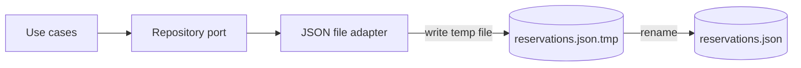

# ADR-BKG-003: JSON file reservation storage

<!-- Motivated by: RQ-BKG-007 (FTR-BKG-002); supersedes ADR-BKG-002 -->

## Status
Accepted

## Context
The first demonstration lost every reservation at restart, which RQ-BKG-007 now forbids. The repository
port of ADR-BKG-001 allows another adapter. The pilot has one service process and fewer than 1000
reservations per month.

## Decision

### DEC-BKG-004: Persist reservations in a JSON file written atomically
A second repository adapter reads all reservations from one JSON file at start and rewrites the file on
every change, by writing a temporary file and renaming it over the data file, so an interrupted save
leaves the previous file intact. A configuration value selects the adapter. This replaces DEC-BKG-003.

## Consequences
- Reservations survive restarts without a database server.
- Every change rewrites the whole file: fine for the pilot volume, a limit if it grows.
- A corrupted file is detected at start and reported by a dedicated error.

## Alternatives Considered
- SQLite: rejected for now, a schema and migrations for a small volume.
- Append-only journal: rejected, replay and compaction code for no present need.

## Diagram

