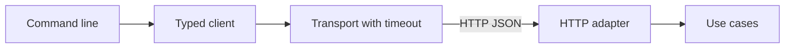

# ADR-CLI-001: HTTP/JSON contract and typed client

<!-- Motivated by: RQ-CLI-001 to RQ-CLI-005 (FTR-CLI-001); builds on ADR-BKG-001 -->

## Status
Accepted

## Context
A TypeScript client and a command-line tool must call the Python service. The contract has to be simple,
testable on both sides, and independent of any web framework.

## Decision

### DEC-CLI-001: Three JSON routes and one error shape
The service answers `GET /rooms` (200), `POST /reservations` (201) and `DELETE /reservations/{id}` (204).
Every error is a JSON body `{code, message}` with a status: 404 for unknown room or reservation, 409 for a
conflict or an already-started reservation, 422 for capacity or closed room. The HTTP adapter uses the
Python standard library and only translates requests and errors; the logic stays in the use cases.

### DEC-CLI-002: A transport, a typed client and a thin command line
The client is built in three layers: a transport that performs the call with a timeout and raises a network
error, a typed client that maps responses and error bodies to types and a service error, and a command-line
tool that only parses arguments, calls the client and sets the exit code.

## Consequences
- The contract is small and can be tested with a fake transport.
- No framework means no routing library; the adapter is a few dozen lines.
- Three layers on the client side, each with its own tests.

## Alternatives Considered
- A web framework on the service side: rejected, a dependency for three routes.
- Generating the client from an OpenAPI file: rejected, tooling heavier than the contract.

## Diagram

