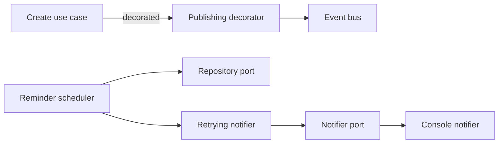

# ADR-NTF-001: In-process events and a notifier port

<!-- Motivated by: RQ-NTF-001, RQ-NTF-002, RQ-NTF-003, RQ-NTF-004 (FTR-NTF-001); builds on ADR-BKG-001 -->

## Status
Accepted

## Context
Reminders must react to reservations without the booking code knowing about notifications, and the way a
reminder is delivered (console today, mail later) must be replaceable. Delivery can fail and must not
break a booking.

## Decision

### DEC-NTF-001: A small in-process event bus and a decorator on the create use case
Reservation creation is announced on an in-process event bus. A decorator wraps the create-reservation
use case and publishes the reservation-created event after the wrapped call succeeds, leaving the use case
unchanged.

### DEC-NTF-002: A notifier port with a retrying decorator
Delivery goes through a notifier port. A retrying decorator calls the real notifier up to 3 times, logs the
final failure and never raises to the caller. The reminder scheduler reads the repository on a clock tick
and sends one reminder per Confirmed reservation entering its lead time.

## Consequences
- Booking code is untouched by this feature (DEC-BKG-002 spirit).
- Events are lost if the process stops between creation and publication: acceptable for reminders.
- Delivery channels can be added behind the port; retry behavior stays in one place.

## Alternatives Considered
- Message broker: rejected, an external dependency for one process.
- Calling the notifier inside the use case: rejected, the use case would know delivery and retries.

## Diagram

