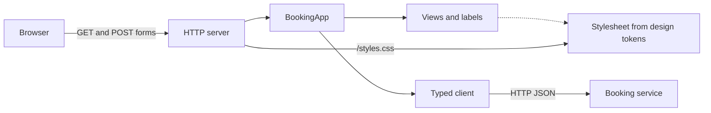

# ADR-WEB-001: Server-rendered web interface on the typed client

<!-- Motivated by: RQ-WEB-001 to RQ-WEB-006 (FTR-WEB-001); builds on ADR-CLI-001 and on the design system ADR-DSN-001 (DEC-DSN-001, DEC-DSN-002) -->

## Status
Accepted

## Context
Office staff need a browser interface to the booking service. The team already has a typed client
(ADR-CLI-001) and a design system whose stylesheet is generated from tokens (ADR-DSN-001). The interface has
one page with three cards and the project avoids heavy dependencies.

## Decision

### DEC-WEB-001: Server-rendered HTML pages from a thin Node HTTP server
Pages are HTML strings produced by pure view functions and served by a Node `http` server that only
translates HTTP to a request object and back. Forms post classic URL-encoded bodies and the server answers a
full page; there is no browser script. Every visible class name is declared once and is styled by the
stylesheet generated from the design-system tokens (DEC-DSN-002), so the views contain no visual value.

### DEC-WEB-002: Application logic as a function of the typed client
A `BookingApp` receives a request object and the `RoombookClient` and returns a response object. It maps
form values to a reservation request, service error codes to worded messages held in one labels module, and
a network error to an unavailable page. The server and the views know nothing of the service contract.
Times typed in the form carry no zone and are booked in UTC.

## Consequences
- Logic, views and server are testable without a browser or a socket, except one test of the server itself.
- No framework to maintain; the cost is hand-written HTML escaping, covered by tests.
- Every action reloads the page, which is acceptable for a booking form.
- The booking offset is fixed to UTC until a requirement asks for time zones.

## Alternatives Considered
- A single-page application with a framework: rejected, a build chain and dependencies for three forms.
- Adding HTML routes to the Python service: rejected, it would couple presentation to the domain service
  and bypass the typed client.
- Browser-side script calling the JSON API directly: rejected, it needs the API to allow cross-origin calls
  and a TypeScript build for the browser.

## Diagram

