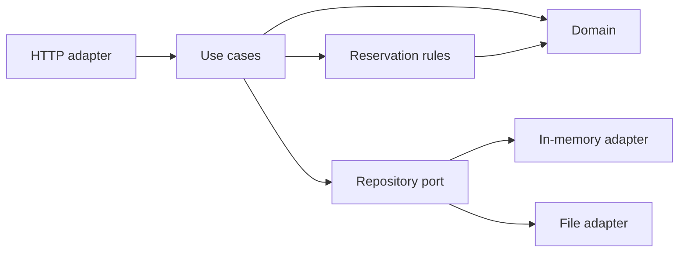

# ADR-BKG-001: Layered architecture with ports

<!-- Motivated by: RQ-BKG-001 to RQ-BKG-006 (FTR-BKG-001) -->

## Status
Accepted

## Context
Roombook starts with a handful of booking rules that will grow (capacity, closed rooms, later reminders).
The storage will change during the project, and the service will be reached through HTTP later.
The domain code must not depend on either.

## Decision

### DEC-BKG-001: Domain, use cases and ports
- **Statement**: The service SHALL apply a layering of domain, use cases and ports for keeping the domain objects (room, reservation, errors) free of storage and transport, use cases depending only on small interfaces, such as the reservation repository, that adapters implement.
- **Rationale**: each module keeps one responsibility, and the storage, which the project expects to change, is replaced without touching the use cases.

### DEC-BKG-002: Reservation rules are separate, discovered objects
- **Statement**: The create-reservation use case SHALL apply a list of rule objects, one module per validity rule (overlap, capacity, closed room) with one `check` method, run in order, for adding a rule without editing the use case.
- **Rationale**: the rules will grow during the project (open for extension, closed for modification); each rule's test stays small.

## Consequences
- Adding a rule or an adapter adds a file and leaves existing files unchanged.
- More small files than a single service class; the test of each rule stays tiny.
- The use case depends on the abstraction of rules and repository, not on concrete classes.

## Alternatives Considered
- One service class with all checks inline: rejected, every new rule would change it and its tests.
- Rules as configuration data: rejected, the rules need code and would hide the logic from the tests.

## Diagram

