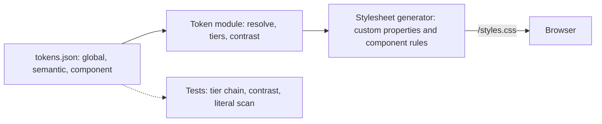

# ADR-DSN-001: Design tokens in three tiers, generated as CSS custom properties

Motivated by: RQ-DSN-001 to RQ-DSN-005 (FTR-DSN-001); design system required by MANDATORY DESIGN SYSTEM.

## Status
Accepted

## Context
The web interface needs a design system before its first screen: one source of truth for every visual value,
readable by code without a browser, that keeps a screen from slipping a raw colour or size into its markup.
The stack is Node with erasable TypeScript and no runtime dependency.

## Decision

### DEC-DSN-001: One JSON token file with three tiers, loaded and checked headlessly
- **Statement**: The interface SHALL use one file, `client/design/tokens.json`, in three tiers (global tokens hold the raw values, semantic tokens alias a global token, component tokens alias a semantic token), loaded by a TypeScript module with no browser that resolves the aliases, rejects a token breaking the tier chain and checks the contrast of the declared pairings, for holding every visual value (RQ-DSN-001, RQ-DSN-002, RQ-DSN-004).
- **Rationale**: the tests read the tokens without a browser, so the chain and the contrast are checked by tests, not by review alone; the stack has no runtime dependency.

### DEC-DSN-002: Stylesheet generated at serve time from `var()` references only
- **Statement**: The server SHALL expose a stylesheet generated from the tokens at serve time, a `:root` rule holding every token as a custom property with aliases kept as `var()` references and component rules using only `var()`, for styling the interface without a hand-written value (RQ-DSN-003).
- **Rationale**: a unit test scans the interface sources for hexadecimal colours, colour functions and dimensions, so a raw literal fails the test run (RQ-DSN-005); the browser needs no build step.

## Consequences
- A value changes in one place; the generated stylesheet and every test read the same file.
- The chain is checked by tests, not by review alone; a token added in the wrong tier fails immediately.
- The class names shared by views and stylesheet are declared once, so a selector cannot drift from its markup.
- Server-side generation means the browser needs no build step, at the price of one more request for the CSS.

## Alternatives Considered
- Tokens authored directly in a hand-written CSS file: rejected, not readable by tests or other tools and
  the tiers cannot be checked.
- A token tool such as Style Dictionary: rejected, an npm dependency and a build step for about 150 tokens.
- Styles written in the TypeScript views (inline styles): rejected, it spreads values over the views and
  makes the literal check harder.

## Diagram

