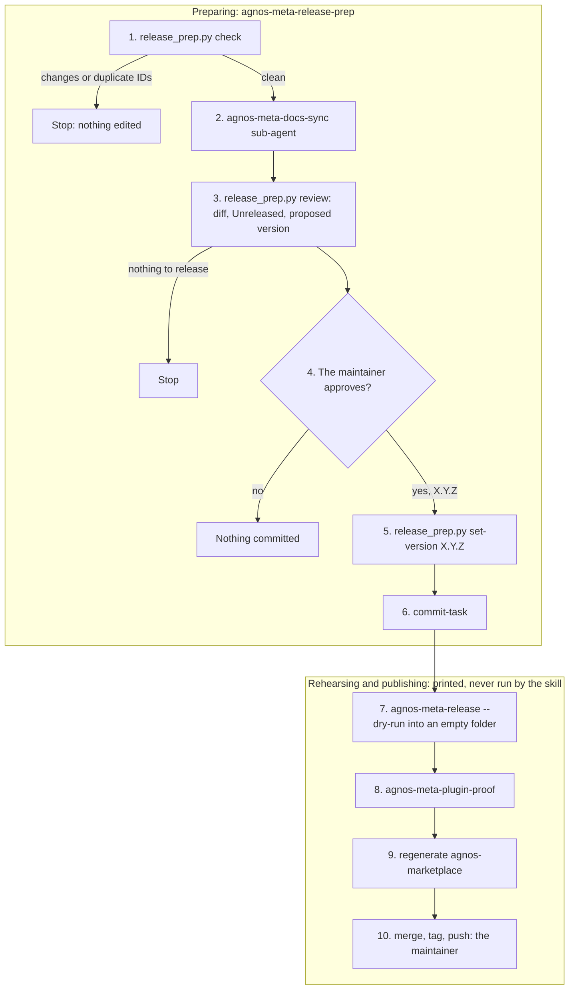

# How a release of AGNOS is made

<!-- FTR-PLG-005; RQ-PLG-027 to RQ-PLG-030 / ADR-PLG-005 (DEC-PLG-022); TASK-PLG-048 -->

A release goes in two halves. The first, **preparing**, is this skill (`agnos-meta-release-prep`): it makes one commit holding
up-to-date documents and the version. The second, **rehearsing and publishing**, starts from that commit: the release is
rehearsed into a folder, proved by a real install, copied into the marketplace, and only then published by the maintainer.
Nothing is ever pushed by an agent.

The steps, in plain words:

1. **Check** the repository: no uncommitted change, no duplicate ID. The open tasks are listed, so you decide whether to
   release with them open.
2. **Sync the documents**: the `agnos-meta-docs-sync` sub-agent brings `CHANGELOG.md`, `AGENTS.md`, `CLAUDE.md` and the user's
   guide up to date with the commits.
3. **Review** what will be released: the diff, the changelog's `[Unreleased]` entries, and a version proposed from them
   (`Removed` → major, `Added` or `Changed` → minor, `Fixed` only → patch).
4. **Approve**, or not. Without your approval nothing is recorded and nothing is committed.
5. **Record the version** you chose: `VERSION` takes it, and `## [Unreleased]` becomes `## [<version>]`.
6. **Commit** with `commit-task`: the documents and the version in one commit.
7. **Rehearse** the release from that commit into an empty folder (`agnos-meta-release --dry-run`).
8. **Prove** it by a real install (`agnos-meta-plugin-proof`).
9. **Regenerate** the marketplace folder `agnos-marketplace` from the proved output.
10. **Publish**: merge, tag and push. This is yours alone.

## Rehearsing without releasing

Steps 7 to 9 can be run on their own, as often as you like, without preparing anything: they read a commit and change
neither `VERSION` nor the changelog. While the changelog still holds `[Unreleased]` entries, the rehearsal says so with one
line, `unreleased: <n> entries, version <VERSION> delivered`, and fails nothing. Only step 5 needs a new version, above
the current one.

The procedure the agent follows is [SKILL.md](SKILL.md); the commands are in `scripts/release_prep.py`.
