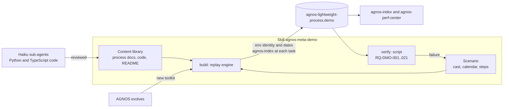

# ADR-DMO-001: Scripted replay of a simulated project
<!-- Amended on 2026-10-31: the skill, its script and its outputs carry their current names (RQ-TRC-104, RQ-TRC-105, DEC-TRC-055). -->

<!-- Motivated by: RQ-DMO-001 to RQ-DMO-021 (FTR-DMO-001, FTR-DMO-002) -->

## Status
Accepted

## Context
The demo repository must look like AGNOS cloned and used for two months by six people, with dates,
identities, working time and traceability all consistent (FTR-DMO-001, FTR-DMO-002). Typing 55 or more
commits by hand with forged dates is slow and error-prone, and the result has to be checked against 19
requirements. The user also allows bulk code generation to be delegated to a cheaper model, provided the
code is not copied from existing sources. The demo is a source of examples, so nothing in it may reveal
the tooling that produced it other than the README's statement that the history is simulated (RQ-DMO-009).

## Decision

### DEC-DMO-001: The demo product is "roombook", in Python and TypeScript
A meeting-room booking product with no graphical interface. A Python service (rooms, reservations,
conflict detection, reminders) and a TypeScript API client with a command-line tool. Three features, one
per session, with trigrams BKG (booking), NTF (notifications) and CLI (client), none of which is used by
this repository. The code is written fresh, following common open-source layering patterns, without
copying any existing source. It has no user interface, so the mandatory design system does not apply to it.
Fulfils RQ-DMO-003, RQ-DMO-004, RQ-DMO-005, RQ-DMO-006.

### DEC-DMO-002: The history is produced by replaying a scripted scenario
The generator (DEC-DMO-006) creates the repository and replays an ordered list of steps:
add files from a content library, close a task (apply the final status, Verification and Assumptions of a
task in its plan), refresh the index with the `agnos-index` skill, create a branch, merge a branch with a
merge commit. Each commit gets its author and committer through environment variables, so no git
configuration is written, and no remote is added. The generator may rebuild the demo from scratch, but only
after checking that the target is the demo it created. The index is therefore always produced by the skill
(RQ-DMO-007), and cited IDs are always defined before use (RQ-DMO-017).
Fulfils RQ-DMO-001, RQ-DMO-002, RQ-DMO-007, RQ-DMO-010, RQ-DMO-013, RQ-DMO-017, RQ-DMO-018.

### DEC-DMO-003: Cast, calendar and sessions
Six identities with a role suffix: `linda-po`, `omar-arch`, `nina-dev`, `paul-dev`, `john-qa`, `sara-qa`,
with e-mails `<identity>@agnos-demo.example`. Period Monday 2026-08-24 to Friday 2026-10-23 (60 days), time
zone Europe/Paris, offset +02:00 throughout, commits between 09:00 and 18:00. Two fictitious public
holidays, Monday 2026-09-14 and Monday 2026-10-12, declared in `docs/WORKING_CALENDAR.md`. A root commit
that starts the project is made on the default branch (it imported the AGNOS toolkit until DEC-MTA-006);
then three sessions on `feature/<TRI>` branches, each merged with a merge commit: BKG
(2026-08-24 to 2026-09-18), NTF (2026-09-21 to 2026-10-02), CLI (2026-10-05 to 2026-10-23). Authors by
role: requirements by `po`, ADRs by `arch`, plans and production code by `dev`, tests by `qa`, committed
before the code they check. The session BKG contains a decision that changes in the middle of the session,
so one ADR is shown as Superseded. The traceability is run on the demo's `process/` folder and the folders
of its own source code.
Fulfils RQ-DMO-011, RQ-DMO-012, RQ-DMO-014, RQ-DMO-015, RQ-DMO-016, RQ-DMO-008.

### DEC-DMO-004: Bulk code is generated by Haiku sub-agents under a written contract
The process documents, the scenario and the scripts are written by the main agent, because their IDs and
dates must be exact. The volume of source and test code is generated by Haiku sub-agents, one per language,
from a contract written by the main agent: file list, public signatures, the RQ and DEC IDs to cite, the
named-constant and Gherkin test-name rules, and the ban on copying existing code. The main agent checks
the output (ID citations, no duplicated literal, one Gherkin test per function) before it enters the
content library.
Fulfils RQ-DMO-004.

### DEC-DMO-005: Acceptance is a script, one check per criterion
A verification script checks each Gherkin criterion of RQ-DMO-001 to RQ-DMO-019 on the finished demo
(names, weekdays, holidays, hours, dates, messages, order of cited IDs, `git fsck --strict`, remote list,
global configuration, `agnos-index` and `agnos-perf-center` results). A failing check leads to a change of the
scenario or the content and a rebuild, never to a manual edit of the demo history.
Fulfils RQ-DMO-006, RQ-DMO-008, RQ-DMO-009, RQ-DMO-019 and every criterion above.

### DEC-DMO-006: The generator is the maintainer skill `agnos-meta-demo`
The replay engine, the verification script, the scenario and the content library (process documents,
Python and TypeScript code, README) are packaged as the skill `agnos-meta-demo` (renamed by the owner on 2026-10-31; DEC-MTA-003), like the other skills: the
canonical procedure, scripts and assets under `.github/skills/agnos-meta-demo/`, a thin entry point under
`.claude/skills/agnos-meta-demo/`. It has two sub-commands, `build` and `verify`. It is a maintainer tool, not
a process skill: CLAUDE.md and AGENTS.md do not list it, and the demo holds no AGNOS file (DEC-MTA-006). The demo is the standing reference to demonstrate and test AGNOS: after an evolution of AGNOS,
`build` rebuilds it from the same scenario on the new toolkit and `verify` checks it again; showing a new
capability means extending the scenario and the content. A build on an unchanged toolkit is deterministic
(dates, times and identities are fixed in the scenario).
Fulfils RQ-DMO-020, RQ-DMO-021, RQ-DMO-010.

### DEC-DMO-007: Two parallel sessions for the design system and the interface, and the engine keys they need
Owner request of 2026-10-24 (RQ-DMO-022). The cast gains `rob-ux` (`rob-ux@agnos-demo.example`, role `ux`), active
on five days of October. Two sessions are added to the scenario after NTF: DSN (design system) on `feature/DSN`,
forked after the NTF merge, and WEB (the booking interface) on `feature/WEB`, forked from the CLI session's typed
client, which merges `feature/DSN` first and is merged into the default branch on 2026-10-23 after CLI. The replay
engine gains three keys: `label` on a step (a name for its commit), `from` on `branch` (fork at a labelled commit),
`into` and `resolveFiles` on `merge` (merge into a given branch; a conflict on a generated file is resolved by
regenerating it, the index by the `agnos-index` skill, the metrics log by the union of its rows). `verify.ps1` accepts
the `ux` role and maps `client/design/` to it. The files and steps were prepared on 2026-10-24 by a sub-agent on the
demo itself and are folded back into the scenario, so that `build` reproduces them (RQ-DMO-021). Fulfils RQ-DMO-022
and the amended RQ-DMO-011.

## Consequences
- The demo can be rebuilt and re-verified at any time, by anyone who has this repository, and serves as a
  regression test of AGNOS: the index and traceability skills are run against it.
- This repository grows by the skill folder, which includes the content library of the demo.
- A rebuild rewrites the demo's history, which is acceptable since the demo has no remote; commit IDs
  change only when the toolkit or the content changes.
- The first version of the engine is PowerShell 5.1 (`session.platform=windows`); a bash version is not
  provided.
- Code generated by a smaller model needs a review pass; the contract and the gates limit that cost.
- The history is entirely simulated, which the README states.
- No git configuration is changed; identities exist only in the commits.

## Alternatives Considered
- Typing every commit by hand with `git commit --date`: rejected, too slow and impossible to rebuild after
  a correction.
- Generating the history normally and rewriting dates and authors afterwards (filter-branch or
  filter-repo): rejected, adds a dependency and makes the order of artifacts hard to control.
- Storing the generator in the demo: rejected, the demo must look like a plain project (RQ-DMO-002).
- Keeping the generator in the session scratchpad: rejected, it would be lost, and the demo could no
  longer follow the evolutions of AGNOS (RQ-DMO-020).
- Having all code written by the main model: rejected, higher cost for no quality gain once a contract and
  gates exist.

## Diagram

