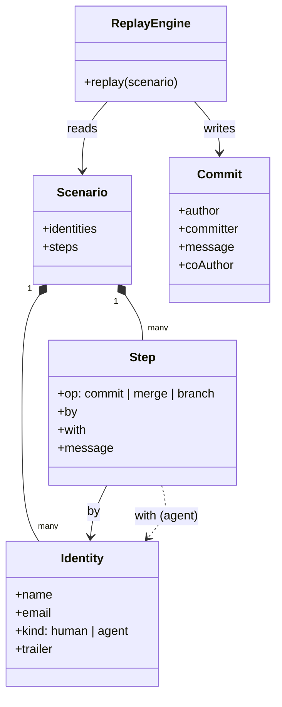
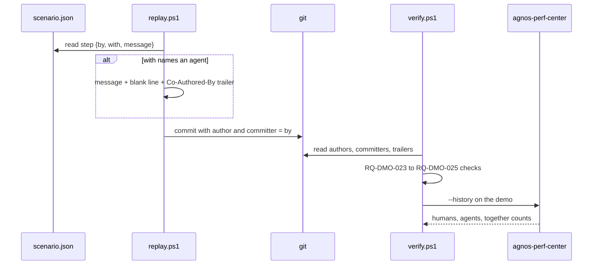

# ADR-DMO-002: Agent contributions in the simulated history

<!-- Motivated by: RQ-DMO-023, RQ-DMO-024, RQ-DMO-025, amended RQ-DMO-011 and RQ-DMO-014 (FTR-DMO-002); RQ-HST-005, RQ-HST-030 -->

## Status
Accepted — approved by the owner on 2026-11-12 (owner request of the same day); DEC-DMO-009 amended the same day for
the team of four (RQ-DMO-011, RQ-DMO-023 amended).

## Context
The demo's history (ADR-DMO-001) shows seven human identities and no agent, so the History view of the Performance
Center, built to show how humans and agents collaborate (RQ-HST-005), shows humans only. The owner asks for a mix: humans
alone, humans with Claude Code, humans with GitHub Copilot, and a few commits by an agent alone, with the trailer that
`commit-task` writes (RQ-HST-030), as validated on 2026-11-11 on this repository's own commits. The replay engine
(DEC-DMO-002) sets the author and committer from a step's `by` and writes the step's `message` as is; it knows no
co-author, and `verify.ps1` rejects a name without a role suffix (RQ-DMO-011).

## Decision

### DEC-DMO-008: Agent identities and a `with` key in the scenario
- **Statement**: The replay engine SHALL apply a scenario step's optional `with` key, naming an agent identity, by
  appending that identity's `Co-Authored-By` trailer to the commit message, and SHALL accept an agent identity in `by`.
- **Rationale**: The scenario stays the single source of the history (DEC-DMO-002, RQ-DMO-021): identities gain a
  `kind` (`human` by default, or `agent`), and an agent's trailer is built from its name and e-mail (`Claude Code/Claude Opus 5.5`,
  `Claude Code/Claude Sonnet 5.5` and `Claude Code/Claude Haiku 5.5`, all `<noreply@anthropic.com>`, and
  `Copilot SDK in VS Code/auto <223556219+Copilot@users.noreply.github.com>`); the three Claude models stay three
  identities, since agents are merged by name and e-mail (RQ-HST-004); every agent
  is named `<Harness>/<Model>` as `commit-task` names it (RQ-HST-030), and an agent `by` uses its trailer's name and
  e-mail, so the Performance Center, which already classes these names as agents, merges author and co-author into one
  identity.
  The engine refuses `with` on a merge step, `with` naming a human, and an agent `by` on a step that adds a file.

### DEC-DMO-009: Who works with which agent
- **Statement**: The scenario SHALL assign Claude Code as co-author to most commits of `andy-tech` (Claude Opus 5.5
  or Claude Sonnet 5.5, Claude Haiku 5.5 on 1 or 2 small commits), `linda-pm` (Claude Opus 5.5) and `john-ux` (Claude
  Sonnet 5.5), `Copilot SDK in VS Code/auto` to most commits of `sachin-tech`, leave every merge alone, and give
  `Copilot SDK in VS Code/auto` alone 3 to 6 small edits of committed files (amended by the owner on 2026-11-12).
- **Rationale**: Each person keeps one habitual tool, as in a real team, which makes the History filters readable,
  and the two technical people show the two tools side by side; every person works mostly with an agent, as the owner
  asked on 2026-11-12, so at least 60% of each one's commits and about two thirds of all non-merge commits are made
  together (RQ-DMO-023); `verify.ps1` gains one check per RQ-DMO-023 to RQ-DMO-025 and leaves agent identities out of
  RQ-DMO-011 and RQ-DMO-014.

## Consequences
- The History view of the demo shows humans, agents and "together" marks, and its kind filter has something to filter.
- Every commit ID of the demo changes once, at the rebuild; a later build on the same toolkit is again deterministic.
- The demo's README states that the agents, like the people, are simulated.
- A real tool's e-mail appears in the demo's trailers, since that is what the tools write and what the patterns file
  of the Performance Center matches.

## Alternatives Considered
- **Trailers typed in each step's `message`**: no engine change, but 40 copies of two strings and no check that a merge
  holds none. Rejected.
- **Fictitious agent names under `agnos-demo.example`**: would not show the real trailers that `commit-task` writes,
  and would rely on a name pattern only. Rejected.
- **An agent per commit chosen at random**: hides each person's habit and breaks reproducibility unless seeded. Rejected.

## Diagram

