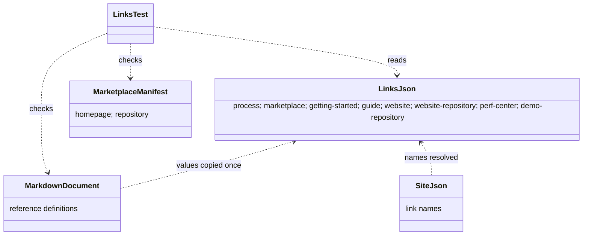

# ADR-DOC-001: Repository address source
## Status
Accepted — approved by the owner on 2026-11-18, for RQ-DOC-007 and RQ-DOC-008.
## Context
RQ-DOC-007 asks for each public AGNOS address to be declared once. The documents that hold them are of two kinds: Markdown read
as it is on GitHub (the README, the guide, the demo's README), where no placeholder can be replaced at read time, and files built
by a script (the website from `site.json`, DEC-WEB-008). The marketplace's manifest held a wrong process address
(`agnos-lightweight-process` instead of `agnos`).
## Decision
### DEC-DOC-001: JSON address file with Markdown reference links
- **Statement**: The repository SHALL use `assets/links.json` as the single declaration of the AGNOS addresses, referenced by
  Markdown reference definitions checked by a test, and read by the website build for the names `site.json` lists.
- **Rationale**: a reference definition renders as a link on GitHub with no build step, and stays the only place of the address in
  its document; the test turns a copy into a failure instead of a silent drift; the website already replaces names at build time,
  so it reads the values from the same file (owner choice of 2026-11-18). Amends DEC-WEB-008. Fulfils RQ-DOC-007, RQ-DOC-008.
## Consequences
- An address changes in `assets/links.json`, then in the one definition line of each checked document; the test names each
  document left behind.
- `site.json` lists link names only; the website build depends on the repository's `assets/links.json`.
- The marketplace's manifest keeps its own copy of the process address, checked by the same test.
- `assets/links.json` is Meta: it is not delivered; the delivered README carries its definitions with it.
## Alternatives Considered
- **Placeholders `{{link.<name>}}` in the Markdown, replaced at release**: rejected, the repository's README would show raw
  placeholders on GitHub.
- **Generating the README from a template**: rejected, a second source of the README for a few addresses.
- **Keeping the values in `site.json` and checking equality**: rejected by the owner in favour of one file read by the build.
## Diagram

```mermaid
sequenceDiagram
    participant Owner
    participant Links as assets/links.json
    participant Test as links test
    participant Doc as Markdown document
    participant Build as website build
    Owner->>Links: change an address
    Owner->>Test: run
    Test->>Doc: read reference definitions and text
    Test-->>Owner: fail naming each stale document
    Owner->>Doc: update its one definition line
    Build->>Links: read the names site.json lists
    Build-->>Owner: page with the new address
```
