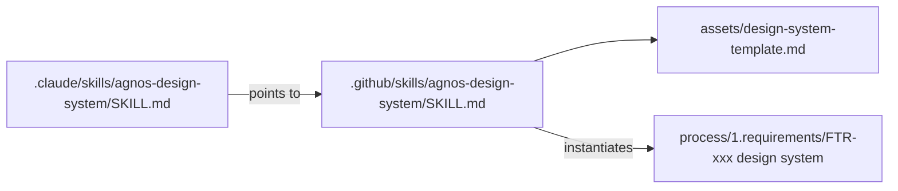

# ADR-DSY-001: Design-system template packaged as a skill

<!-- Motivated by: RQ-DSY-001 (FTR-DSY-001) -->

## Status
Accepted

## Context
The design-system template sat in `process/1.requirements/` next to the project's artifacts, which
it is not: it is reusable process tooling. Other process tooling (`agnos-index`,
`agnos-git-workflow`) is already packaged as skills.

## Decision

### DEC-DSY-001: A skill owns the template, a pointer serves Claude Code
The template moves (`git mv`, history kept) to
`.github/skills/agnos-design-system/assets/design-system-template.md`. The canonical procedure is
`.github/skills/agnos-design-system/SKILL.md`; `.claude/skills/agnos-design-system/SKILL.md` is a
thin pointer, as for `agnos-index`. Instantiated design systems still live in
`process/1.requirements/` as normal artifacts.

## Consequences
- `process/1.requirements/` holds only project artifacts.
- The template is discoverable and invocable by both agents.
- Projects copying the process must copy the skill folder to get the template.

## Alternatives Considered
- Keep the file in `process/`: rejected, mixes tooling with artifacts.
- Move it to a `templates/` root folder: rejected, not discoverable as a skill.

## Diagram

