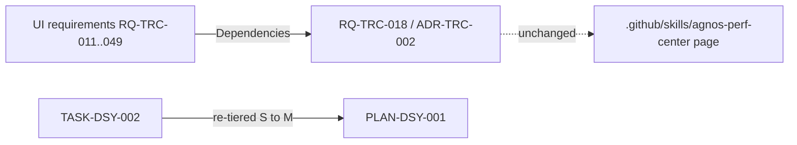

# ADR-FIX-001: Documentation-only corrections
<!-- Amended on 2026-10-31: the skill, its script and its outputs carry their current names (RQ-TRC-104, RQ-TRC-105, DEC-TRC-055). -->

<!-- Motivated by: RQ-FIX-001, RQ-FIX-002, RQ-FIX-003 (FTR-FIX-001) -->

## Status
Accepted

## Context
Two inconsistencies were found when reading the whole process (see FTR-FIX-001). They live in
requirement and plan documents. The traceability page has a design system (ADR-TRC-002) whose look the
owner does not want changed.

## Decision

### DEC-FIX-001: Prefix the design-system IDs in the existing Dependencies fields
RQ-TRC-018 and ADR-TRC-002 are inserted at the head of the Dependencies field of each UI requirement
(RQ-FIX-001). No requirement is added, renumbered or reworded, so IDs and index ranges stay stable.
TASK-DSY-002 is re-tagged Tier M with its Verification filled (RQ-FIX-002).

### DEC-FIX-002: The page's appearance is frozen
Only files under `process/` change. Nothing under `.github/skills/agnos-perf-center/` (tokens, CSS, JS,
template) is touched, and the design system of ADR-TRC-002 is not re-instantiated or restyled
(RQ-FIX-003).

## Consequences
- The matrix shows the UI requirements linked to the design system.
- The design system keeps living in FTR-TRC-001 / ADR-TRC-002, not in a separate design-system feature.
- Unit tests do not apply: only documents change.

## Alternatives Considered
- Add a separate design-system feature through the agnos-design-system skill: rejected, it would
  restructure the page's design system the owner wants left as is.
- Add new requirements stating the dependency: rejected, the Dependencies field is where the
  instructions ask for it.

## Diagram

