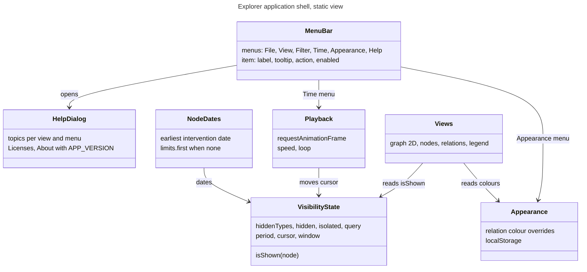
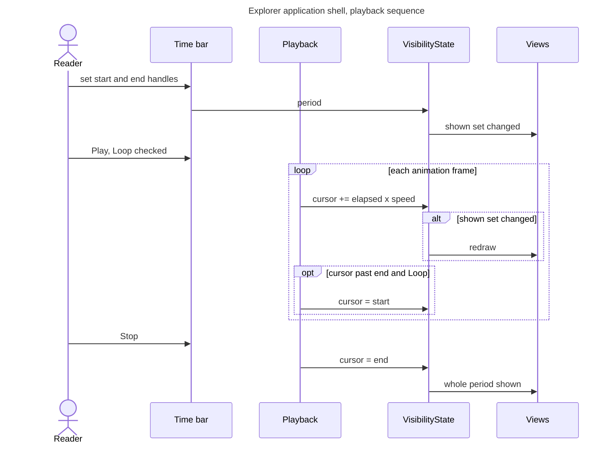

# ADR-GXP-001: Explorer application shell

## Status
Accepted (owner, 2026-11-24) — for FTR-GXP-001, lot A (RQ-GXP-001 to RQ-GXP-009). Extends ADR-TRC-025 (DEC-TRC-084, DEC-TRC-089,
DEC-TRC-093, DEC-TRC-095) and applies ADR-TRC-002 (the design system, DEC-TRC-009, DEC-TRC-010). The 3D view of lot B
(RQ-GXP-010 to RQ-GXP-019) takes an ADR of its own.

## Context
The explorer (ADR-TRC-025) is assembled by `graph.py` from `assets/explorer/`, holds one view model (DEC-TRC-089) whose
visibility state (`isShown`: hidden types, hidden nodes, isolated set, query) every view reads, and keeps the reader's saved
queries in `localStorage` (DEC-TRC-093). Its header holds a file button only. The performance center has a help dialog
(DEC-TRC-052), a licence list (DEC-TRC-058, DEC-TRC-062) and an About section with a version filled by the `@APP_VERSION@`
marker from the version file (DEC-TRC-061). The history block (DEC-HST-010) gives each element, file and function its
`[commit index, changed lines]` rows, and `limits.first` the date of the oldest commit read. FTR-GXP-001 asks for menus, the
copied help, a period of time over every view, its playback and a colour per relation kind chosen by the reader.

## Decision

### DEC-GXP-001: Hand-written menu bar
- **Statement**: The explorer SHALL draw its menu bar and menus as its own elements with the ARIA `menubar` and `menu` roles, styled by tokens and driven by click and arrow keys, each menu built from a list of items with a label, a tooltip, an action and an enabled test.
- **Rationale**: a few menus need no UI library; the context menu of DEC-TRC-095 is built the same way, and the enabled test lets a menu follow the graph and the view.
- **Requirement refs**: RQ-GXP-001, RQ-TRC-164
- **Dependencies**: DEC-TRC-095, DEC-TRC-010

### DEC-GXP-002: Help dialog copied from the performance center
- **Statement**: The explorer SHALL copy the performance center's help dialog, licence badges and About lockup, their markup, styles and token values, and `graph.py` SHALL fill an `@APP_VERSION@` marker with the label `perf_center.py` computes from the same version file.
- **Rationale**: the owner asked for the performance center's help and About; the copy follows option A (DEC-TRC-084), no file shared between the two skills.
- **Requirement refs**: RQ-GXP-002, RQ-GXP-003, RQ-GXP-004
- **Dependencies**: DEC-TRC-084, DEC-TRC-052, DEC-TRC-058, DEC-TRC-061, DEC-TRC-062

### DEC-GXP-003: Time period in the shared visibility state
- **Statement**: The explorer's visibility state SHALL hold the period, the cursor and the window, and `isShown` SHALL test a node's date against them, so that every view applies the period as it applies a facet.
- **Rationale**: one state read by every view keeps them in step (DEC-TRC-089); the 3D view of lot B reads the same test.
- **Requirement refs**: RQ-GXP-006, RQ-GXP-008, RQ-GXP-009
- **Dependencies**: DEC-TRC-089

### DEC-GXP-004: Node date from history interventions
- **Statement**: The explorer SHALL date each node with the earliest commit date of its rows in `history.interventions`, a node without rows with `history.limits.first`, and SHALL compute no date when the graph has no history.
- **Rationale**: the rows already give every element, file and function its commits; a node with none existed before the history read.
- **Requirement refs**: RQ-GXP-006, RQ-GXP-009
- **Dependencies**: DEC-HST-010, DEC-TRC-089

### DEC-GXP-005: Relation colour overrides in browser storage
- **Statement**: The explorer SHALL keep the reader's colour per relation kind in `localStorage`, apply it over the kind's `relation-*` token in the graph's styles and the legend, and remove it on "Reset colours".
- **Rationale**: the tokens stay the design system's defaults and the only colours of the code (DEC-TRC-010); a reader's choice is the reader's data, as the saved queries are (DEC-TRC-093).
- **Requirement refs**: RQ-GXP-005
- **Dependencies**: DEC-TRC-093, DEC-TRC-010

### DEC-GXP-006: Playback driven by animation frames
- **Statement**: The explorer SHALL move the playback cursor on `requestAnimationFrame` by the elapsed time times the chosen speed in days per second, from tokens, redrawing the views only when the shown set changes.
- **Rationale**: animation frames follow the screen and pause in a hidden tab; redrawing on change only keeps the 2D view fluid with thousands of nodes.
- **Requirement refs**: RQ-GXP-007, RQ-GXP-008
- **Dependencies**: DEC-GXP-003

## Consequences
- Easier: every setting has one place; the period filters every view, the 3D one included.
- Harder: the help, licence and About markup exist twice until the two pages share a kit.
- Constrained: the period needs `--history`; the reader's colours stay in one browser until the saved views of RQ-GXP-016.

## Alternatives Considered
- **A UI library for menus** (e.g. a web component kit): a second pinned script for a few menus. Rejected, as `cytoscape-cxtmenu` was (DEC-TRC-095).
- **A date from the element's document heading**: only elements have one, files and functions none. Rejected.
- **A timer (`setInterval`) for playback**: drifts and runs in a hidden tab. Rejected.

## Diagram

