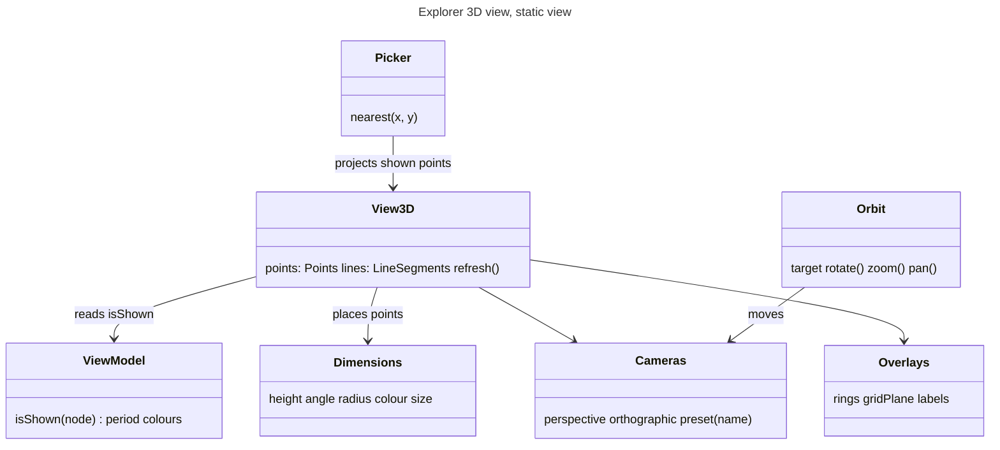
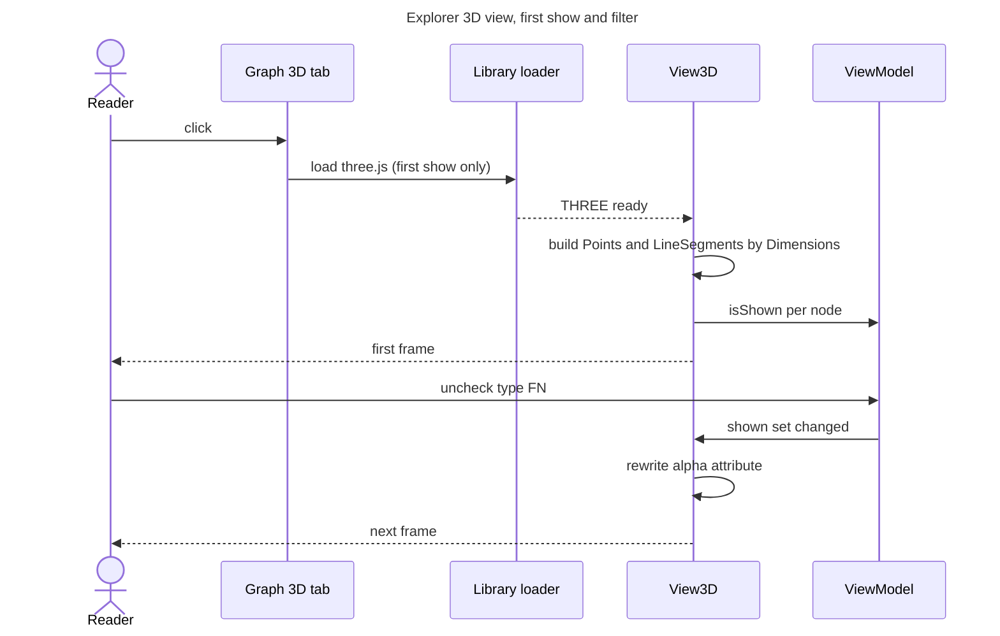

# ADR-GXP-002: Explorer 3D view

## Status
Accepted (owner, 2026-11-25) — for FTR-GXP-001, lot B1 (RQ-GXP-010 to RQ-GXP-015, RQ-GXP-019). Extends ADR-GXP-001 (DEC-GXP-001, DEC-GXP-003,
DEC-GXP-005) and ADR-TRC-025 (DEC-TRC-089, DEC-TRC-090, DEC-TRC-095), applies ADR-TRC-002 (the design system, DEC-TRC-009,
DEC-TRC-010). RQ-GXP-016 to RQ-GXP-018 (saved views, image export, presentation) are left to a later session.

## Context
The explorer holds one view model whose `isShown` test (DEC-TRC-089, DEC-GXP-003) every view reads, and draws its graph view
with Cytoscape.js loaded from cdnjs with its integrity (DEC-TRC-090, `libraries.json`). FTR-GXP-001 asks for a Graph 3D tab
beside Graph 2D, Nodes and Relations, whose points the reader places by chosen dimensions, under a perspective, orthographic or
isometric camera, with reference planes, drawn in less than 3 s on this repository's graph built with `--call-graph` and
`--history` (thousands of function nodes, tens of thousands of call relations). The owner chose three.js from cdnjs
(session GXP, 2026-11-25) and, on 2026-11-24, a hand-written orbit controller.

## Decision

### DEC-GXP-007: three.js renderer from cdnjs
- **Statement**: The explorer SHALL draw the 3D view with three.js, one pinned UMD build loaded from cdnjs with its integrity and recorded in `libraries.json` and the licence list, loaded only when the Graph 3D tab is first shown.
- **Rationale**: WebGL draws tens of thousands of lines at screen rate where a 2D canvas does not; loading on first show keeps RQ-TRC-158's first view unchanged (RQ-GXP-019); owner's choice of 2026-11-25.
- **Requirement refs**: RQ-GXP-011, RQ-GXP-019, RQ-GXP-003
- **Dependencies**: DEC-TRC-090, DEC-GXP-002

### DEC-GXP-008: Points and lines in two buffers
- **Statement**: The 3D view SHALL draw every node as one entry of a single `Points` geometry and every relation as one segment of a single `LineSegments` geometry, coloured per vertex from the type and relation tokens and the reader's overrides, and SHALL hide what `isShown` refuses by its vertex alpha, without rebuilding the buffers.
- **Rationale**: two draw calls whatever the graph's size; a filter or a playback step rewrites one attribute array only (DEC-GXP-006).
- **Requirement refs**: RQ-GXP-011, RQ-GXP-019
- **Dependencies**: DEC-GXP-007, DEC-GXP-003, DEC-GXP-005

### DEC-GXP-009: Hand-written orbit controller
- **Statement**: The explorer SHALL rotate, zoom and pan the 3D camera with its own pointer and wheel handler around a target point, keeping the wheel sensitivity and zoom bounds of the 2D view's tokens.
- **Rationale**: three.js's `OrbitControls` is an ES module absent from the UMD build; the owner asked for a hand-written controller (2026-11-24).
- **Requirement refs**: RQ-GXP-011, RQ-GXP-014
- **Dependencies**: DEC-GXP-007

### DEC-GXP-010: Picking by screen distance
- **Statement**: The 3D view SHALL find the point under the pointer by projecting the shown points to the screen and taking the nearest within a token radius, then reuse the 2D view's selection, tooltip and node context menu.
- **Rationale**: a screen-distance test stays exact at every point size and projection, where a raycast's threshold is in world units; the actions stay those of DEC-TRC-095.
- **Requirement refs**: RQ-GXP-012
- **Dependencies**: DEC-GXP-008, DEC-TRC-095

### DEC-GXP-011: Dimensions as pure mapping functions
- **Statement**: The explorer SHALL compute each node's height, angle, radius, colour and size from a table of dimensions, each a function from a node to a number or a category, normalised to the view's extent, the history's dimensions disabled when the graph has none.
- **Rationale**: one table feeds the Dimensions menu, the placement and the tests; adding a dimension adds a row.
- **Requirement refs**: RQ-GXP-013, RQ-GXP-009
- **Dependencies**: DEC-GXP-004, DEC-GXP-001

### DEC-GXP-012: Two cameras with fixed presets
- **Statement**: The explorer SHALL switch between a perspective and an orthographic three.js camera sharing the controller's target, the isometric, top, front and side views being orthographic presets of its angles, and SHALL draw points at a fixed screen size.
- **Rationale**: an orthographic camera keeps equal heights equal on screen (RQ-GXP-014); fixed-size points stay readable at every zoom.
- **Requirement refs**: RQ-GXP-014
- **Dependencies**: DEC-GXP-009

### DEC-GXP-013: Reference planes as scene overlays
- **Statement**: The 3D view SHALL draw the month rings, the cursor's grid plane and the angle's category labels as line geometries and HTML labels projected each frame, each toggled from the View menu.
- **Rationale**: HTML labels keep the design system's type tokens; the grid plane follows the playback cursor of DEC-GXP-006.
- **Requirement refs**: RQ-GXP-015
- **Dependencies**: DEC-GXP-011, DEC-GXP-006

## Consequences
- Easier: one draw path for every graph size; a new dimension is one table row.
- Harder: a second library to pin, audit and list in the licences; WebGL needed (a headless browser runs it by software).
- Constrained: the 3D view's colours come from the same tokens as the 2D view's; no layout library in 3D, positions are the dimensions.

## Alternatives Considered
- **A hand-written Canvas 2D projection**: no dependency, but tens of thousands of call lines miss RQ-GXP-019. Rejected by the owner (2026-11-25).
- **`3d-force-graph`**: a force layout contradicts the reader's dimensions, and pulls three.js anyway. Rejected.
- **One mesh per node**: thousands of draw calls. Rejected.
- **three.js `OrbitControls`**: an ES module, not in the UMD build. Rejected (DEC-GXP-009).

## Diagram

