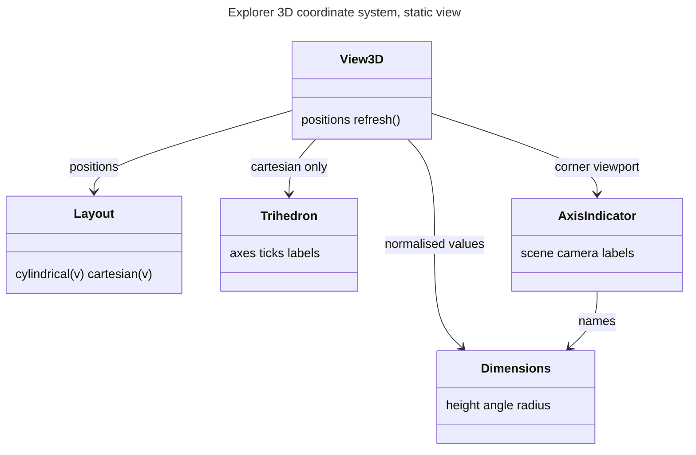
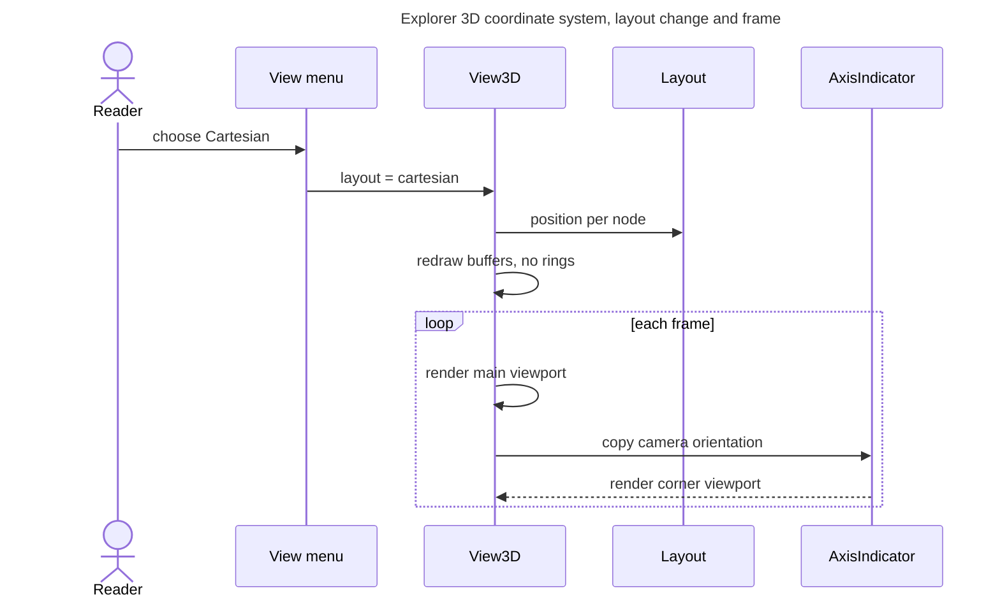

# ADR-GXP-003: Explorer 3D coordinate system

## Status
Accepted (owner, 2026-11-26) — for FTR-GXP-001 (RQ-GXP-020 to RQ-GXP-022). Extends ADR-GXP-002 (DEC-GXP-011, DEC-GXP-012,
DEC-GXP-013), applies ADR-TRC-002 (the design system, DEC-TRC-009, DEC-TRC-010).

## Context
The 3D view places each node in cylindrical coordinates: the height, angle and radius dimensions of DEC-GXP-011, read with
month rings and angle labels (DEC-GXP-013). The reader does not see which dimension each direction shows, and has no
traditional view of three straight axes. The owner asked, on 2026-11-26, for an axis indicator in the bottom left corner
and a cartesian layout with a trihedron, each toggled in the View menu, in a decision record of its own.

## Decision

### DEC-GXP-014: Axis indicator in a corner viewport
- **Statement**: The 3D view SHALL draw the axis indicator as a second render of a small scene into a bottom left scissored viewport, its camera copying the main camera's orientation, its axis labels HTML labels named from the current dimensions.
- **Rationale**: one renderer and one canvas; the orientation follows the orbit controller without a second controller; HTML labels keep the type tokens, as DEC-GXP-013.
- **Requirement refs**: RQ-GXP-020
- **Dependencies**: DEC-GXP-012, DEC-GXP-013, DEC-GXP-011

### DEC-GXP-015: Layout as a pure placement function
- **Statement**: The explorer SHALL compute each point's position by a layout function chosen in the View menu, cylindrical or cartesian, from the same normalised dimension values, the cartesian one also drawing a graduated trihedron overlay.
- **Rationale**: the dimensions table stays unchanged (DEC-GXP-011); switching layout redraws the two buffers as a dimension choice does, the camera kept (DEC-GXP-008).
- **Requirement refs**: RQ-GXP-021
- **Dependencies**: DEC-GXP-011, DEC-GXP-008, DEC-GXP-013

### DEC-GXP-016: Date dimensions scaled on the period
- **Statement**: The explorer SHALL normalise every date dimension, and draw the month rings, over the selected period, or over the history's first to last commit without one, clamping outside dates, and SHALL redraw the 3D scene when the period changes while a date dimension is chosen.
- **Rationale**: the shown nodes all lie in the period (RQ-GXP-006), so the rest of the scale is empty; the redraw is the dimension change's (DEC-GXP-015), after the time bar's settle (TASK-GXP-010); the playback cursor keeps the period's scale, so that no point moves during a playback.
- **Requirement refs**: RQ-GXP-022
- **Dependencies**: DEC-GXP-011, DEC-GXP-013, DEC-GXP-003, DEC-GXP-015

## Consequences
- Easier: a new layout is one function; the indicator reads the axes of any layout.
- Harder: two renders per frame; the rings and angle labels depend on the layout.
- Constrained: the cartesian axes reuse the angle, height and radius choices, no new Dimensions entry.

## Alternatives Considered
- **A second canvas for the indicator**: a second WebGL context, costly. Rejected.
- **Three.js `AxesHelper` alone**: no labels, no graduations. Kept for the lines only, labels hand-written.
- **New x, y, z dimension choices**: doubles the Dimensions menu. Rejected (owner, 2026-11-26).

## Diagram

