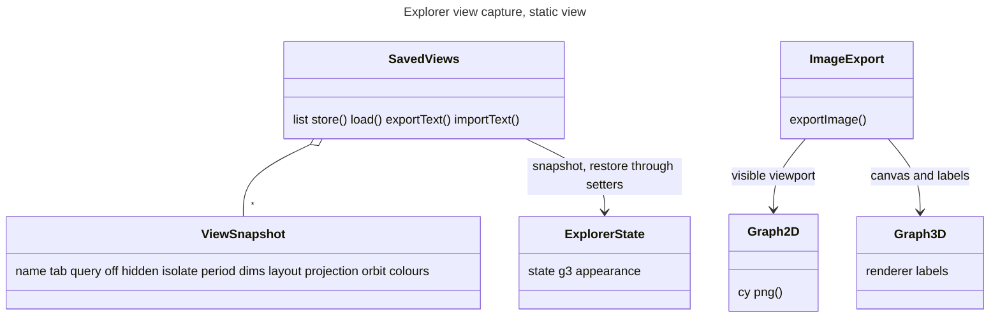
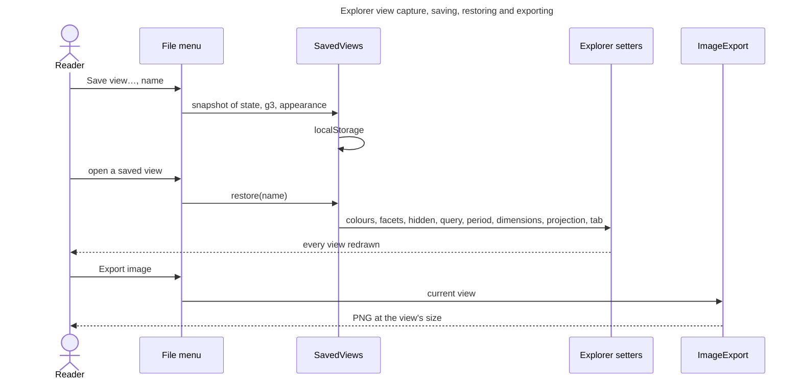

# ADR-GXP-004: Explorer view capture

## Status
Accepted (owner, 2026-11-27) — for FTR-GXP-001, lot B2 (RQ-GXP-016, RQ-GXP-017; RQ-GXP-018 cancelled by the owner on
2026-11-27). Extends ADR-TRC-025 (DEC-TRC-090, DEC-TRC-093), ADR-GXP-001 (DEC-GXP-001, DEC-GXP-003, DEC-GXP-005) and
ADR-GXP-002 (DEC-GXP-007, DEC-GXP-011, DEC-GXP-012), applies ADR-TRC-002 (the design system, DEC-TRC-009, DEC-TRC-010).

## Context
A reader prepares a view, a tab with a query, facets, hidden or isolated nodes, a period, 3D dimensions, a projection and
relation colours, and loses it when the page is closed (RQ-GXP-016). The saved query buttons keep a query only
(RQ-TRC-153, DEC-TRC-093). The reader also wants an image of the current graph view for a document (RQ-GXP-017). The view's
state lies in three places: `state` (tab, facets, hidden and isolated nodes, query, period), `g3` (dimensions, layout,
camera, orbit) and `appearance` (relation colours). Each part already has a setter that redraws its views (call graph of
`explorer.js`, graph of 2026-11-26): `showView`, `query`, `refresh`, `setPeriodDays`, `setDimension`, `setLayout`,
`setProjection`, `setRelationColour`. The 2D view is a Cytoscape canvas (DEC-TRC-090); the 3D view is one WebGL canvas
created with `preserveDrawingBuffer` (DEC-GXP-007) under HTML labels (DEC-GXP-013).

## Decision

### DEC-GXP-017: Named view snapshots in browser storage
- **Statement**: The explorer SHALL keep each saved view in `localStorage` as a named JSON snapshot of the tab, the query text, the unchecked facet values, the hidden and isolated node IDs, the period's dates, the 3D dimensions, layout, projection and orbit, and the relation colours, under a key of its own, and SHALL export and import the list as a JSON file, the saved queries' export and this one opening a save dialog that remembers its last folder where the browser offers `showSaveFilePicker`, a download elsewhere.
- **Rationale**: the store and the file of the saved queries (DEC-TRC-093) already work offline and are understood by the reader; a snapshot of plain values, not of the internal sets, survives a reload and a newer graph of the same project; the export is the reader's copy on disk, and a dialog reopened in `agnos-process/4.knowledge/graph/` once chosen keeps it with the graph (owner, 2026-11-27), where a page cannot name a folder itself.
- **Requirement refs**: RQ-GXP-016
- **Dependencies**: DEC-TRC-093, DEC-GXP-003, DEC-GXP-005, DEC-GXP-011, DEC-GXP-012

### DEC-GXP-018: View restore through the existing setters
- **Statement**: The explorer SHALL restore a saved view by calling, in order, the setters of the relation colours, the facets, the hidden and isolated nodes, the query, the period, the 3D dimensions, layout and projection, then the tab, skipping each value the loaded graph cannot apply.
- **Rationale**: each setter already redraws every view it concerns (call graph of `explorer.js`), so a restore adds no second drawing path; the period is stored by date and mapped onto the loaded history's days; an ID absent from the graph is left out rather than failing the view.
- **Requirement refs**: RQ-GXP-016
- **Dependencies**: DEC-GXP-017, DEC-GXP-003, DEC-GXP-015

### DEC-GXP-019: PNG from the view's own canvas
- **Statement**: The explorer SHALL export the 2D view with Cytoscape's `png` of the visible viewport, and the 3D view by drawing its WebGL canvas, then its HTML labels in the label tokens, onto a canvas of the view's size saved as PNG.
- **Rationale**: both libraries are already loaded; `preserveDrawingBuffer` keeps the last 3D frame readable; without the labels a 3D image loses the month rings' and the axes' names, which the reader reads in the view.
- **Requirement refs**: RQ-GXP-017
- **Dependencies**: DEC-TRC-090, DEC-GXP-007, DEC-GXP-013, DEC-GXP-014

## Consequences
- Easier: a new view setting needs one snapshot field and its setter; the images need no new library.
- Harder: a snapshot field renamed later needs a reading of the former name.
- Constrained: the views live in one browser until exported; a 3D label style not drawn by the label tokens is not in the image.

## Alternatives Considered
- **The view in the page's URL**: shareable by link, but the hidden node lists of a large graph exceed a URL's length. Rejected.
- **Saved views as an extension of the saved query buttons**: one list, but a button would then change the tab and the camera
  when the reader expects a query; RQ-TRC-153 unchanged. Rejected.
- **A screenshot library (html2canvas)**: one more library from cdnjs, and WebGL canvases are not reliably captured. Rejected.
- **The 3D image without its labels**: simpler, but the image no longer names its dimensions. Rejected.
- **The views and queries written to a project file read at load** (`graph-explorer.views.js` beside the graph, written through
  the File System Access API): shared by every browser and versionable, but needs a directory permission, has no Firefox
  support, amends RQ-TRC-153 and DEC-TRC-093, and the existing export and import already give the copy on disk. Rejected
  (owner, 2026-11-27).

## Diagram

