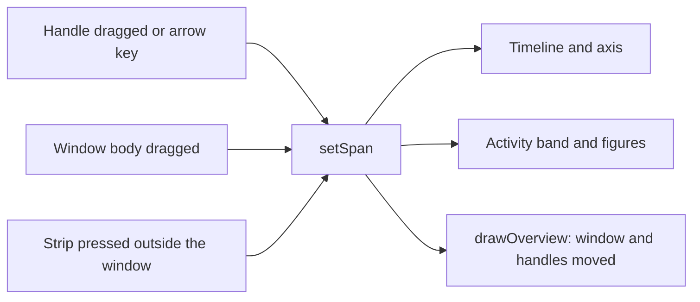

# ADR-HST-002: Handles Drawn on the History's Own Overview Strip

## Status
Accepted — approved by the owner on 2026-10-31; from the owner's review of 2026-10-31, reformulated as FTR-HST-003 (RQ-HST-027 to RQ-HST-029). Keeps
DEC-HST-005 and uses ADR-TRC-002 (the design system).

## Context
The Delivery chart's slider, from ECharts, has handles; the History's overview strip, drawn by hand, has a window that
only moves. The owner wants them handled alike. The strip sits in one grid with the timeline's rows, the axis and the
activity band, with the virtualised rows between the band and the strip, so a chart spanning them would be cut by those
rows.

## Decision

### DEC-HST-012: Two handles in the strip's SVG, one setSpan
`drawOverview` adds, above the ticks, two handle elements to the strip's inline SVG, moved like the window on each draw
and never redrawn with the ticks (RQ-HST-013). A pointer press is told apart by its target: a handle moves one end, the
window's body moves the span with the offset of the press kept, the rest of the strip centres the window. Every change
goes through the existing `setSpan`, which clamps the period and redraws the timeline, axis, band and figures. The strip's
role goes from `img` to `group`, each handle being a focusable `slider` named with its date; its arrow keys use the
timeline's pan step and stop there, so that the timeline's own keys do not also apply. New tokens size and colour the
handles, each a rounded light grip with a border and two lines, as the Delivery slider's, so that it cannot be taken for
one of the strip's ticks (owner review of 2026-10-31). Fulfils RQ-HST-027, RQ-HST-028, RQ-HST-029.

## Consequences
- The two tabs read alike, though their code differs: a change to the look of one needs the same change in the other.
- No library enters the History, so its speed thresholds keep their margin.
- The strip gains interactions to test; the wheel, drag and keyboard of the timeline stay as they are.

## Alternatives Considered
- **The band, the strip and the timeline in ECharts**: one look by construction, but the rows between them cannot be
  drawn by the chart, and the virtualised rows, grouped marks and keyboard would be rebuilt. Rejected, as in ADR-TRC-010.
- **The strip alone in ECharts, its slider driving the timeline**: a whole chart for one slider, kept in step by hand
  with `setSpan`. Rejected.

## Diagram

