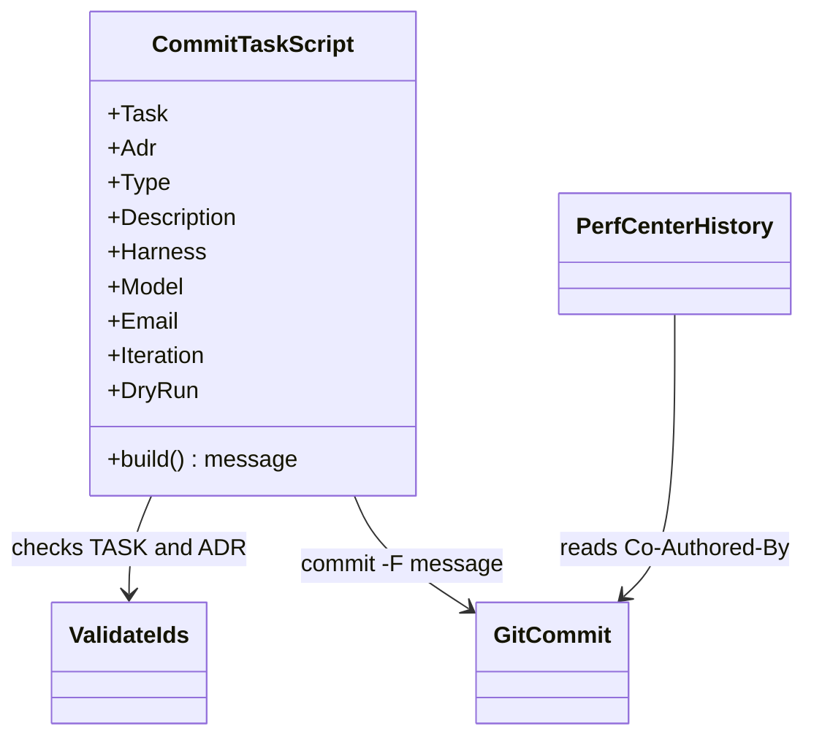
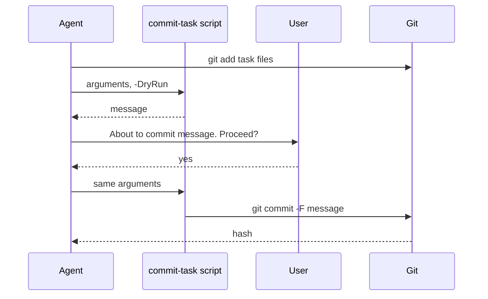

# ADR-HST-003: Commit message construction

## Status
Accepted — approved by the owner on 2026-11-11, after GitHub Copilot read the RQ-HST-030 rule of `commit-task` and
still wrote its own `Co-authored-by: Copilot` trailer (commit bd16415 of the test clone).

## Context
RQ-HST-030 asks each agent commit to carry one `Co-Authored-By: <Harness>/<Model> <e-mail>` trailer, so that the
performance center (RQ-HST-005) tells apart the tools and models. TASK-PLG-063 wrote it as a rule of the
`agnos-git-workflow` skill, the agent writing the message. Claude Code followed it; GitHub Copilot read it and kept the
trailer its own built-in instructions impose. A rule the agent has to write out competes with the tool's habits.

## Decision
### DEC-HST-013: A script for the commit message and its co-author trailer
- **Statement**: The `commit-task` sub-command SHALL use a script, `commit-task.ps1` or `commit-task.sh`, for building
  the commit message and its co-author trailer from the arguments the agent gives, and for running `git commit`.
- **Rationale**: the agent gives values (harness, model, e-mail), not text: the script writes the trailer, refuses to
  run without them, and the grammar has a single executable source. Evidence: the TASK-TST-002 test, where the written
  rule was read and not applied.

## Consequences
- The commit-message grammar lives in the script; the SKILL.md describes it and calls the script.
- A dry run prints the message for the user's confirmation, then the same arguments commit it.
- The script stages nothing: the agent stages the task's files before, which keeps the user's changes out.
- An agent can still bypass the script with a raw `git commit`; the message then lacks the AGNOS format and shows it.
- Both versions give the same bytes, and are tested on the same cases.

## Alternatives Considered
- **A stronger written rule** (counter-example, self-check): rejected, the agent still writes the trailer and its
  built-in instructions won once already.
- **A git `commit-msg` hook**: the only hard guarantee, rejected for now, since it has to be installed in each clone;
  kept as a possible follow-up through `agnos-init`.
- **A fixed table of harness names**: rejected by the owner, the values are taken as the tool gives them (RQ-HST-030).

## Diagram

