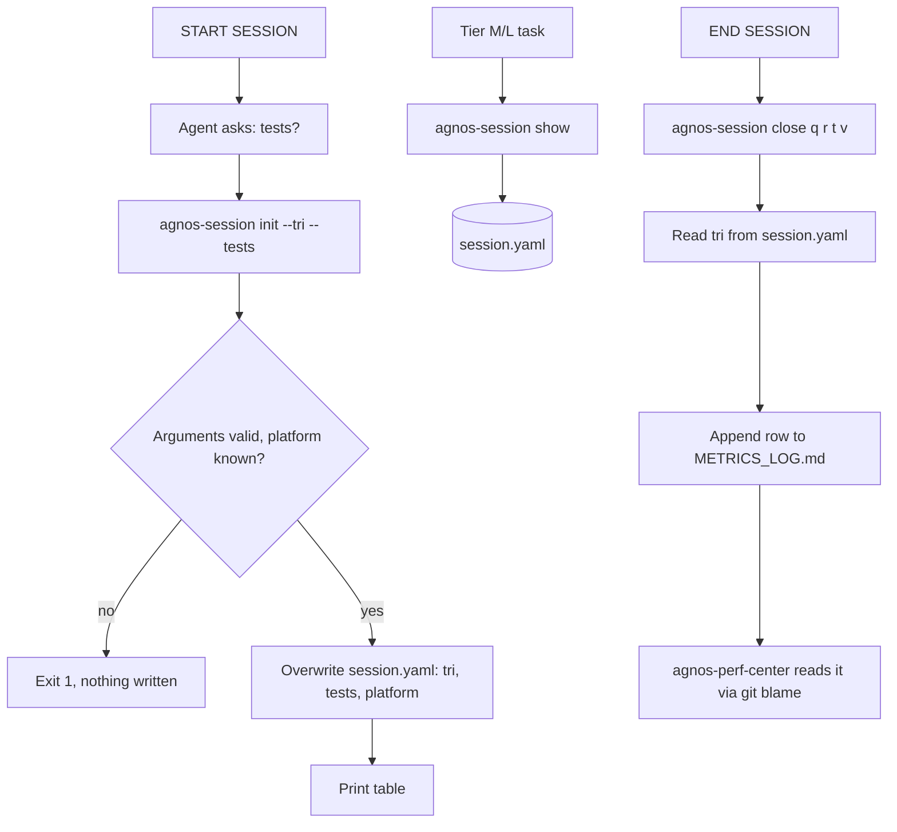

# ADR-INI-002: A Skill Writes the Session State

## Status
Accepted — approved by the owner on 2026-11-07, for FTR-INI-002 (RQ-INI-011 to RQ-INI-018). Amends RQ-DMO-006.

## Context
START SESSION step 3 had the agent detect the platform, write `session.yaml` and complete it on an override; END SESSION step 2 had
it write the metrics row that `agnos-perf-center` parses with a fixed pattern (DEC-TRC-045). Both depend on what an agent writes.
The file was version-controlled, so each session's values went into the history, and the demo's verification required it among the
committed files although RQ-DMO-006 did not. The session trigram was not kept anywhere: END SESSION had to recall it. The key
`unit_tests` was named for unit tests while the tests are Gherkin acceptance tests.

## Decision

### DEC-INI-008: A dedicated skill, `agnos-session`
A process skill holds three sub-commands, `init`, `show` and `close`, in `session.ps1` (Windows PowerShell 5.1) and `session.sh`
(POSIX sh), reading their paths from layout copies generated for it (DEC-PLG-027). Its `SKILL.md` runs
`powershell -NoProfile -File <skill-folder>/scripts/session.ps1` and, if `powershell` is not found, `bash <skill-folder>/scripts/session.sh`:
it cannot select by `session.platform`, which it writes. Behaviour rules stay in the instructions; only the writing moves to a script.
No hook. Fulfils RQ-INI-018. (amended on 2026-11-07, TASK-INI-012: `bash`, as the other skills; the script stays POSIX sh)

### DEC-INI-009: `init` overwrites, with two required arguments
`init --tri <TRI> --tests <true|false>` validates both before any write, then rewrites `session.yaml` whole with `tri`, `tests` and
`platform`, LF endings, UTF-8 without BOM, and prints the table. An override is a new `init` call; nothing is ever merged. The
trigram is stored as given, three uppercase letters, with no check against the branch: the user may work on `ABC` on `feature/PLG`.
The tests question stays with the agent, in START SESSION step 3. Fulfils RQ-INI-011, RQ-INI-012.

### DEC-INI-010: The platform is detected from the running shell
PowerShell: `Test-Path variable:IsLinux` and its value give `linux`, the same for `IsMacOS` gives `macos`, otherwise `windows`; the
`Test-Path` guard keeps StrictMode from failing on 5.1, where these variables are absent. bash: `uname -s` gives `Linux`, `Darwin`, or
a `MINGW`, `MSYS` or `CYGWIN` prefix; any other value exits 1. The tests simulate Linux, macOS and PowerShell 7; only Windows with
PowerShell 5.1 runs for real, which each task's Verification states. Fulfils RQ-INI-013. (amended on 2026-11-07, TASK-INI-012: `bash`, as the other skills; uname detection stays)

### DEC-INI-011: `show` and `close`
`show` prints `tri=<v> tests=<v> platform=<v>` on one line; START SESSION step 3.e uses it to reload the state. `close` validates its
four counters, reads `tri` from `session.yaml`, and appends the row in the format `FRICTION_ROW_RE` reads, dated with the local date,
taking the line ending of the log's first line; an absent log is created with its title and header, in LF. Fulfils RQ-INI-014, RQ-INI-015.

### DEC-INI-012: `session.yaml` leaves git, without migration
`agnos-init` adds `agnos-process/_sessionstate/session.yaml` to the target's `.gitignore` only when `git check-ignore` says it is not
ignored, so a broader rule already in place is respected; outside a git repository it compares lines. It does not untrack a file
already committed: there is no migration, and the change ships in a major version, its changelog stating it. This repository untracks
its own copy once. `METRICS_LOG.md` stays committed, since `agnos-perf-center` reads it with `git blame`. RQ-DMO-006 drops "a session
state file" from its Statement, and the demo no longer commits one. Fulfils RQ-INI-016.

### DEC-INI-013: `tests`, not `unit_tests`
The key becomes `tests`; the Testing section says "test" for "unit test", its rules unchanged. The rule "never rename or remove
existing keys" is removed: the file is rewritten by a script at every start, so a removed key cannot linger. Fulfils RQ-INI-017.

## Consequences
- The agent no longer writes the state or the metrics row: a malformed row or a stale key cannot come from it.
- END SESSION gets the trigram from a file, even after the conversation was compacted.
- A project upgraded from an earlier version still tracks `session.yaml` until its owner untracks it; the changelog says how.
- Two scripts must stay byte-equivalent: one Python suite drives both on the same cases.
- Linux and macOS are proven by simulation only until a real run; the plugin proof may later run them.
- The instructions file shrinks at step 3 and in the schema, and must stay within 400 lines.

## Alternatives Considered
- **The agent keeps writing the files, with stricter wording**: what an agent writes is not deterministic. Rejected.
- **Reading the trigram from the branch name**: the user may keep a branch of another trigram. Rejected.
- **Completing `session.yaml` instead of overwriting it**: keeps stale keys of former sessions. Rejected.
- **`git rm --cached` in `agnos-init`**: changes the user's index without asking. Rejected; a major release documents it.
- **A `SessionStart` hook**: tied to one harness and invisible (DEC-INI-001). Rejected.
- **Python**: the first command of a session would need an interpreter. Rejected.
- **Recording a status and a start time to detect a session left open**: no use was found for it. Rejected.

## Diagram

