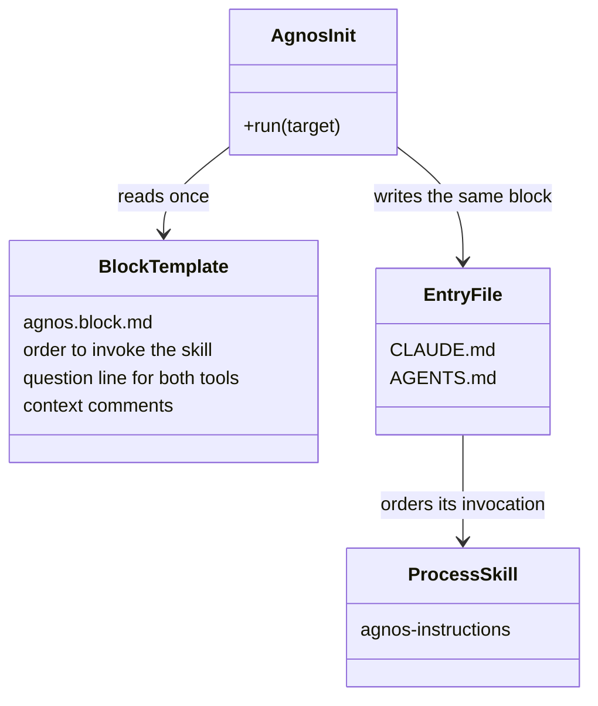
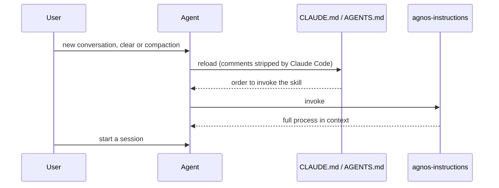

# ADR-INI-003: Entry-point block source

## Status
Accepted — approved by the owner on 2026-11-14, for RQ-INI-019, RQ-INI-020, RQ-INI-021. Amends DEC-INI-003 of ADR-INI-001.

## Context
`agnos-init` wrote two blocks from two templates (DEC-INI-003), differing by their question line only. GitHub Copilot reads
`AGENTS.md` and, with `chat.useClaudeMdFile`, `CLAUDE.md` too, so it received two orders for one question (RQ-INI-019). Claude Code reads
`CLAUDE.md` only when both files exist. The process reaches the agent as a skill, whose content lives only in the conversation:
Claude Code documents that an automatic compaction re-attaches the first 5,000 tokens of each skill, while the instructions skill is about
7,000 tokens; GitHub Copilot documents neither its summarisation nor how long a skill stays loaded (RQ-INI-020, RQ-INI-021).

## Decision

### DEC-INI-014: Single template shared by both entry files
- **Statement**: `agnos-init` SHALL use one template, `assets/templates/agnos.block.md`, for the block of both `CLAUDE.md` and `AGENTS.md`, so
  that every tool reading either file receives the same order.
- **Rationale**: the only difference was the question line, which can name both tools' question features in one sentence, as the
  instructions file already does.

### DEC-INI-015: Block comments for context behaviour
- **Statement**: The block SHALL hold its context-behaviour notes as block-level HTML comments, and one visible line ordering the agent to
  invoke the process skill again after a compaction.
- **Rationale**: Claude Code strips block-level HTML comments from `CLAUDE.md` before loading it, so the notes cost it no context and stay
  readable by a developer; the re-invocation order must be visible, since a comment does not reach Claude.

## Consequences
- One template to maintain; both scripts read the same file, and the tests compare the two blocks byte for byte.
- GitHub Copilot's documentation does not say it strips HTML comments: the notes are kept short, since they may cost it context.
- Projects keep their former blocks until `agnos-init` runs again; the demo and the user's guide follow in a later task.
- The re-invocation order still depends on the agent following it; the README tells the user how to check.

## Alternatives Considered
- **Two identical templates**: no script change, but two files to keep equal by hand. Rejected.
- **`CLAUDE.md` importing `AGENTS.md` with `@`**: one block, but RQ-INI-010 forbids relying on an import. Rejected.
- **Notes in visible text**: reach every agent, but spend context in every conversation. Rejected.
- **Notes in the README only**: a developer opening `CLAUDE.md` would not see why the block orders a re-invocation. Rejected.

## Diagram

