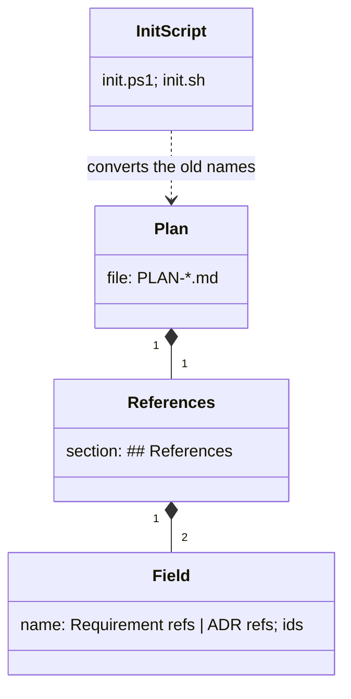
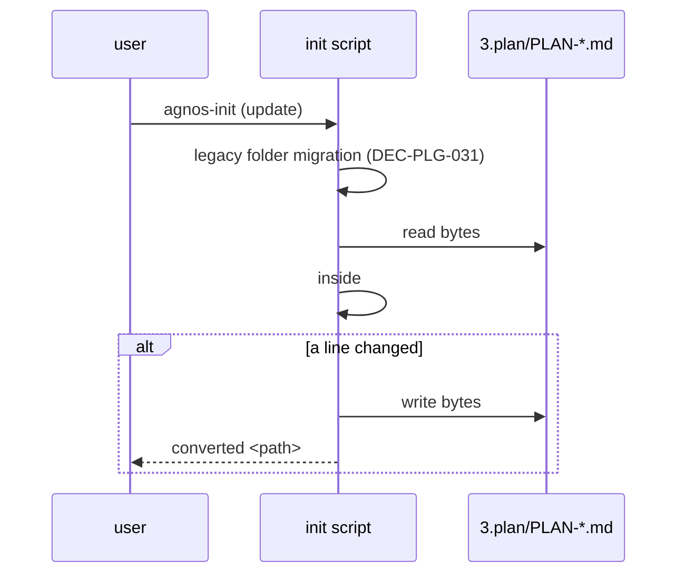

# ADR-INI-004: Plan reference field conversion

## Status
Accepted (owner, 2026-11-22) — for FTR-INI-003 (RQ-INI-022, RQ-INI-023). Extends ADR-INI-001 (DEC-INI-002, the bytes preserved) and the folder migration of DEC-PLG-031.

## Context
FTR-INI-003: the plan template names its references `Requirements` and `ADRs`, the task template `Requirement refs` and
`ADR refs`. A project initialised before holds plans written with the old names; `agnos-init`, called again at every update,
already migrates the legacy `process/` folder (DEC-PLG-031) and preserves every byte it does not own (DEC-INI-002), in a
PowerShell and a bash version that give the same bytes.

## Decision

### DEC-INI-016: Task field names for plan references
- **Statement**: The process file SHALL use `Requirement refs` and `ADR refs` as the field names of the plan template's `## References` section.
- **Rationale**: the task template already uses them for the same links; one name per kind of link lets `agnos-graph` keep one field table per type (DEC-TRC-082).
- **Requirement refs**: RQ-INI-022
- **Dependencies**: None

### DEC-INI-017: Line-wise conversion at every init run
- **Statement**: The init scripts SHALL apply, at every run and after the folder migration, a line-wise rename of the two field names, restricted to the `## References` section of each `PLAN-*.md` of the plan folder, writing a file only when a line changed.
- **Rationale**: running at every call needs no version detection and is idempotent; a line-wise rename on the bytes keeps the line endings, the encoding and every other line, as the block update does (DEC-INI-002); restricting it to the section leaves a task's own fields untouched.
- **Requirement refs**: RQ-INI-023
- **Dependencies**: DEC-INI-016, DEC-INI-002, DEC-PLG-031

## Consequences
- Easier: a reader, an author and `agnos-graph` find the same field names in plans and tasks.
- Harder: both scripts must give the same bytes on the conversion too; the tests run them on the same files.
- Constrained: a plan whose author wrote the old names outside `## References` keeps them there; the old names stay valid
  text, read as plain text by `agnos-graph`.

## Alternatives Considered
- **A one-off conversion script delivered beside the release**: an extra step for every project, easy to forget. Rejected.
- **`agnos-graph` reading both names**: no conversion, but two names for one link forever. Rejected (owner, 2026-11-22).
- **Conversion of the whole plan file**: simpler, but rewrites a task's field an author named `Requirements`. Rejected.

## Diagram

