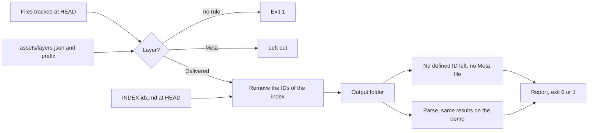

# ADR-MTA-002: How the Release is Rehearsed

## Status
Accepted — approved by the owner on 2026-10-31, for FTR-MTA-002 (RQ-MTA-006 to RQ-MTA-014). Adjusts DEC-MTA-002 (files it did not place) and DEC-MTA-004 (how a release is
validated, as DEC-MTA-006 already did).

## Context
DEC-MTA-004 leaves its how open. Measured at `6d31347`: 58 candidate files, 48 of them holding 1,094 citations of defined IDs, mostly in
comments, docstrings, `_comment` keys and `--help` strings. Sampling found no ID that the code reads at run time. In delivered Markdown, 89 lines
show IDs outside any comment, against the traceability rule: 76 in `CHANGELOG.md`, and 13 in `agnos-perf-center`'s `rules.md` and `maintaining.md` and
in `agnos-index`'s `SKILL.md`, as headings or in parentheses, sometimes mixed with other words. Citations span lines, as in `CHANGELOG.md`. `RQ-ABC-001` and `DEC-USR-001`
are examples, undefined in the index. Four tracked files have no layer in DEC-MTA-002: `.gitignore`, `.gitattributes`, `agnos-overview.png`
and `.claude/settings.json`, which allows `git checkout *`. `verify.ps1` cannot judge a release: RQ-DMO-001 wants the demo beside the
toolkit given, and RQ-DMO-020 wants `agnos-meta-demo` in it.

## Decision

### DEC-MTA-007: One Python script
`agnos-meta-release` is one script using the standard library, as `agnos-perf-center`'s generator already needs Python, so one
behaviour on the three platforms, with no twin PowerShell and bash versions to keep equal. Fulfils RQ-MTA-013.

### DEC-MTA-008: Layers as rules, and the files left out of DEC-MTA-002
`assets/layers.json` holds patterns of delivered and meta paths; the prefix `agnos-meta-` stays the only criterion for skills and
sub-agents, and no list of skills is kept. Delivered: `.gitignore`, `.gitattributes` and `agnos-overview.png` go in the public repository
or the toolkit. Not delivered: `.claude/settings.json`, as a toolkit does not grant permissions in the name of its users. A file matching
nothing stops the build. Adjusts DEC-MTA-002. Fulfils RQ-MTA-008.

### DEC-MTA-009: Removal by text rules, then a check that reads the output
What to remove comes from the trigrams of the commit's index, not from its list of IDs: a mistyped or deleted ID of the workshop goes too, and the
examples stay as long as they use another trigram (`EXP`, `ABC`, `USR`, 113 occurrences today). Rules work on the whole file, since citations span lines:
an ID list in parentheses goes with them, IDs mixed with other words leave those words, a comment of IDs alone goes with its line, a leading `<ids>:` goes and the next letter takes a capital,
ranges and separators go with their IDs. Any other line stays byte-exact. RQ-MTA-010 then searches the output for what is left, and what
the rules cannot judge goes in the report. No file of the workshop changes. Fulfils RQ-MTA-009, RQ-MTA-010, RQ-MTA-012.

### DEC-MTA-010: Equivalence on the demo, rather than `verify`
The release proves itself by comparing what the workshop's and the output's skills write on the demo, plus a parse of each script: this
tests the edited code directly, with no change to `verify.ps1`. Adjusts DEC-MTA-004 and DEC-MTA-006, which named the demo's acceptance
checks; these remain the workshop's check of the demo. Fulfils RQ-MTA-011.

### DEC-MTA-011: The rehearsal only, for now
Without `--dry-run` the skill refuses. The `copy` target's folder is all it writes: a commit on `main`, a tag and a push come with the
owner's publishing decision, with their own requirements. Fulfils RQ-MTA-006, RQ-MTA-007.

## Consequences
- A new tracked file outside the known rules stops the next rehearsal until it is classified.
- An example written with a workshop's trigram would be removed: examples keep trigrams the workshop does not use.
- A sentence that reads badly after a removal is listed, not fixed. It is corrected in the workshop, by rewording it.
- Comparing outputs needs the demo built and Python; nothing more.
- Equivalence covers the three skills that write files. `agnos-git-workflow` and `agnos-design-system` get the parse check only.
- The page's HTML differs by its comments, so the comparison reads its data, not the page itself.

## Alternatives Considered
- **Parsers per language for the comments**: exact on code, but six parsers for 590 lines of mostly regular text, and useless on prose. Rejected.
- **Marking citations in the sources to strip them**: 1,094 edits, and the rule binds every future citation. Rejected.
- **Running the skills' tests on the output**: they assert the workshop's layout and read the files they would need. The equivalence is simpler and direct. Rejected.
- **Failing on a badly reading line**: no rule can tell reliably, so it would stop on false alarms. Rejected.
- **Running `verify.ps1` on the output**: fails on two checks that are right about the workshop. Rejected.

## Diagram

