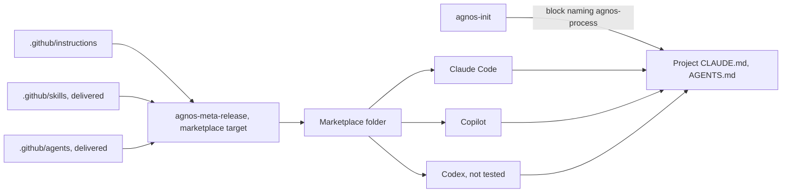

# ADR-PLG-001: One Marketplace for Three Tools

## Status
Accepted — approved by the owner on 2026-11-01, for FTR-PLG-001 (RQ-PLG-001 to RQ-PLG-009). Amends DEC-MTA-004, DEC-MTA-005, DEC-INI-003, DEC-INI-004 and DEC-INI-005. DEC-PLG-001, DEC-PLG-005 and DEC-PLG-006 amended by DEC-PLG-033 (ADR-PLG-008, 2026-11-15): Codex is withdrawn.

## Context
FTR-PLG-001 (RQ-PLG-001 to RQ-PLG-009) delivers AGNOS as a plugin. DEC-MTA-005 planned a plugin beside a copy format, and DEC-INI-005
left the path of the installed files to design. The owner abandoned the copy format and asked for one marketplace, Windows first and
other systems supported, with no push.

A throwaway trial on 2026-10-31, outside the repository, used a mini marketplace with markers: Claude Code 2.1.314 on Haiku, Copilot CLI
1.0.105 on its `Auto` model (the only one available to this account in the CLI), both on Windows, with isolated configurations for the installs.

| Question | Claude Code | Copilot CLI |
|---|---|---|
| Root `plugin.json` and `.claude-plugin/plugin.json` together | installs, `validate --strict` passes on the plugin | installs |
| `.claude-plugin/marketplace.json` from a local folder | installs | installs |
| A skill found by its name, no path | yes | yes |
| Script named relative to the skill's folder | found | found |
| Script named with `${CLAUDE_SKILL_DIR}` | found | variable empty, call failed, the model recovered by itself |
| Plugin agent in `agents/` | listed and run | ignored |
| Plugin agent in `com.github.copilot/agents/` | ignored | listed, body applied, tested with no read tool |
| Block naming a skill, on a work question | not run | skill loaded |
| Block naming a skill, on a trivial question | skill loaded | not loaded, while a direct sentence in `AGENTS.md` is obeyed |
| Same question, no block (control) | not loaded | not loaded |

Not known: Codex, absent from this machine; the install from a remote, since both tools read a local marketplace in place, with no copy.

## Decision

### DEC-PLG-001: One marketplace, one plugin, built by the release
`agnos-meta-release` gets a marketplace target. It writes:

```
.claude-plugin/marketplace.json     Claude Code, Copilot
.agents/plugins/marketplace.json    Codex
README.md  LICENSE  CHANGELOG.md  GETTING_STARTED.MD  agnos-overview.png  .gitignore  .gitattributes
plugins/agnos/plugin.json           Agent Plugins schema: Copilot, Codex
plugins/agnos/.claude-plugin/plugin.json
plugins/agnos/skills/<skill>/...    the delivered skills, and agnos-process
plugins/agnos/agents/               generated, Claude Code
plugins/agnos/com.github.copilot/agents/   generated, Copilot
```

The root holds what a public marketplace needs: the format requires a README and a license, the rest tells a user what AGNOS is and how
it changed. `CLAUDE.md`, `AGENTS.md`, `.github/`, `.claude/`, and the files addressed to the workshop's contributors (`CONTRIBUTING.md`,
`SECURITY.md`, `CODE_OF_CONDUCT.md`, the issue and pull request templates) are not in it. Fulfils RQ-PLG-001, RQ-PLG-002. Replaces the
`plugin` target and the copy format of DEC-MTA-005, and the `copy` target of DEC-MTA-004.

### DEC-PLG-002: The process is a generated skill
The build writes `agnos-process/SKILL.md` from `.github/instructions/agnos-sw-eng.instructions.md`, which stays the only source, with a
frontmatter added by the build. No file of the workshop holds this skill. Fulfils RQ-PLG-003.

### DEC-PLG-003: The block names the skill, with no path and no toolkit input
`agnos-init` writes one wording in both files: before any other action, invoke the skill named `agnos-process` and follow it. `-Toolkit` and
`{{TOOLKIT}}` are removed. Copilot does not load the skill on a trivial question and does on a work question, which is enough: a question
that involves no work needs no process. A session on the demo runs with the plugin installed, and the demo's block becomes the same for
everyone, which keeps its commit IDs stable. Fulfils RQ-PLG-004. Amends DEC-INI-003, DEC-INI-004, DEC-INI-005, and RQ-INI-001, RQ-INI-006,
RQ-INI-008.

### DEC-PLG-004: Skills name their files from their own folder
The canonical `SKILL.md` files are rewritten once, in the workshop, with no rewriting by the build: scripts are "`scripts/x` of this skill's
folder", and commands run from the project's root. The wording works in the workshop too, since its `.claude/skills` pointers lead to the
canonical file. This replaces the rewriting by the build planned in DEC-MTA-005. No `${CLAUDE_SKILL_DIR}`, which Copilot leaves empty.
Fulfils RQ-PLG-005.

### DEC-PLG-005: Agents are generated from `.github/agents`
One definition per agent, as decided for `agnos-meta-docs-sync` (RQ-DOC-003). A table in the release's assets maps each tool's frontmatter
(tools, model); an unmapped value stops the build. Claude Code reads `agents/<name>.md`, Copilot `com.github.copilot/agents/<name>.agent.md`.
Codex gets none, since its documentation states no plugin distribution of agents. AGNOS delivers no agent today, so the mechanism is proved on
a test agent. Fulfils RQ-PLG-006.

### DEC-PLG-006: Tested on Windows and Linux, the rest stated
Windows is the primary target and Ubuntu 24.04 under WSL proves Linux. The owner keeps the no-push rule, which rules out a CI, so macOS stays not
tested and is stated as such, sharing the Linux scripts. Codex receives its catalogue and manifest from the documentation, and is stated as not
tested until the owner installs it. Fulfils RQ-PLG-008.

### DEC-PLG-007: No push, and an install from a clean local clone
The output stays in a local folder. The install proof uses a clean git clone of it through a `file://` URL if the tools accept one, to come
closest to a remote and to the per-version folder of Claude Code; if they do not, the proof states that the install read the folder in place and
that a remote install is untested. Publishing is a later decision. Fulfils RQ-PLG-009, DEC-MTA-004.

## Consequences
- Easier: one install command per tool, a project holds no path, and an update of the plugin breaks nothing.
- Easier: the demo and the workshop no longer need a folder layout between them.
- Harder: a project can no longer use AGNOS without the plugin; an agent without plugins is no longer served.
- Harder: every `agnos-meta-demo` script and check that calls `agnos-init` with a toolkit path has to change, and the demo is rebuilt.
- Constrained: an agent's frontmatter values must be in the table, and a new tool means a new column.
- Accepted risk: the block relies on the model obeying it. Measured on two tools only, and weaker on Copilot's `Auto` model.

## Alternatives Considered
- **One manifest in `.claude-plugin/` (the study's Mode A)**: simpler for two tools, and it would let one `agents/x.agent.md` serve both, but it relies on Copilot's legacy lookup and Codex documents only the root and `.codex-plugin/`. Rejected for the third tool.
- **`.agents/` as the canonical folder (the study's Mode C)**: moves every skill of the workshop for no benefit to a user, since the build generates the output anyway. Rejected.
- **`${CLAUDE_PLUGIN_ROOT}` in skills (in the study)**: Copilot documents this alias for MCP and agent `mcp-servers`, and the trial's equivalent variable stayed empty in a skill body. Rejected.
- **A path in the block, supplied by the plugin (DEC-INI-005)**: the installed folder holds the version, so it breaks at each update. Rejected.
- **A CI for Linux and macOS**: needs a push, excluded by the owner. Rejected.
- **A separate repository for the marketplace now**: nothing leaves the machine yet. Left to the publication decision.

## Diagram

