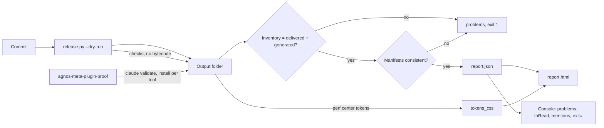

# ADR-PLG-002: A Deterministic Release and its Report Page

## Status
Accepted — approved by the owner on 2026-11-03, for FTR-PLG-002 (RQ-PLG-012 to RQ-PLG-017). Amends RQ-MTA-012 on the summary line. DEC-PLG-010 amended by DEC-PLG-037 (ADR-PLG-009, 2026-11-15): the strict validation accepts the `logo` warning.

## Context
FTR-PLG-002 (RQ-PLG-012 to RQ-PLG-017) comes from the rehearsal of `1361a8b` on 2026-11-03. Its `sameBehaviour` check ran the output's
Python in place, which left `__pycache__` in the marketplace. Claude Code was absent, the script said so on the error stream and exited 0.
The exit code and the two lines to read reached the owner only because an agent opened the JSON. The owner asked for a release that gives
the same result whoever runs it, and a page to read its report.

## Decision

### DEC-PLG-008: No cache written, and an inventory of the output
Every subprocess the release starts gets `PYTHONDONTWRITEBYTECODE=1`, and the release itself runs with no bytecode written into the output.
After the checks, the release lists the files on disk and compares them with the delivered and generated paths: any other file is a problem,
named in `problems`. Fulfils RQ-PLG-012, RQ-PLG-013.

### DEC-PLG-009: The console holds the report's verdict
The script prints `problems`, `toRead`, `mentions` and `idsOutsideComments` as `file:line: text`, all on the standard output so
that their order holds, then one last line: `agnos-meta-release: exit=<n>, <files> files, <ids> IDs removed, <lines> lines to read,
<output> written in <s> s`, or `exit=<n>, nothing written in <s> s` after a refusal, which stays on the error stream. The JSON is
unchanged apart from the new keys, and stays the input of tools. Fulfils RQ-PLG-014; amends the summary line of RQ-MTA-012.

### DEC-PLG-010: The release checks the manifests by script, the proof by the tools
The release reads the four manifests and catalogues it wrote and checks their required fields, the paths they name, and that name, version
and description agree; the result is `checks.manifests`. It no longer calls `claude plugin validate`, nor reads `AGNOS_CLAUDE`: that
validation, and the real install, stay in `agnos-meta-plugin-proof` (RQ-PLG-010), which already runs them for each tool present. The
required fields are those of the formats as documented and observed in the trial of ADR-PLG-001; a format change is caught by the proof.
Fulfils RQ-PLG-015.

### DEC-PLG-011: The page is built from a template, its data embedded
A template in the release's assets, `report.html`, receives the report's JSON as an escaped `<script type="application/json">` block, and a
short inline script draws the sections with `textContent` only. No library, no network, no second file. Fulfils RQ-PLG-016.

### DEC-PLG-012: The perf center's tokens, read from the commit rehearsed
The page's custom properties are compiled from the output's `agnos-perf-center/assets/tokens.json` by the output's own `tokens_css`
(DEC-TRC-009), so the page follows the design system of the commit rehearsed, and the release adds no token file. Its stylesheet uses only
`var(--…)` of those tokens. Fulfils RQ-PLG-017, under ADR-TRC-002.

## Consequences
- Easier: whoever runs the release, agent or person, sees the same verdict; the owner reads one page.
- Easier: a stray file in the output can no longer reach a user.
- Easier: a maintainer with GitHub Copilot only, or no AI tool, gets the same verdict as with Claude Code.
- Harder: the release's manifest rules must follow the formats; the proof catches a drift, not the release.
- Constrained: the page depends on the perf center's token names; renaming a token it uses fails the release's tests.

## Alternatives Considered
- **Delete `__pycache__` after the checks**: hides the symptom, leaves any other stray file unseen. Rejected for the inventory.
- **Run the checks on a copy of the output**: doubles the copy for the same guarantee as no bytecode plus the inventory. Rejected.
- **Keep the console as is, the agent reads the JSON**: the result depends on the agent, the owner's complaint. Rejected.
- **A token file of the release's own**: a second design system to maintain for one page. Rejected by the owner on 2026-11-03.
- **Claude Code's validation required, `--no-validate` to skip it**: a Copilot-only maintainer could never release validated, and the verdict would depend on the machine. Rejected by the owner on 2026-11-03.
- **Claude Code's validation kept as an extra when present**: duplicates the proof and makes the verdict depend on the machine. Rejected.
- **The perf center's page template**: built for a large interactive page, far more than a report needs. Rejected.

## Diagram

