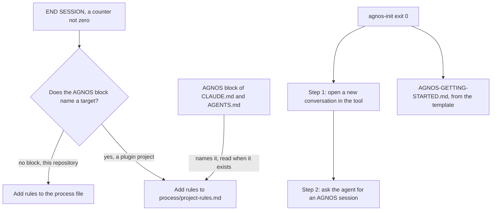

# ADR-PLG-003: The Process Speaks to a Plugin User

## Status
Accepted — approved by the owner on 2026-11-04, for FTR-PLG-003 (RQ-PLG-018 to RQ-PLG-022); DEC-PLG-018 for RQ-PLG-023, the same day. Amends RQ-PLG-004 and DEC-PLG-003 on the block's paths, and RQ-DOC-001, RQ-DOC-002, RQ-INI-007 on the guide's location.

## Context
FTR-PLG-003 (RQ-PLG-018 to RQ-PLG-022) comes from the owner's Claude Code session of 2026-11-04 on a new repository with the plugin
installed. The process is one file, written for this repository and delivered as the `agnos-process` skill (DEC-PLG-002). Two of its
passages assume the project holds that file: the self-improvement follow-up adds rules to "this file", and the line budget names it
`agnos-sw-eng.instructions.md`. In a plugin user's project the file sits in the plugin's cache, overwritten at each update. Separately,
`agnos-init`'s skill ends by telling the user to "start a new session", a word the process uses for its own sessions.

## Decision

### DEC-PLG-013: The block declares the improvement target
The `agnos-init` block of `CLAUDE.md` and `AGENTS.md` gains one line: read `process/project-rules.md` when it exists, the project's own
rules added to the process, and put the process's improvements into that file. The RECURSIVE SELF-IMPROVEMENT section defines the
improvement target once: the file the project's AGNOS block names, this file otherwise; the END SESSION step refers to that target.
This repository's `CLAUDE.md` imports the instructions and holds no block, so its target stays this file. The agent has read the block
before loading the process, so the test needs no path of its own, which a tool may not give (`<skill-folder>`, DEC-PLG-004). The same
process text holds in both places, so the release generates the skill as before. A read instruction, not Claude Code's `@` import, so
the same line serves every tool; `AGENTS.md` has no import. A conflict between that file and the process is reported as START SESSION
step 7 says. Fulfils RQ-PLG-018; amends RQ-PLG-004 to "no path outside the project".

### DEC-PLG-014: The process says "this file"
The line budget says "this file" and drops the file name. The release keeps replacing only the path it already replaces. Fulfils RQ-PLG-019.

### DEC-PLG-015: The init's last words in two steps, in its skill
`agnos-init`'s SKILL.md states the two steps: a new conversation in the tool, then an AGNOS session asked for in it. The scripts, whose
output is byte-tested on both platforms, are unchanged. Fulfils RQ-PLG-020.

### DEC-PLG-016: A getting-started file owned by AGNOS, from a template
`agnos-init`'s scripts write `AGNOS-GETTING-STARTED.md` at the project's root from `assets/templates/AGNOS-GETTING-STARTED.md`, as they
write the block: the same bytes on both platforms, reported `created`, `updated` or `unchanged`. The file is AGNOS's, not the
developer's: its first line says so, and each call rewrites it whole, so an update of the plugin reaches it by calling `agnos-init`
again. The success step of the init's skill points to it. Fulfils RQ-PLG-021.

### DEC-PLG-017: The former guide becomes the template, and docs-sync follows it
`GETTING_STARTED.MD` is reworded for a user of the plugin into the template of DEC-PLG-016, then removed from the root: the
release no longer delivers it, and the marketplace's `README.md` sends the user to the file `agnos-init` writes. `agnos-meta-docs-sync`
keeps four documents, the fourth being the template, under the rules RQ-DOC-002 gave the guide. Links from `README.md`,
`CONTRIBUTING.md` and the issue template follow. Process documents that cite `GETTING_STARTED.MD` are history and stay. Fulfils
RQ-PLG-022; amends RQ-DOC-001, RQ-DOC-002 and RQ-INI-007 on the guide's location.

### DEC-PLG-018: One reader per document
Added on 2026-11-04, after the owner's review of the README. `README.md` addresses the plugin user only: what AGNOS is, its skills,
its requirements per platform, read from the skills themselves (Python only for `agnos-perf-center`, the call graph's packages
installed by the user, never fetched), getting started in three steps ending on the guide, and a reference to `COMPATIBILITY.md`
that states nothing of what was tested. That new root file, delivered by a
release layer rule, holds the table of what was tested per tool and system, and is the only place stating it: the changelog says what
each release holds, and the guide, copied into projects, would let it age there. How a session runs and the concepts are the guide's,
which gains the table of artifacts and the identifier format, the only part it lacked; the repository map moves to `CONTRIBUTING.md`,
read by contributors and not delivered. Fulfils RQ-PLG-023; amends RQ-PLG-008 on where what was tested is stated.

## Consequences
- Easier: a plugin user's improvements survive updates, stay theirs, and stay apart from what they write in `CLAUDE.md` and `AGENTS.md`.
- Harder: every project's block changes once; `agnos-init` called again updates it, and the demo is rebuilt.
- Easier: the user is told one clear action at a time after `agnos-init`.
- Constrained: the line budget applies to this file only; in a plugin user's project, what is added is bounded by the lines the user allows.
- Constrained: a project set up without `agnos-init`'s block keeps "this file" as its target, as this repository does.
## Alternatives Considered
- **Rules written in `CLAUDE.md` and `AGENTS.md`, outside the block**: no block change, but the same rule written twice, mixed with
  the developer's text. Rejected by the owner on 2026-11-04 for a dedicated file.
- **Target decided by whether the file read lies in the project's folder**: unclear to the owner, and a tool may not give the path of a
  skill's file. Rejected on 2026-11-04 for the target named by the block.
- **The process, not the block, reads the file**: no block change, but the rules are lost whenever the skill is not loaded, and the
  user does not see where they come from. Rejected.
- **Rules sent to AGNOS's maintainers**: keeps the process the same everywhere, but the user's friction is not addressed in their
  project. Rejected by the owner on 2026-11-04.
- **No self-improvement outside this repository**: drops a feature the metrics exist for. Rejected by the owner on 2026-11-04.
- **A different process text generated for the plugin**: two texts for one rule, and a release that rewrites meaning. Rejected.
- **The release replaces the bare file name too**: a rewrite for a name that tells the user nothing. Rejected for "this file".
- **The guide removed, a short page of steps only**: the worked example is lost. Rejected by the owner on 2026-11-04.
- **A short page pointing to the guide in the plugin's folder**: two documents, one of them out of the user's repository. Rejected.
- **The written file named `GETTING_STARTED.MD`**: `agnos-init` would overwrite a guide of the developer's own. Rejected for the prefix.
- **A README in three titled parts, use, understand, contribute**: keeps everything, but still three readers on one page and the
  concepts written twice. Rejected by the owner on 2026-11-04.
- **What was tested under each release of `CHANGELOG.md`, or in the guide**: the changelog only says what a release holds, and the
  guide ages in each project. Rejected by the owner on 2026-11-04 for `COMPATIBILITY.md`.
- **The concepts in a document of their own**: a third user document beside the README and the guide. Rejected by the owner on
  2026-11-04.
- **The getting-started steps in the block**: loaded into every conversation, for steps read once. Rejected.
- **The file written once, then left to the developer**: an update of the plugin could never correct it. Rejected.
- **The init scripts print the next steps**: changes two scripts and their byte-tested output for a sentence the agent restates anyway.
  Rejected.

## Diagram

