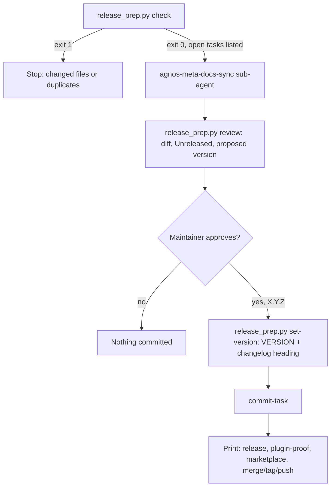

# ADR-PLG-005: Release Preparation

## Status
Accepted (owner, 2026-11-06) — for FTR-PLG-005 (RQ-PLG-027 to RQ-PLG-033). DEC-PLG-026 amends DEC-PLG-016. DEC-PLG-025 and DEC-PLG-026 amended by DEC-PLG-032 (ADR-PLG-007, 2026-11-07): the file is `VERSION.txt`.

## Context
FTR-PLG-005: the steps before a release (sync the documents, review, choose a version, commit) are written nowhere as one
procedure; on 2026-11-05 the marketplace was regenerated with stale documents. `agnos-meta-release` reads the latest released
version of `CHANGELOG.md` and ignores `[Unreleased]`, and is also used to rehearse during development, while `[Unreleased]` is full.

## Decision

### DEC-PLG-022: A maintainer skill with a deterministic script and an agent's procedure
`agnos-meta-release-prep`, under `.github/skills/` with its Claude Code pointer, prefixed `agnos-meta-` so the release leaves it out.
`scripts/release_prep.py` holds what can be decided without a model: `check` (clean tree, `agnos-index`, open tasks: RQ-PLG-027),
`review` (changed files, unexpected ones, `[Unreleased]`, proposed version: RQ-PLG-028), `set-version <vX.Y>` (RQ-PLG-029). The
SKILL.md orders them around what needs an agent or a person: the `agnos-meta-docs-sync` sub-agent, the user-question tool for the
approval, `commit-task`, and the printed next steps (RQ-PLG-030). Python, as the other meta skills, one script on all platforms.

### DEC-PLG-023: The version is proposed from the changelog's sections, chosen by the maintainer
From `VERSION`: next major when `[Unreleased]` holds `### Removed`, next minor when it holds `### Added` or `### Changed`, next patch
for `### Fixed` only. The maintainer may give another version, accepted if it is SemVer 2.0.0 (the specification's regular
expression, pre-release and build metadata included) and above the current one by SemVer precedence. Fulfils RQ-PLG-028, RQ-PLG-029.

### DEC-PLG-024: The release reports the unreleased entries without failing
`release.py` counts the bullets under `## [Unreleased]` of `CHANGELOG.md` at the rehearsed commit; when the count is above 0, it
prints `unreleased: <n> entries, version <VERSION> delivered` and records `unreleased_entries` in its report and on its page. The exit
code is unchanged, so a rehearsal during development still passes. Fulfils RQ-PLG-031.

### DEC-PLG-025: `VERSION` among the init's templates is the single source of the version
`.github/skills/agnos-init/assets/templates/VERSION`: one line, SemVer 2.0.0, no `v` prefix, created at `3.1.0` from the changelog's
`[v3.1]`. `release.py` reads it at the rehearsed commit instead of the changelog's latest heading and writes it into the four
manifests; it is delivered with the `agnos-init` skill, as the guide is (DEC-PLG-017), so no layer rule changes. Released sections of
the changelog stay as written (`[v3.1]` included); new headings take the bare version, as Keep a Changelog shows it. Fulfils RQ-PLG-032.

### DEC-PLG-026: `agnos-init` writes the guide and the version into `agnos-process/`
`init.ps1` and `init.sh` write `agnos-process/AGNOS-GETTING-STARTED.md` and `agnos-process/VERSION` from their templates, as they write the guide
today, reported `created`, `updated` or `unchanged`. A root `AGNOS-GETTING-STARTED.md` whose first line is AGNOS's is removed and
reported `moved`; any other is left. `agnos-index` reads only the subfolders of `agnos-process/`, so neither file is indexed. The init's
success step, `README.md` and the guide's own references name `agnos-process/AGNOS-GETTING-STARTED.md`. Both names are declared
once in `layout.json` (`guide`, `version`) and read by the scripts from their copies (RQ-PLG-036); the check matches a name of the
layout standing alone, so that a copy's constant such as `AGNOS_VERSION` is not one. Fulfils RQ-PLG-033; amends
RQ-PLG-021 and DEC-PLG-016 on the guide's location.

## Consequences
- Easier: one command prepares a release; the documents and the version are reviewed together; the release says when a commit was not prepared.
- Harder: one more meta skill to maintain, and its tests.
- Easier: the documents and the perf center can show the version by reading one file, in this repository or in a project.
- Harder: projects initialised before see their root guide moved at the next `agnos-init`.
- Constrained: the preparation needs a clean working tree; `VERSION` changes only through the preparation, so a hand edit
  would bypass the review.

## Alternatives Considered
- **Docs-sync called by `agnos-meta-release`**: the release reads a commit and edits nothing; editing would break its byte-for-byte
  reproducibility (RQ-MTA-013). Rejected.
- **The release refuses a non-empty `[Unreleased]`**: blocks every rehearsal during development. Rejected for a reported line.
- **The skill commits without asking**: the documents and the version are the maintainer's decision. Rejected.
- **The changelog's latest heading as the version**: today's source; a Markdown heading to parse wherever the version is shown,
  and two-part (`v3.1`). Rejected for `VERSION` (owner, 2026-11-06).
- **`VERSION` at the repository's root, copied by the release into the plugin**: two places in the delivered tree, and `agnos-init`
  run from this repository (the demo's build) would not find it. Rejected.
- **The version in `assets/marketplace.json` or a `pyproject.toml`**: a maintainer asset not delivered, or a Python packaging file
  for a repository that is not a package. Rejected.
- **The procedure in SKILL.md only, no script**: the checks and the version rewrite would depend on the model. Rejected.

## Diagram

