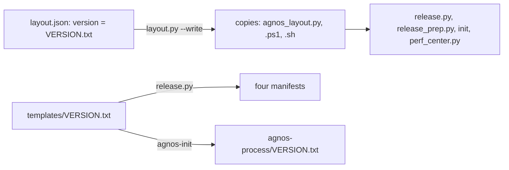

# ADR-PLG-007: The Version File is `VERSION.txt`

## Status
Accepted (owner, 2026-11-07) — for RQ-PLG-032, RQ-PLG-033, RQ-PLG-036. DEC-PLG-032 amends DEC-PLG-025 and DEC-PLG-026 on the file's name.

## Context
DEC-PLG-025 named the version file `VERSION`, declared once in `layout.json` (`version`, RQ-PLG-036). The Python copy of the layout
holds `VERSION = 'VERSION'`: the constant's name equals its value, so a script reading `agnos_layout.VERSION` looked like one writing
the name out, and `layout.py --check` refused it (TASK-TRC-101, fixed in the check by TASK-PLG-050). A file without extension also says
nothing of its content to an editor or a reader. No release of AGNOS has delivered `VERSION`: no project holds `agnos-process/VERSION`.

## Decision

### DEC-PLG-032: The version file is `VERSION.txt`, holding only the SemVer version
The file is `.github/skills/agnos-init/assets/templates/VERSION.txt` in this repository and `agnos-process/VERSION.txt` in a project:
one line, the SemVer 2.0.0 version and nothing else, no `v` prefix (DEC-PLG-025 unchanged otherwise). `layout.json` declares
`"version": "VERSION.txt"`; the copies are regenerated by `layout.py --write`; every script reads the name from its copy, as before.
`.txt`, not `.md`: the content is not Markdown. No migration of a former `agnos-process/VERSION`: none was ever released (owner,
2026-11-07). Amends DEC-PLG-025 and DEC-PLG-026, RQ-PLG-032 and RQ-PLG-033 on the name only.

## Consequences
- Easier: the name tells what the file holds; the layout's value differs from its copy's constant name.
- Harder: about 30 files cite the name and are updated once, by this decision's task.
- Constrained: a project initialised from this repository before the change keeps a stray `agnos-process/VERSION`, removed by hand;
  only development copies such as the demo are concerned, rebuilt by `agnos-meta-demo`.

## Alternatives Considered
- **Keep `VERSION`**: the check now accepts `agnos_layout.VERSION` (TASK-PLG-050), but the name stays silent on its content. Rejected by the owner.
- **`VERSION.md`**: the owner's first proposal; the content is a bare version, not Markdown. Rejected for `.txt` (owner, 2026-11-07).
- **Migrate `agnos-process/VERSION` in `agnos-init`**: code and tests for a file no released project holds. Rejected.

## Diagram

