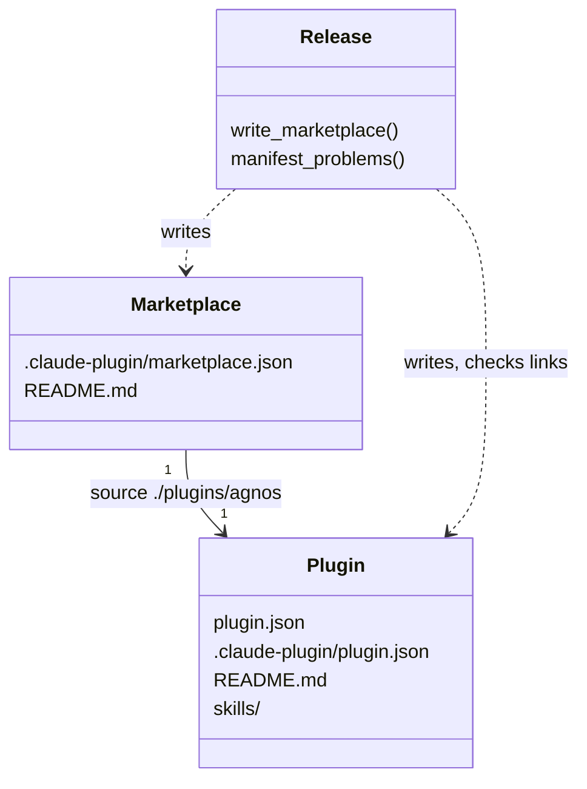
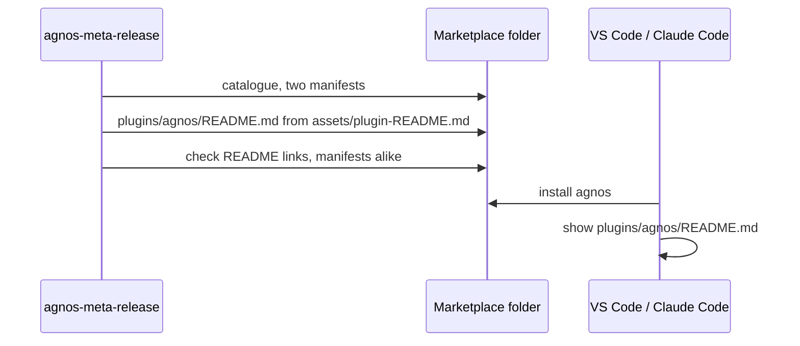

# ADR-PLG-008: Marketplace tool scope

## Status
Accepted (owner, 2026-11-15) — for FTR-PLG-008 (RQ-PLG-042, RQ-PLG-043). DEC-PLG-033 amends DEC-PLG-001, DEC-PLG-005 and DEC-PLG-006 of ADR-PLG-001 on Codex.

## Context
ADR-PLG-001 built one marketplace for three tools, Codex receiving a catalogue from its documentation, never tested (DEC-PLG-006).
On 2026-11-15 the owner withdrew Codex from what is delivered (RQ-PLG-043). The same day VS Code reported no README for the installed
plugin: it reads `README.md` in the plugin's folder, `~/.copilot/installed-plugins/<marketplace>/<plugin>/`, while the release writes
the README at the marketplace's root only (RQ-PLG-042). The root README cannot be copied there: its links lead from the root into
`plugins/agnos/` (RQ-PLG-008).

## Decision

### DEC-PLG-033: Claude and Agent Plugins manifests only
- **Statement**: The release SHALL write `.claude-plugin/marketplace.json`, the root `plugin.json` and `.claude-plugin/plugin.json` only, for Claude Code and GitHub Copilot.
- **Rationale**: the trial of ADR-PLG-001 and COMPATIBILITY.md show both tools install from these files; the `.agents/plugins/` catalogue served Codex alone.

### DEC-PLG-034: Plugin README from a release asset
- **Statement**: The release SHALL copy `assets/plugin-README.md` to `plugins/agnos/README.md`, and check that each relative link it holds leads to a file of the plugin.
- **Rationale**: the VS Code agent-plugin reference shows the README "when provided"; the path VS Code reported is the plugin's folder.

## Consequences
- Easier: one catalogue to keep, and no untested tool promised to a user.
- Easier: VS Code shows the plugin's README after its install.
- Harder: delivering Codex later means a new ADR and a catalogue again.
- Constrained: the plugin README is written for links from `plugins/agnos/`, a second text beside the root README.

## Alternatives Considered
- **Copy the root README into the plugin**: its links break from `plugins/agnos/`. Rejected.
- **Rewrite the root README's links for the plugin**: one text for two readers, the marketplace's visitor and the installed plugin's user (DEC-PLG-018). Rejected.
- **Keep the Codex catalogue, untested**: the owner withdrew it. Rejected.

## Diagram

