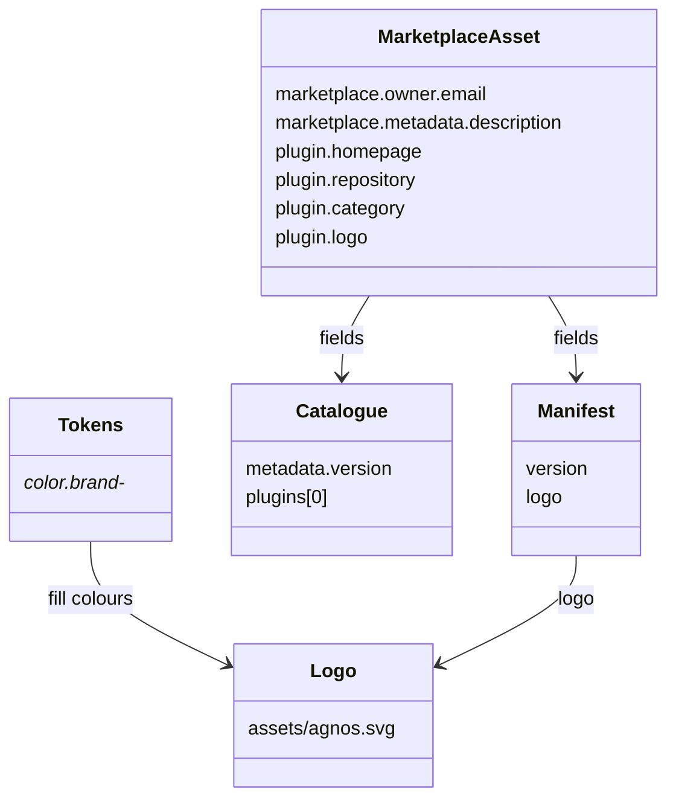
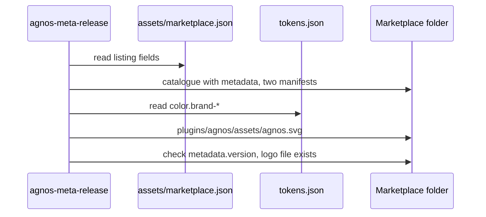

# ADR-PLG-009: Plugin listing metadata

## Status
Accepted (owner, 2026-11-15) — for FTR-PLG-009 (RQ-PLG-044 to RQ-PLG-046). DEC-PLG-035 amends DEC-PLG-001 of ADR-PLG-001 on what the manifests and the catalogue hold; DEC-PLG-037 amends DEC-PLG-010 of ADR-PLG-002 on the strict validation.

## Context
The release writes the catalogue and the two manifests from `assets/marketplace.json` with a name, a version, a description,
an author's name, a license and keywords (DEC-PLG-001, DEC-PLG-033). The catalogue's description sits at its root, where the
catalogue format of both tools reads it in `metadata`. A Microsoft plugin installed from GitHub Copilot holds the project's links,
a category and a `logo` in its `.claude-plugin/plugin.json` (RQ-PLG-044, RQ-PLG-045, RQ-PLG-046). The brand mark exists in the
website's template, its colours as the `color.brand-*` tokens of the perf center (RQ-PLG-017, DEC-PLG-012).

## Decision

### DEC-PLG-035: Listing fields from the marketplace asset
- **Statement**: The release SHALL write every listing field from `assets/marketplace.json`, the catalogue's description and version in `metadata`, and check that `metadata.version` equals the manifests' version.
- **Rationale**: one source for every field, as DEC-PLG-001 holds for the name and the description; the Microsoft example holds the version at both levels.

### DEC-PLG-036: Logo generated from brand tokens
- **Statement**: The release SHALL generate `plugins/agnos/assets/agnos.svg` from the brand mark's shapes and the `color.brand-*` tokens of the commit rehearsed, and check that the file a `logo` names exists.
- **Rationale**: MANDATORY DESIGN SYSTEM forbids a copied visual value; DEC-PLG-012 already reads the tokens from the commit rehearsed.

### DEC-PLG-037: Strict validation accepting the logo warning
- **Statement**: The plugin proof SHALL count a failed `claude plugin validate --strict` as passed when each warning it prints is the unknown field `logo`, and as failed on any other warning or error.
- **Rationale**: on 2026-11-15 the proof's validation warned "Unknown field 'logo' … Claude Code ignores unrecognized fields at load time, so it's safe to keep", while install and skills passed in both tools; the owner installed Microsoft's Azure DevOps plugin, whose Claude manifest holds a `logo`, in Claude Code without trouble. Amends DEC-PLG-010 on the tools' verdict.

## Consequences
- Easier: a tool shows the plugin with its links, keywords, category and logo.
- Easier: a change of a brand colour reaches the logo at the next release.
- Harder: the release's `assets/logo-template.svg` holds the brand mark's shapes, a second copy beside the website's template.
- Constrained: a field added to the listing goes into `assets/marketplace.json`, never into the script.

## Alternatives Considered
- **A committed `agnos.svg` asset**: its colours would be raw literals outside the tokens. Rejected.
- **The logo in the root manifest only**: the Microsoft plugin declares it in `.claude-plugin/plugin.json`, which GitHub Copilot reads. Rejected (owner, 2026-11-15, after the strict validation's warning).
- **Validation without `--strict`**: any warning would pass. Rejected.
- **Keep the description at the catalogue's root**: the format reads it in `metadata`. Rejected.

## Diagram

