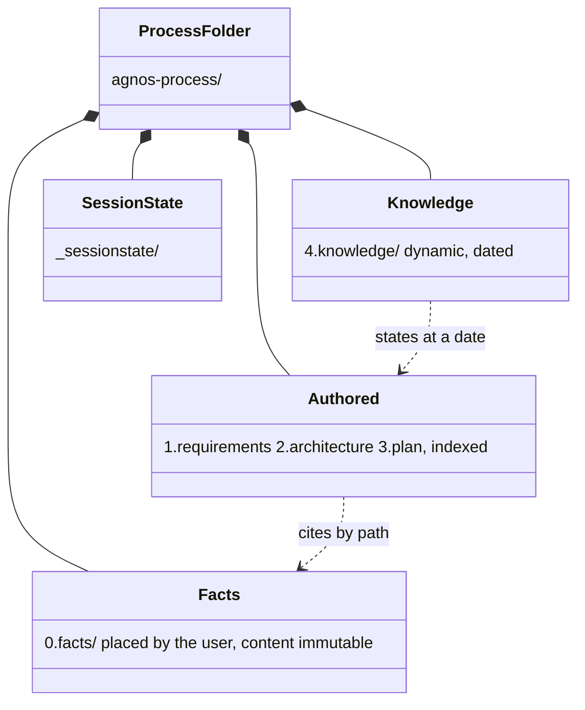
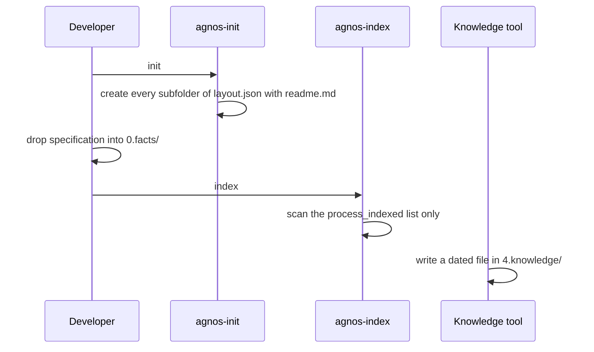

# ADR-PLG-010: Process folder content partition

## Status
Accepted (owner, 2026-11-22) — for FTR-PLG-010 (RQ-PLG-048 to RQ-PLG-050). Extends ADR-PLG-006 (DEC-PLG-027): the layout gains two subfolders and a
list of indexed subfolders.

## Context
FTR-PLG-010: the process folder holds what the project writes (`1.requirements/` to `3.plan/`) and its session state. It has no
place for normative inputs, which are true whatever the project decides, nor for dynamic knowledge produced by tools, true at
its date only. `agnos-index` scans every subfolder of `layout.json` except `_sessionstate`: a fact quoting an ID, or a generated
file, would become an indexed artifact.

## Decision

### DEC-PLG-038: Numbered subfolders for facts and knowledge
- **Statement**: `layout.json` SHALL declare `0.facts` and `4.knowledge` in `subfolders`, so that `agnos-init` creates both with their `readme.md`, the number giving their place before and after the authored artifacts.
- **Rationale**: the numbering already orders the folder by the flow of the work; facts come before requirements, knowledge after the plan. `agnos-init` already creates every subfolder of the layout (RQ-PLG-036).

### DEC-PLG-039: Indexed subfolders declared apart in the layout
- **Statement**: `layout.json` SHALL declare an `process_indexed` list (`1.requirements`, `2.architecture`, `3.plan`), and `agnos-index` SHALL scan only its subfolders, in place of excluding `_sessionstate`.
- **Rationale**: an explicit list keeps facts, knowledge and state out of the index, and a future subfolder out until it is declared indexed; the index's scripts already read their layout copy (DEC-PLG-027).

### DEC-PLG-040: User-placed immutable facts, dated knowledge
- **Statement**: The instructions file SHALL state that the user places the facts in `0.facts/`, that AGNOS never changes a fact's content but a skill may transform it technically and index it with unique IDs, and that each file a skill writes in `4.knowledge/` carries its production date.
- **Rationale**: owner, 2026-11-22: facts are the user's inputs, later converted (to Markdown, for example) and given a deterministic index of IDs the project cites; until that feature exists, an artifact cites a fact by its path. A date is what tells knowledge from a fact.

## Consequences
- Easier: a project drops its specifications in a known place; a tool writes its output where nobody mistakes it for an artifact.
- Harder: every description of the subfolders, and the demo, change once; `layout.py --write` regenerates the copies.
- Constrained: an ID quoted in a fact counts for nothing in `process.idx.md` or the perf center; until the facts index exists,
  a requirement derived from a fact cites its path.

## Alternatives Considered
- **Facts read by `agnos-index` into `process.idx.md`**: the documents are external, not written in AGNOS's format; their IDs
  will come from a dedicated, deterministic facts index generated after their technical transformation. Deferred to a later
  feature (owner, 2026-11-22).
- **Keeping the exclusion of `_sessionstate` and adding two more**: three exceptions instead of one list; a new subfolder would be
  indexed by default. Rejected.
- **Facts and knowledge outside `agnos-process/`**: they belong to the project's process; a second root to declare. Rejected.

## Diagram

