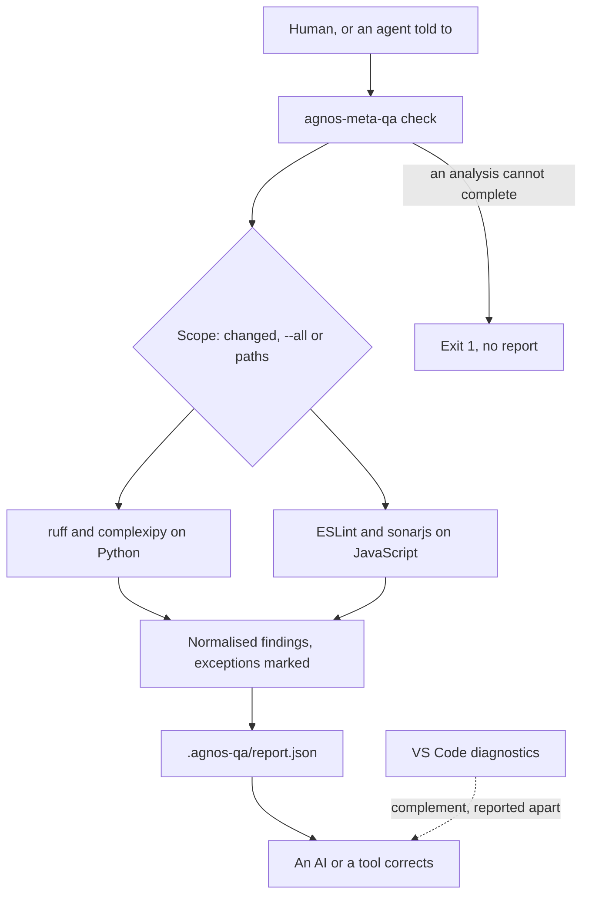

# ADR-QLT-001: A Report on Demand, from Pinned Command-Line Analysers
<!-- Amended on 2026-10-31: the skill, its script and its outputs carry their current names (RQ-TRC-104, RQ-TRC-105, DEC-TRC-055). -->

## Status
Accepted — approved by the owner on 2026-10-31, for FTR-QLT-001 (RQ-QLT-001 to RQ-QLT-010).

## Context
Findings surface late, in the pull request. SonarQube for VS Code analyses only the files open in the editor, so the Python scripts had
never been analysed, and no SonarQube Cloud project exists for this repository. The owner wants a skill called by a human or by an agent
told to, with neither hook nor blocking, and a report an AI or a tool can act on. The toolkit cannot call a meta skill (DEC-MTA-003).

Measured on 2026-10-31: ESLint with `eslint-plugin-sonarjs` finds 24 of the 29 SonarQube findings of `matrix.js`, with the same complexity
scores. The 5 others are S6582, S7755 and S7744.

## Decision

### DEC-QLT-001: An explicit call that blocks nothing
`check` runs when called, and findings exit 0. There is no hook and no change to `commit-task`. An instruction can tell an agent to call it,
so the skill stays invocable by the model, and its description limits it to an explicit request. Fulfils RQ-QLT-001, RQ-QLT-005.

### DEC-QLT-002: Three analysers on the command line
`ruff` for Python rules, `complexipy` for Python's cognitive complexity, ESLint with `eslint-plugin-sonarjs` for JavaScript. A script in
Python, standard library only, drives them, in the language of `agnos-perf-center`. Fulfils RQ-QLT-003.

### DEC-QLT-003: One normalised JSON report
Each analyser's output becomes the same finding fields, sorted by file and line, under a `schemaVersion`. The report goes to
`.agnos-qa/report.json` or `--out`; the standard output holds only a summary naming it. The skill corrects nothing, not even what an
analyser could fix: `fixable` tells the consumer. Fulfils RQ-QLT-002, RQ-QLT-007.

### DEC-QLT-004: One exception comment for every analyser
`agnos-qa-exception: <rule> <reason>`, on the finding's line or the line above, in any comment syntax. The analysers' own suppressions are not
used, since they would drop the finding from the report and each has its own syntax. A comment without a reason is not an exception.
Fulfils RQ-QLT-004.

### DEC-QLT-005: Pinned versions, in a folder git ignores
`assets/requirements.txt` and `assets/package.json` with its lock file record exact versions. `setup` installs them into `.agnos-qa/`, and a
missing analyser makes `check` fail by naming `setup`. Fulfils RQ-QLT-005, RQ-QLT-006.

### DEC-QLT-006: The rule set, in the assets
Line length 120, cognitive complexity 15 as SonarQube's default, Python 3.9 as the skill's stated minimum, at most 7 arguments. Rules left out, with their
reasons: `S` (security rules, which only flag this repository's fixed `git` calls), `C901` and the `PLR0911`, `PLR0912`, `PLR0915` counts
(cognitive complexity already measures it), `SIM905` (a long list of extensions reads better as one string). Fulfils RQ-QLT-009.

### DEC-QLT-007: VS Code's diagnostics are a complement outside the report
They cover HTML and the 3 rules ESLint lacks, but depend on the editor and on the files open. An agent in VS Code reads them for the changed
files and reports them apart; they never enter the JSON. Fulfils RQ-QLT-008, RQ-QLT-010.

### DEC-QLT-008: Corrections keep the behaviour and `matrix.js` in one file
A complex function is cut into named helpers beside it, and the suite of `agnos-perf-center` is the safeguard, running the page in a real browser.
A test changes only if a required behaviour changes. Splitting `matrix.js` is a separate architecture decision, not taken here. Fulfils RQ-QLT-009.

## Consequences
- The report can be produced on each machine, without a server or an account, and a consumer needs only its schema.
- Nothing forces the call: quality depends on the instruction or the habit of asking for it, as the owner chose.
- The command line and SonarQube can differ: `ruff` and `complexipy` are not SonarQube, and 5 JavaScript findings and all HTML ones show only in the editor.
- A first `setup` needs network access, Python and Node.js.

## Alternatives Considered
- **Git hooks, or blocking at commit or push**: rejected by the owner.
- **`sonar-scanner` with SonarQube Cloud**: the same engine, but needs a project and sends the code to a service, while everything here stays local. Rejected for now.
- **Only VS Code's diagnostics**: no command line and only open files, so no reproducible report. Kept as a complement.
- **The analysers' raw outputs**: each consumer would parse three formats. Rejected.
- **Letting the skill apply `--fix`**: a surprising write, and unsafe fixes change behaviour. Rejected.
- **A limit of 5 arguments, `ruff`'s default**: forces new abstractions on internal helpers for no reader's benefit. Rejected.

## Diagram

