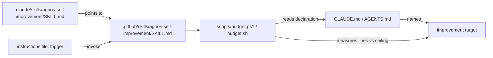

# ADR-RSI-001: Recursive self-improvement packaged as a skill

<!-- Motivated by: RQ-RSI-001, RQ-RSI-002, RQ-RSI-003, RQ-RSI-004 (FTR-RSI-001). Amends DEC-PLG-013 (RQ-PLG-018). -->

## Status
Accepted — approved by the owner on 2026-11-07

## Context
The RECURSIVE SELF-IMPROVEMENT SESSIONS section holds a procedure used only while a session improves
the process, in an instructions file of 386 lines for a ceiling of 400. It names the improvement
target as "the file the project's AGNOS block names, this file otherwise" (DEC-PLG-013): AGNOS's own
development, whose `CLAUDE.md` has no block, falls on "this file", and so would a plugin user's
project whose block is missing, which would then direct improvements to a file of the plugin. Only
the instructions file has a ceiling; a project's rules file, loaded in every session too, has none.
Its rule 2 also forbade rewriting content that predates the effort, which the owner rejected:
revisiting past rules is part of improving them.

## Decision

### DEC-RSI-001: A skill owns the procedure, the instructions file keeps the trigger
`.github/skills/agnos-self-improvement/SKILL.md` holds the procedure: iteration tagging, budget across
the effort, one theme at a time, the conflict check, keeping the target's sections and templates and
updating the cross-references a renamed section breaks. Content of any age may be revised.
`.claude/skills/agnos-self-improvement/SKILL.md` is a thin pointer, as for the other skills. The
instructions file keeps the WHILE trigger, the pointer to the skill and the rule never to edit a file
of an installed plugin; END SESSION step 3 points to the skill.

### DEC-RSI-002: The target is always declared, with no fallback
The target is given by the sentence `` `<path>` is the improvement target `` in `CLAUDE.md` or
`AGENTS.md`: the block `agnos-init` writes already says it for `agnos-process/project-rules.md`, and
this repository's `AGENTS.md`, which its `CLAUDE.md` imports, says it for the instructions file. Neither file is
delivered (`layers.json`: workshop layer). A missing declaration, or a path outside the project's git
root, stops the skill with an error. Amends DEC-PLG-013: "this file otherwise" is removed.

### DEC-RSI-003: A stateless script measures the budget
`scripts/budget.ps1` (Windows PowerShell 5.1) and `scripts/budget.sh` (bash), with the same output
and exit codes and no other runtime, as the process's other core skills (RQ-RSI-004), resolve the target and print its ceiling,
line count and lines left, exiting with an error over the ceiling. The ceiling is the instructions
file's own "SHALL NOT exceed <N> lines" when it is the target, otherwise the declaration's optional
`at most <N> lines`, otherwise 100. The scripts keep no state and read no git history: the budget
is the target's line count against its ceiling, re-measured at each iteration.

## Consequences
- The instructions file loses about 10 lines.
- A plugin user's rules file gets a ceiling of 100 lines by default.
- No path to a plugin file remains, by fallback or by declaration outside the project.
- The structure of the target is kept by the procedure, not checked by the script.

## Alternatives Considered
- Procedure-only skill, no script: rejected, the budget is measurable and should be measured.
- A mode variable (meta / plugin) in `session.yaml`: rejected, the declaration makes modes needless.
- A state file or git trailers holding the effort's start commit: rejected with the rule that
  protected pre-effort content, which it served.
- A Python script, as `agnos-perf-center`: rejected by the owner, it would make Python a requirement
  of a process step; only the optional perf center needs it.
- A ceiling declared in the `agnos-init` block: rejected by the owner for a default in the skill.

## Diagram

