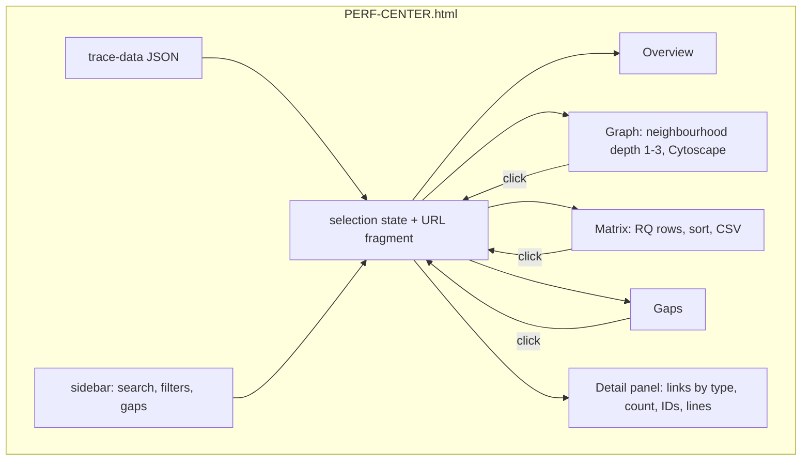

# ADR-TRC-003: Self-Contained Page and Interactive Graph
<!-- Amended on 2026-10-31: the skill, its script and its outputs carry their current names (RQ-TRC-104, RQ-TRC-105, DEC-TRC-055). -->

## Status
Accepted — owner decisions of 2026-10-18: Cytoscape.js, vendored and inlined. Motivated by RQ-TRC-010 to RQ-TRC-016,
RQ-TRC-020 to RQ-TRC-022, RQ-TRC-024; styled through ADR-TRC-002.

## Context
The page is opened from disk, mailed or attached; it must work offline, in any current browser, from one file. A process
of this size has about 500 elements and a few hundred source files, so a few thousand edges: a force layout of the whole
graph takes seconds and is unreadable, while the reviewer mostly asks about one element and its neighbours. The page shows
text from every scanned file, any of which can hold `</script>` or HTML.

## Decision

### DEC-TRC-005: Template assembly and safe data embedding
`assets/matrix.html` holds the page skeleton with four placeholders (tokens CSS, page CSS, scripts, data). The generator
inlines `matrix.css`, the vendored library and `matrix.js`, and the data as `<script type="application/json"
id="trace-data">` whose JSON has every `<` written `<`, so no file content can close the block (RQ-TRC-022). The
page script builds the DOM with `createElement`/`textContent` only, never `innerHTML` with data. No `src`, `href` or
`url()` points outside the file (RQ-TRC-010).
Amended by the owner on 2026-10-18 (RQ-TRC-010): the data leave the page. The generator writes `<page>.json` (the
data, the same escaped JSON, for other tools) and `<page>.data.js` (`window.AGNOS_PERF_CENTER_DATA = <the same JSON>;`), and the
template's data block becomes `<script src="<page>.data.js">`, before the page script. A `.js` twin, because a browser
refuses `fetch` of a sibling file to a page opened from `file://`, while it runs a sibling script. The page script reads
`window.AGNOS_PERF_CENTER_DATA` and, when it is missing, says which file it lacks. The three files are written together and
must travel together; a page mailed alone no longer works.
Amended by DEC-TRC-040 (ADR-TRC-010, 2026-10-28): the libraries are no longer inlined, but loaded from cdnjs.

### DEC-TRC-006: Cytoscape.js, pinned and vendored, drawing neighbourhoods first
`scripts/vendor/cytoscape.min.js` at one pinned version, with `LICENSE` (MIT) and `VENDOR.md` (version, source URL,
SHA-256, RQ-TRC-024); the licence notice is inlined with it. Core layouts only, no extension. The graph view draws the
selected element and its neighbours to the chosen depth (1 by default, up to 3) as a **traceability flow**: one column per
element family, left to right (features, requirements, ADRs and decisions, plans and tasks, source files, undefined IDs),
each column headed by its name and count, as wide as its widest node, wrapped into sub-columns beyond 18 rows and cut
with a "+n more" note beyond 72; each node is a pill holding its ID (a file's base name), with a band of its type colour;
an edge between two nodes of one column bows out of it. Positions are computed by the page (`preset` layout), so the
drawing is the same at every visit and redraws in well under 500 ms (RQ-TRC-020); the view never zooms below a readable
floor (a token) and starts at its top-left corner, "Fit" shows all of it. Selection: the element is outlined in the
accent colour, its edges drawn in the accent colour, the others dimmed (RQ-TRC-012); clicking a node selects it; hovering
shows its title. "Whole graph" draws every element as a dot with `cose`, after a warning when there are more than 1,500.
A first concentric layout was replaced at the owner's review: at depth 2 a requirement brought ~370 nodes, which the fit
shrank to unreadable dots.
Amended by DEC-TRC-040 and DEC-TRC-041 (ADR-TRC-010, 2026-10-28): Cytoscape.js 3.30.2 is loaded from cdnjs, no longer vendored.

### DEC-TRC-007: One page, four views, one selection
A header (title, generation time, inputs, theme switch), a sidebar (search with keyboard navigation, type and trigram
filters, gap shortcuts), and four views: **Overview** (counts, coverage, gaps, per-trigram bars — RQ-TRC-015), **Graph**
(RQ-TRC-012), **Matrix** (one row per requirement, sortable, filtered by the search, CSV export — RQ-TRC-014) and **Gaps**
(the lists of DEC-TRC-004). A detail panel shows the selection (RQ-TRC-013). The selection is one state shared by every
view and written to the URL fragment; `hashchange` and `popstate` restore it (RQ-TRC-016).

### DEC-TRC-008: Skill packaging
`.github/skills/agnos-perf-center/` holds `SKILL.md` (the canonical procedure), `scripts/perf_center.py`, `scripts/vendor/`,
`assets/` and `tests/` (Python `unittest` on a synthetic fixture process); `.claude/skills/agnos-perf-center/SKILL.md` points to
it, as for the other AGNOS skills. The generated page is not committed by the skill; a project that does not want it in
its working tree ignores the output path. Extended by DEC-TRC-050 and DEC-TRC-051 (2026-10-31): `SKILL.md` holds the contract,
`references/` the rest.

### DEC-TRC-012: Splitter bars between the three panels
Owner request after the first review (RQ-TRC-025). The page grid gets two columns of its own between the sidebar, the
main area and the detail panel, each holding a vertical bar (`role="separator"`, focusable). Dragging a bar (pointer
capture) or pressing ←/→ on it (one keyboard step, a token) sets the side panel's width as a custom property of the grid;
the width is clamped to the panel's minimum and maximum (tokens), and to what leaves the main area its minimum width.
Widths are kept in `localStorage` (a missing or refused storage only loses the memory); a double-click removes them and
the defaults of the tokens apply again. The graph is resized, not redrawn, after a change.

## Consequences
**Easier.** The page opens anywhere, offline, without a server; a reviewer goes from a requirement to the lines that
implement it in two clicks; a link to one element can be shared.
**Harder.** Each page carries the library (about 430 KB); a library update is a deliberate vendoring step with a new hash.
**Constrained.** The whole-graph view of a large process is slow by nature; the neighbourhood view is the default.

## Alternatives Considered
- **Load the library from a CDN.** Rejected by the owner: the page would not work offline.
- **D3.js or vis-network.** D3 is a toolkit, the graph interactions would be ours to write; vis-network is heavier for the
  same result. Cytoscape gives selection, neighbourhoods and layouts as primitives.
- **A hand-written canvas graph.** Rejected: much more code for a weaker result.
- **Mermaid diagrams.** Rejected: static, no navigation or highlighting.

## Diagram

