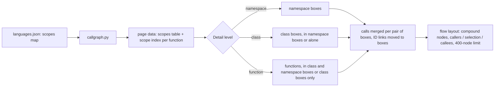

# ADR-TRC-005: Namespace and Class Boxes in the Graph

## Status
Accepted — reviewed and accepted by the owner on 2026-10-18. Implemented by PLAN-TRC-003. Owner request of 2026-10-18 (functions in nested namespace and class boxes, three levels of detail, the
enclosing boxes shown or not), reformulated and confirmed as RQ-TRC-047 (FTR-TRC-002). Extends ADR-TRC-004 (the call
graph's data and its place in the graph) and ADR-TRC-003 (the flow graph, DEC-TRC-006); styled through ADR-TRC-002.

## Context
The analysis gives each function a qualified name (`net::Port::send`) and reads the scopes that enclose a definition
(DEC-TRC-014), but keeps no scope as such: the page cannot tell a namespace from a class, and `int Session::send()`
written out of its class only says "Session" in its name. The flow graph (DEC-TRC-006) draws one column of functions,
at most 400 nodes (DEC-TRC-017); a project has a few dozen namespaces, a few hundred classes, thousands of functions.
RQ-TRC-047 asks to read that structure first: boxes for namespaces and classes, three levels of detail, calls and
requirement links kept at every level. The page must stay as fast (RQ-TRC-037) and nearly as small (RQ-TRC-038).

## Decision

### DEC-TRC-019: Scopes as data, their kind from the language table
Each language entry of `languages.json` gains a `scopes` map from a scope node type of its grammar to a box kind,
`namespace` or `class` (C++: `namespace_definition` → namespace; `class_specifier`, `struct_specifier`,
`union_specifier` → class); the query's `@scope` capture already finds those nodes. The analysis records every scope it
reads, by qualified name, with its kind; a qualifier part that no scanned declaration defines (a class declared in a
file not scanned, say) takes the kind `class` when it is the innermost part of a method's qualifier and `namespace`
otherwise. The page data gains one table, `scopes: [[qualified name, kind, parent index]]`, and each function row its
scope index (`-1`: none). A language with no scope entry (C) gives functions without box. At the namespace and class
levels, what stands in no named namespace gathers in one box, `(global)`, of kind `global`: the global namespace, which
an anonymous namespace counts as. At the namespace level it holds every function outside a named namespace; at the
class level the functions without scope, and with enclosing boxes it frames the classes outside any namespace. Amended
by the owner on 2026-10-18 after a run on a C++ code base: the first version's box per file, named after the file, drew 92
file names among the namespaces (316 functions in anonymous namespaces, 74 methods of classes outside a namespace, 8
global ones).

### DEC-TRC-020: Boxes are Cytoscape compound nodes placed by the flow layout
A box is a compound node (`parent` data), drawn as a labelled rounded frame in the colour of its kind (tokens); its
children keep the flow layout's preset positions (DEC-TRC-006): the Functions column becomes a column of boxes, stacked
top to bottom in name order, each holding its children in rows, and Cytoscape sizes each box around them. Around a
selected function the column still splits in three — callers, the function, callees (DEC-TRC-017) — each third holding
the boxes of its functions. With enclosing boxes off, the outer level's boxes are not drawn and their children stand in
the column by themselves. A frame holding nothing near the selection is drawn faint like its pills (its border, label
and fill at the dim opacity, not the node's opacity, which would fade its pills twice); a frame holding the selection
or one of its neighbours stays plain (owner review of 2026-10-18: plain frames over faint pills read as a veil).

### DEC-TRC-021: Levels are computed in the page, from the arrays already there
The level of detail maps each function to the box that stands for it — itself, its class, or its namespace — once per
draw. The neighbourhood walk (DEC-TRC-017) runs on functions as today, then its functions are replaced by their boxes:
calls between functions of two boxes become one link per ordered pair of boxes, labelled with the number of calls;
calls inside one box are not drawn; a function's ID links move to its box. The 400-node limit applies to what is drawn
after that mapping. Nothing is aggregated by the generator: the page data grows by the scope table and one integer per
function only.

### DEC-TRC-022: Controls, detail panel and look
The graph toolbar gains, with a call graph only, a "Detail" choice — Namespace · Class · Function, Function by default
(today's drawing) — and an "Enclosing boxes" switch, on by default, disabled at the namespace level. A box is
selectable: its detail panel gives its kind, qualified name, enclosing box, its classes and functions with their counts,
its calls in and out by box, and the requirements its functions cite. The box colours, frame stroke, label and padding
are tokens; an aggregated link takes the call colour and arrow (RQ-TRC-044), its tooltip (RQ-TRC-046) gives the count.
Renamed by the owner on 2026-10-18 (RQ-TRC-048, DEC-TRC-023): the choice is "Implementation detail", the switch
"Enclosing scopes", the box kinds "Namespace", "Class" and "Global namespace".

### DEC-TRC-023: Specification and implementation told apart in the toolbar and the links
RQ-TRC-048. The graph calls what it draws of the code "Implementation": the column, its callers / callees split, and
the switch bound to the Function type filter, whose label alone changes. The single "Containment" switch is split by
what it governed: the specification's links (feature → requirement, ADR → decision, plan → task) keep the kind
`contains`, shown as "specification hierarchy", under a "Specification hierarchy" switch that, off, neither draws nor
walks them; the link from a file to its functions becomes a kind of its own, `defines`, with its own colour token,
always walked, so drawn whenever files are (the "Source files" switch). The four switches stand in one `fieldset`
"Display", styled like the "Depth" group; "Implementation" and "Enclosing scopes" are added there by the page only with
a call graph. "Scope" is the word every language parsed by tree-sitter uses for a namespace, module, package or class;
the switch's tooltip says that blocks and functions, scopes too, are not drawn. The global box's label becomes
`(global namespace)`; its key stays `box:(global)`. Amended on 2026-10-18 after a second review: the groups stand
Depth, Display, Implementation detail (the reading order: how far, what, how finely); the "Implementation detail"
`fieldset` and the "Enclosing scopes" switch are disabled while the implementation is off, whichever of the switch
or the Functions type filter turned it off (one function syncs them, called by the graph's `refresh`); each group's
label has a background from the accent-subtle role, as the selected fill, with the accent colour for its text.

### DEC-TRC-024: A search result's tooltip is the page's own
RQ-TRC-049. The browser's `title` shows after about a second and cannot be set shorter, and the list's popup cuts names
and titles to its width. A result gets a tooltip of the page's own, a fixed-position element beside the list (so that
the sidebar's overflow does not cut it), shown after the quick delay token (`duration.quick`, 300 ms, `--c-search-tip-delay`)
when the pointer enters a result or the keyboard moves onto one, hidden when the pointer leaves the list, the search
closes, a result is picked or the list scrolls. It holds the element's type, its whole name, its whole title and its
location (`file:lines`, which tells apart the same name in two places). The element's colours, border, shadow and
size come from the tooltip tokens of RQ-TRC-046's graph tooltip.

## Consequences
**Easier.** A large code base is read from the top: which namespace calls which, which classes carry a requirement,
then the functions; the same selection and the same three columns at every level.
**Harder.** Compound nodes cost Cytoscape more per node than plain ones; the layout must size the boxes and keep the
columns; a new data table to keep reproducible (RQ-TRC-040).
**Constrained.** A box's kind is syntactic: a namespace or class declared in no scanned file is guessed by its place
in the qualifier; anonymous namespaces and lambdas have no box; an aggregated link hides which function calls which,
the detail panel and the function level show it.

## Alternatives Considered
- **Aggregate in the generator** (one call graph per level in the page data). Faster to draw, but three times the call
  data, against RQ-TRC-038; the page already holds every call in typed arrays.
- **A force or `fcose` compound layout.** Groups boxes well on its own, but loses the flow columns and the
  callers / callees split that make the graph readable (DEC-TRC-006, DEC-TRC-017).
- **Boxes by file or folder.** Always available, any language; but the owner asks for the language's own structure, and
  files are already their own column.
- **Kinds from the qualified name alone.** No change to the analysis, but `a::b::f` cannot tell a namespace from a class.
- **A "Defines" switch of its own for file → function** (DEC-TRC-023). One more switch for a link that means nothing
  without the files it starts from; the "Source files" switch already decides whether files are drawn.

## Diagram

