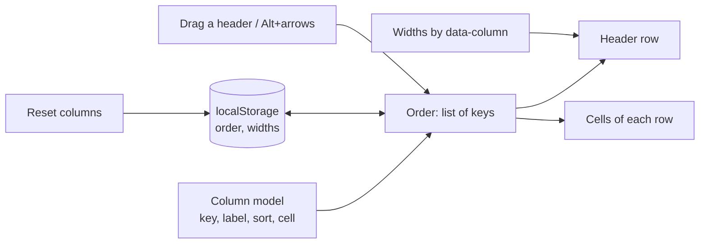

# ADR-TRC-006: Rearrangeable Matrix Columns

## Status
Accepted — approved by the owner on 2026-10-24; owner request of 2026-10-24 (Feature column first by default, columns arranged by the user), reformulated
as RQ-TRC-051 and RQ-TRC-052 (FTR-TRC-001). Extends the matrix of RQ-TRC-014 and the column widths of RQ-TRC-043
(DEC-TRC-012); styled through ADR-TRC-002.

## Context
The matrix is built from a fixed list of columns whose order is repeated in three places: the header row, the cells of
each row, and the stylesheet's default widths, which select a header by its position (`th:nth-child(n)`). The Feature
column stands third, after Requirement and Coverage, while the graph reads from the feature down to the code
(RQ-TRC-051). RQ-TRC-052 asks the reader to arrange the columns: that is impossible while the order lives in three
places, and a widths rule tied to a position would give a moved column another column's width. The widths are already
remembered per column key in the browser (RQ-TRC-043).

## Decision

### DEC-TRC-027: One column model; the order is a list of keys
Each matrix column is declared once, with its key, label, hint, sort value and the function that draws its cell; the
header row and every row are drawn by walking the ordered list of keys, so a header and its cells cannot part. The
default order is Feature, Requirement, Coverage, ADRs / decisions, Plans / tasks, Functions (with a call graph), Source
files, Lines (RQ-TRC-051). The stylesheet's default widths select a header by its `data-column`, not by its position.
The CSV export keeps its own fixed column list. Fulfils RQ-TRC-051.

### DEC-TRC-028: Moving a column: drag, keyboard, remembered, reset
A header is draggable (HTML drag and drop): dropping it on another header puts the moved column at that header's
place, and a marker, drawn with design-token strokes and colours, shows the drop side while the pointer is over it. A
focused header takes Alt+←/Alt+→ to move one place, and keeps the focus. A resize grip never starts a drag
(RQ-TRC-043). Sort state and widths are keyed by column, so a move changes neither. The order is kept in `localStorage`
under its own key, as a list of column keys; a missing or refused storage, an unknown key or a missing one only fall
back to the default order. A "Reset columns" button in the matrix toolbar, with a tooltip (RQ-TRC-045), removes the
saved order and widths. Fulfils RQ-TRC-052.

## Consequences
- Adding a column later is one entry in the model; its default place is its place in the list.
- The page stays a single self-contained file: no library, native drag and drop only.
- Native drag and drop does not work on touch screens; the Alt+arrow keys and the reset remain.
- A saved order from an older page is repaired (unknown keys dropped, new columns inserted at their default place).

## Alternatives Considered
- **A column chooser (checkboxes and up/down buttons)**: more controls on a toolbar already busy; dragging the header
  is the usual gesture for a table. Rejected.
- **Keeping the positional width rules and re-labelling them after a move**: couples the stylesheet to script logic
  and breaks with the Functions column that only some pages have. Rejected.
- **Pointer-event drag written by hand**: more code than the native API for the same result on desktop browsers.
  Rejected.
- **Ordering the CSV like the screen**: scripts reading the CSV rely on a stable layout. Rejected.

## Diagram

