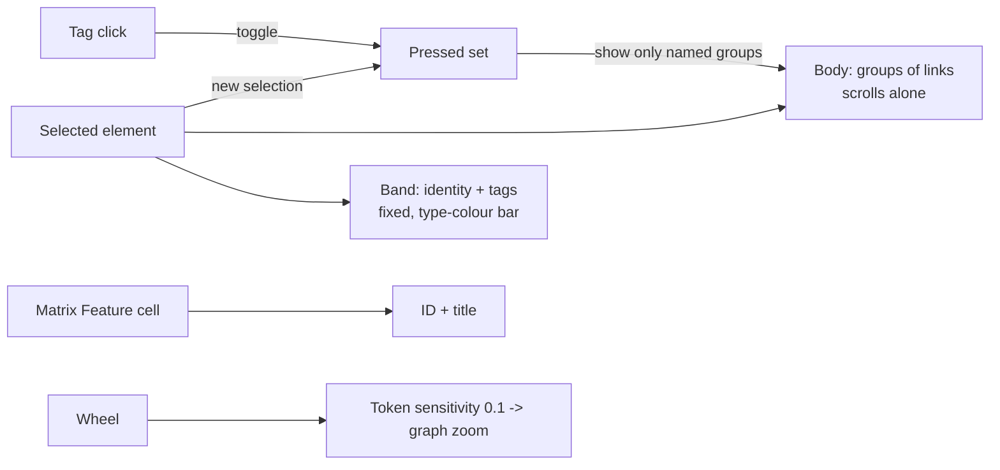

# ADR-TRC-007: Feature Titles, a Fixed Detail Band, Tag Filters and a Finer Wheel Zoom

## Status
Accepted — approved by the owner on 2026-10-24; owner review of 2026-10-24 (feature title in the matrix, selected element kept in view and highlighted, tags
as filters, finer wheel zoom), reformulated as RQ-TRC-053 to RQ-TRC-056 (FTR-TRC-001). Extends the matrix of ADR-TRC-006
(DEC-TRC-027), the detail panel of RQ-TRC-016 and the graph of ADR-TRC-003 (DEC-TRC-006); styled through ADR-TRC-002.

## Context
The matrix draws a requirement as an ID with its title under it, but a feature as an ID alone (RQ-TRC-053). The detail
panel is one scrolling column: the element's identity and its tags scroll away with the links, so the reader of a long
list no longer sees what it belongs to, and the identity looks like any other block (RQ-TRC-054). The tags (counts of
links by type) only inform; a requirement with hundreds of lines cannot be read one type at a time (RQ-TRC-055). The
graph library's wheel zoom uses its default sensitivity, whose step is too coarse (RQ-TRC-056).

## Decision

### DEC-TRC-029: The Feature cell draws the ID and the title like the Requirement cell
The Feature column's cell draws, for each feature, its ID button and, under it, its title in the muted, ellipsized
`cell-title` style of the Requirement cell. Only the cell function of DEC-TRC-027 changes. Fulfils RQ-TRC-053.

### DEC-TRC-030: The detail panel is a fixed band over a scrolling body; tags are toggles
The panel becomes a column of two parts: the band (identity and tags, for elements and for boxes), which does not
scroll, and the body (the groups of links), which scrolls alone; a band taller than half of the panel scrolls inside
itself. The band stands out by a bar in the type colour, a tinted background and a larger title, all from design tokens.
Each tag that counts a group is a button with `aria-pressed`; the page keeps the set of pressed tags for the current
selection, shows only the groups they name (all when none), and clears the set when the selection changes. A tag that
counts no group (such as "No link" or the warning on a requirement without function) stays a plain label. Fulfils
RQ-TRC-054 and RQ-TRC-055.

### DEC-TRC-031: The wheel sensitivity is a design token
`dimension.graph-wheel-sensitivity` (0.1, about 10 % of zoom per wheel notch instead of 150 %) goes through the semantic and component tiers like the zoom limits and is
passed to the graph library as its wheel sensitivity. Fulfils RQ-TRC-056.

## Consequences
- Matrix rows with a feature title are slightly taller only when the column is wide enough to wrap nothing (the title
  is cut with an ellipsis).
- The panel's scroll container changes from the panel to its body; the splitters and the panel's width are not affected.
- The library logs a warning in the console when the sensitivity is not 1; it has no other effect.
- Tag filters live only for the current selection, so a stored state never hides links by surprise.

## Alternatives Considered
- **A separate filter bar above the groups**: duplicates the tags, which already count the groups. Rejected.
- **Pinning only the ID, not the tags**: the tags are the filter; they must stay in reach while scrolling. Rejected.
- **A custom wheel handler for the zoom**: more code than the library's own option for the same step. Rejected.
- **Remembering the tag filter across selections**: a filter set for one element would hide groups of the next. Rejected.

## Diagram

