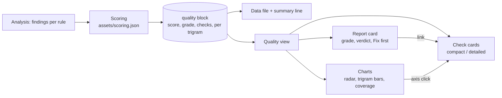

# ADR-TRC-008: Quality Scorecard — Scored Checks, Grade, and a Two-Reader View

## Status
Accepted — approved by the owner on 2026-10-24; owner request of 2026-10-24 (replace the gap lists by a scoring in the manner of the OpenSSF Scorecard, readable
by a manager and a technician), reformulated as FTR-TRC-003 (RQ-TRC-057 to RQ-TRC-066). Replaces the gap lists of
ADR-TRC-001 (DEC-TRC-004) in the data file and the page; uses the tokens and tiers of ADR-TRC-002 and the tooltip of
RQ-TRC-049.

## Context
The generator turns the model into nine lists (`gaps`: eight rules, plus the informational untraced functions that the
page adds from the call graph), and the page prints them one after the other. A list says what fails, not how much:
two uncovered requirements out of two hundred and out of three read the same, and no figure compares a feature area with
another. The reader who decides cannot read the lists; the reader who fixes needs them whole (FTR-TRC-003). The score must
be one number computed once (RQ-TRC-064), from the same populations that make the findings, so that the page, the data
file, the summary line and an agent agree. The page is one offline file with no library but the graph's, and its colours
and sizes are tokens (ADR-TRC-002).

## Decision

### DEC-TRC-032: Checks are data; the generator scores them
Amended by DEC-PLG-019 (2026-11-05): *functions traced* has the risk level medium, no longer informational.

A data file of the skill, `assets/scoring.json`, declares the checks (key, title, rule in words, population, risk
level), the weights of the risk levels (critical 10, high 7.5, medium 5, low 2.5, informational 0), the grade
thresholds (A 9, B 7.5, C 6, D 4, else E) and the "needs attention" threshold (a score below 7.5). The nine checks are
the existing rules, each as a population and its findings: *requirements covered* (critical; requirements; uncovered),
*IDs defined* (critical; distinct IDs cited; undefined), *requirements tasked* (high; requirements; untasked), *tasks
with a requirement* (high; tasks; task-no-rq), *ADRs with a requirement* (medium; ADRs; adr-no-rq), *containers not
empty* (medium; features, ADRs and plans; empty), *elements connected* (medium; defined elements; isolated), *source
files traced* (medium; scanned files; untraced-files), *functions traced* (informational; functions; untraced
functions, with a call graph only). The score of a check is ten times the share of its population that is not a finding,
rounded to one decimal; an empty population gives no score and no weight. The overall score is the weighted average of
the scored checks, with no cap: a critical check at 0 weighs 10 and shows first in "Fix first". The per-trigram score
uses the same formula on the elements of that trigram; the checks about files, functions and undefined IDs, which
belong to no trigram, are left out of it. The code reads the file; changing a weight or a threshold changes no code.
Fulfils RQ-TRC-058 and RQ-TRC-059.

### DEC-TRC-033: One `quality` block replaces `gaps` in the data file and the summary line
The data file's `gaps` and `gapKinds` are replaced by `quality`: the overall score and grade, the checks (key, title,
rule, risk, population, score, findings as IDs in index order), and the same for each trigram. The page reads this block
and computes no score. The generator's last line ends with `quality: <grade> <score>/10; checks: <key> <score>, …;
findings: <n>` in place of the gap counts. The change is incompatible for external readers of the data file; the skill
documents the new keys. The sentinel test of RQ-TRC-026 (page and data before the call graph) is re-pinned on purpose,
once, after this change. Fulfils RQ-TRC-064 and RQ-TRC-057 (data file).

### DEC-TRC-034: The Quality view in three bands, without scrolling
The view is a grid of three bands: the **report card** (grade letter on the A–E scale, score, verdict, grades of the
trigrams, three "Fix first" links), the **charts** (radar, trigram bars, coverage shares) and the **checks** (a grid of
cards, three to a row). Heights and gaps are tokens; at 1440 by 900 the nine compact cards, the charts and the card fit
the main area. A check card is compact (name, risk badge, score bar, count of findings) and opens with a chevron
(`aria-expanded`) to the rule, the formula with population and findings, the KPIs and the findings, sixty at first;
opened, the card spans the row and the others stay put. Checks stand lowest score first, the informational one and those with no score last. "Expand all" and "Collapse
all" sit in the view's toolbar; a "Fix first" link or a radar axis opens its check and scrolls it into view. The
verdict names the grade in words (A excellent, B good, C fair, D weak, E poor) and counts the checks under the attention
threshold. The word "gap" and its identifiers (`gap-*` CSS classes and ids, `gaps-list`, the tab's `data-view="gaps"`)
become `quality-*`, `checks` and `findings`. Fulfils RQ-TRC-057, RQ-TRC-060, RQ-TRC-062 and RQ-TRC-063.

### DEC-TRC-035: A green-to-red grade palette like the food and energy labels; charts are inline SVG
Five grade colours are global tokens, with their on-colour text tokens, resolved for both themes: dark green (A), light
green (B), yellow (C), orange (D) and red (E), the scale of the French Nutri-Score and DPE labels, which is socially
understood (owner decision of 2026-10-24, reversing the first choice of a blue-to-orange scale). The letter is always
written, so that a colour-blind reader loses nothing, and every grade text meets 4.5:1
(checked by a test on the resolved tokens). The charts are drawn by small functions from the `quality` block, as inline
SVG with `role="img"`, a title and a description, and focusable items that raise the page's tooltip (name, score or
share, population, findings): a **radar** with one axis per scored check, **bars** per trigram (score and grade), and a
**stacked bar** of covered, indirect and uncovered requirements. No chart library is added. Fulfils RQ-TRC-061 and
RQ-TRC-065.
Amended by DEC-TRC-043 (ADR-TRC-010, 2026-10-28): the radar is drawn by ECharts; the bars and shares stay inline SVG.
Amended by TASK-TRC-074 (2026-10-29): the bars and the shares merge into one ECharts chart (rows Total and per trigram
with requirements, shares stacked to 100 % in the coverage colours, grade colour for the score at each row's end); no inline-SVG chart is left in Quality.

## Consequences
- The scoring is reproducible by hand from the data file, and an agent can report the grade without the page.
- The page shrinks a little in logic (the lists become check cards) and grows in markup; the budget of RQ-TRC-038 and
  the time of RQ-TRC-066 are measured, not assumed.
- A project with few elements swings its score with one finding (1 of 3 requirements uncovered is 6.7); the population
  is always shown beside the score so that the figure is read in its size.
- Weights and thresholds are the skill's, not a project's; configuring them per project stays out of scope.
- External readers of the data file break once; the rename is documented and the tests are updated in the same change.

## Alternatives Considered
- **Keep the lists and add a score tile**: the manager still lands on nine lists, and "gap" survives. Rejected.
- **Score by counts (points off per finding)**: not comparable between a 10-requirement and a 1,000-requirement project.
  Rejected.
- **A cap on the grade when a critical check fails**: asked and declined by the owner; the weakest checks stay visible
  in "Fix first". Rejected.
- **A blue-to-orange scale**: colour-blind safe and original, but not the code everybody reads; first choice, replaced
  by the owner on 2026-10-24 by the green-to-red scale of the food and energy labels. Rejected.
- **A chart library**: hundreds of kilobytes in an offline file for three simple charts. Rejected.
- **Quadrant (priority) chart**: needs an effort estimate per finding that the model does not hold. Rejected.

## Diagram

