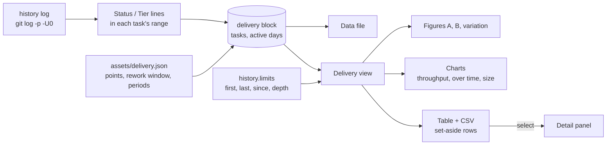

# ADR-TRC-009: Delivery Tab — Tasks Closed in Git, Points per Active Day, Periods Within the History Read

## Status
Accepted — approved by the owner on 2026-10-27; owner request of 2026-10-27 (compare what was delivered between two periods, by tier and by identity),
reformulated as FTR-TRC-004 (RQ-TRC-068 to RQ-TRC-079). Extends the history of ADR-HST-001 (DEC-HST-002 to DEC-HST-005);
uses the tokens of ADR-TRC-002 and the tooltip of DEC-HST-007.

## Context
The history module reads one `git log -p -U0` over the process and source folders and follows each element's line range
back through it (DEC-HST-002). A task's definition holds a `**Status**` line and a `**Tier**` line, so the commits that
change them are already in that log. In AGNOS a task is committed once, by `commit-task`, when it is Done: the close of a
task is recorded, its start is not (in the six weeks of a sample repository, 265 status changes to Done against 23 to
In Progress). Any duration would count the pauses and the DoR discussion; a heuristic on the gaps between commits
(`git-hours`) has an error of the order of a task, since there is one commit per task. The owner chose throughput over
duration, calendar periods over sessions, and no extra commit to mark a start (FTR-TRC-004).

## Decision

### DEC-TRC-036: Deliveries read from the history's own log
`history.py` scans, in the hunks it already follows for each task's range, the added and removed `**Status**` and
`**Tier**` lines. The first commit adding `**Status**: Done` (the value alone) in the task's range is its delivery; its
author date, its identities (DEC-HST-003) and its lines changed in the scanned folders make the delivery. The tier is
the task's `**Tier**` line in the working tree; any commit that changed it marks the task re-tiered. A later commit
replacing `Done` by another value, a status line with text after its value, or a `Done` added in the commit that added
the task's heading sets the task aside with that reason. The commit type is the Conventional-Commits word before `(` in
the subject. A task is reworked when a later `fix` commit, within the days of the data file, cites the task or a
requirement the task cites, in its subject (an AGNOS commit message names its task and often its requirements; reading
the changed lines of every commit would cost a scan of the whole patch text). No other git command is run. Fulfils RQ-TRC-068 and
RQ-TRC-071.

### DEC-TRC-037: A compact `delivery` block, weights in a data file
The data file's `history` gains a sibling `delivery`: `tasks` as arrays `[ID, tier, reTiered, commit index or null,
lines, type, reworked, reason or null]` in index order, and `activeDays` as `{person index: [day, …]}` in the
repository's time zone of each commit (author date). A new data file of the skill, `assets/delivery.json`, holds the
points per tier (S 1, M 3, L 8), the rework window (14 days), the ready-made periods and the month threshold (12 weeks);
it is copied into the block so that the page and any reader agree. Without `--history` nothing is written. Fulfils
RQ-TRC-069 and RQ-TRC-070 (weights as data). Extended by DEC-TRC-045 (2026-10-30): the block also holds `friction`, read
with one `git blame` of the log.

### DEC-TRC-038: Figures computed in the page, bounded by the history read
The page computes the points, the throughput, the rework rate and the grains from the block, so that filters and periods
need no new run. The period bounds are `history.limits.first` and `last`: ready-made ranges that reach beyond are
disabled, dates outside are refused, and the first and last days are left out of the active days when `since`, `depth`
or a shallow clone may have cut them. Default periods: the last week read and the week before, or two halves of a
shorter history. Fulfils RQ-TRC-070, RQ-TRC-072 and RQ-TRC-073.

### DEC-TRC-039: The Delivery view shares the History view's state and drawing
A `delivery` view between History and Quality: a toolbar (periods A and B, grain, text filter, tags for tiers, kinds,
trigrams and commit types, identities, re-tiered switch), a band of four figures for A, B and their variation, three
inline-SVG charts drawn by small functions like those of DEC-TRC-035 (throughput per identity stacked by tier, points
over time, lines per task by tier), and a sortable table with its CSV and the set-aside rows. Identities keep their
colour and icon from the History view (RQ-HST-026); marks raise the one rich tooltip (DEC-HST-007); a task selected
goes to the detail panel, whose band states its delivery. Every visual value is a token. Fulfils RQ-TRC-074 to
RQ-TRC-077 and RQ-TRC-079.
Amended by DEC-TRC-043 (ADR-TRC-010, 2026-10-28): the charts are drawn by ECharts.

## Consequences
- The tab says what was delivered and how much per active day, never how long a task took; the page states it.
- Old tasks closed with no status history (Done at creation) are set aside, visibly, not guessed.
- An active day counts the same whether one hour or eight were worked: the bias is shared by both periods, so the
  comparison holds, not the absolute figure.
- The weights are the skill's; a project changes them in `assets/delivery.json`, not in the code.
- The history log is scanned for two more lines per task; the time and size of RQ-TRC-078 are measured, not assumed.

## Alternatives Considered
- **Duration from the end of the previous task**: counts pauses, nights and the DoR discussion. Rejected by the owner.
- **Duration from gaps between commits (`git-hours`)**: one commit per task makes its error the size of a task. Rejected.
- **A `start-task` commit to record the start**: a commit with no source change only to measure. Rejected by the owner.
- **A session or branch grain**: a branch may hold several sessions of any size and trigram. Rejected by the owner.
- **Agents' conversation logs for times**: outside git, tied to one tool and one machine. Rejected.
- **Counting tasks without weights**: ten S tasks would outweigh three L tasks. Rejected.

## Diagram

