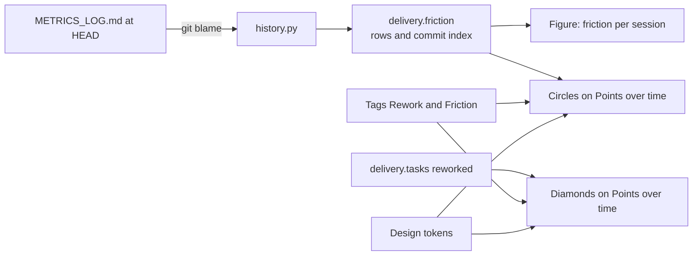

# ADR-TRC-011: Friction Read from Git, per Session, and Overlays on the Delivery Timeline

## Status
Accepted — approved by the owner on 2026-10-30; from the owner's review of 2026-10-30, reformulated as FTR-TRC-006 (RQ-TRC-090 to RQ-TRC-096). Extends
DEC-TRC-037 (the delivery block) and DEC-TRC-043 (the points over time); uses ADR-TRC-002 (the design system).

## Context
`METRICS_LOG.md` has one row per session: a date, a trigram, four counters. It names no person, tier or task. It is
versioned, so git can say who added each row. The history of this repository shows the limits: each of the 8 current
rows was added by its own commit, one of them named `WIP`; a former row was removed by a later commit; the header's names
changed once; and sessions went unlogged (53 commits lie between two rows, including 37 TRC tasks, against a FIX session
of 2 events), so the commits between two rows are not one session's work.

## Decision

### DEC-TRC-045: The log at HEAD, each row with the commit that added it
`history.py` runs `git blame --porcelain HEAD` on the log and writes `delivery.friction`, a list of `[date, trigram,
questions, recoveries, re-tiered, verification, commit index]`. Columns are read by position, data rows only. Content at
HEAD decides: a removed or corrected row is a versioned decision and is respected. A row whose commit is not in
`history.commits` (outside the history read, or a merge) is left out; a malformed row or a merge is named on the error
stream. Fulfils RQ-TRC-090, RQ-TRC-091.

### DEC-TRC-046: Friction per session, as a plain sum
The figure is the sum of the four counters over the sessions of the period, divided by those sessions. No task
denominator: it cannot be linked to a session, and a tier filter would change it alone. No weights: they would be
arbitrary; the tooltip gives each counter. Fulfils RQ-TRC-092.

### DEC-TRC-047: Words on the variations, no groups of figures
`deliveryFigure` keeps its `lowerIsBetter` argument and adds to the existing `is-better` / `is-worse` colour the word
"better" or "worse"; the figures are not grouped, tinted or topped with a bar (owner decision of 2026-10-30). Fulfils
RQ-TRC-093.

### DEC-TRC-048: Filters of the friction
Period, trigram and identity apply, the identity being the commit's author only. Kind does not: a commit may omit its
agent co-author, as `9a0b864` does. Tier, commit type, text and re-tiered do not, and the figure's tooltip says so.
Fulfils RQ-TRC-094.

### DEC-TRC-049: Overlays on one second axis, behind two tags
`timelineOption` adds two series on a second value axis, as symbols with no line, since a line would suggest values
between sessions: circles for friction, diamonds for rework, placed at the delivery date so that they agree with the
rework rate and need no new data. The tokens `--c-delivery-friction` and `--c-delivery-rework` colour them, and shape
tells them apart without colour. Two tags in the card header, kept in the tab's state and outside its filters, rebuild the
chart's option; the second axis fits what is shown. The series stay out of the tier legend. Extends DEC-TRC-043. Fulfils
RQ-TRC-095, RQ-TRC-096. Owner review of 2026-10-31: both tags off by default, each showing its mark's icon, the tags being
the marks' only legend; `rework` takes blue, left free by period A (DEC-TRC-043).

## Consequences
- The page is reproducible for one commit; a row shows only once committed.
- A recent period's rework stays underestimated while its 14 days run; the marks make this easier to see.
- The band holds five figures; its layout and the tests counting four change.
- The friction cannot follow every filter, and the page says so rather than hiding it.

## Alternatives Considered
- **Reading the file from disk**: simpler, but not reproducible, and no author. Rejected.
- **Every row ever added**: would restore the removed REC row, but overrides a versioned removal. Rejected.
- **Friction per task or point, sessions delimited by log rows**: false wherever a session went unlogged. Rejected.
- **Rework at the date of the `fix` commit**: needs new data and disagrees with the rate of the figure. Rejected.
- **Two extra axes or a strip under the bars**: more to read; the tags already solve the flattening. Rejected.
- **Groups of figures with bars and tints**: declined by the owner; the words suffice. Rejected.

## Diagram

