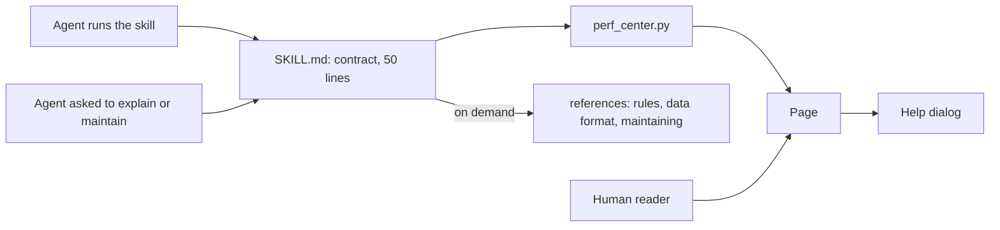

# ADR-TRC-012: The Skill as a Contract, References on Demand, a Guide in the Page
<!-- Amended on 2026-10-31: the skill, its script and its outputs carry their current names (RQ-TRC-104, RQ-TRC-105, DEC-TRC-055). -->

## Status
Accepted — approved by the owner on 2026-10-31; from the owner's decisions of 2026-10-31, reformulated as FTR-TRC-007 (RQ-TRC-098 to RQ-TRC-102). Extends
DEC-TRC-008 (skill packaging); uses ADR-TRC-002 (the design system).

## Context
No requirement asks `SKILL.md` to describe the page or the algorithms; it grew because plans said "document in `SKILL.md`".
A skill's body is loaded at each run, and an agent running this one only needs the command and what to report. `process/` is
not delivered to host projects, so the text cannot simply be replaced by links to requirements. No script reads `SKILL.md`,
and two tests read it, each for an absence.

## Decision

### DEC-TRC-050: A contract of at most 50 lines
`SKILL.md` keeps when to use, prerequisites, command, a parameter table, outputs, exit codes, the summary line, what to report,
the warning not to scan folders that quote IDs as examples, and a table from question to reference. A test holds the 50 lines
and the 400 characters of the description. Tasks now write "document in the references or the guide". Fulfils RQ-TRC-098,
RQ-TRC-102.

### DEC-TRC-051: Three references, read on demand
`references/rules.md` holds the rules, findings, scoring, call-graph resolution and the history and delivery rules;
`references/data-format.md` the contract of `<page>.json` (RQ-TRC-100); `references/maintaining.md` the tests, library upgrades
and design-system notes. They carry their requirement IDs in comments, and the test of RQ-TRC-057 reads them too. `agnos-demo`
already works this way. Fulfils RQ-TRC-099, RQ-TRC-100.

### DEC-TRC-052: A Help dialog written in the page's template
A Help button in the header, apart from the tabs since it changes no view, opens a native `<dialog>` holding one section per tab,
written in `matrix.html`. The page removes the sections of tabs it does not hold and shows the current tab's section alone; a
list on the side goes to the others, and only the section scrolls, its height bounded by a token. The text is the former "What the page shows", cut down
to what a reader needs. Nothing about it enters the data files. Fulfils RQ-TRC-101.

## Consequences
- Each run costs about 1,000 tokens instead of 7,200 (estimated); explaining a finding costs one more read.
- The page gains a control and about 90 lines of text in its template; the text must follow the page's changes.
- The demo's copy follows at its next rebuild, from the tracked files.
- Closed plans keep their mentions of `SKILL.md` as history.

## Alternatives Considered
- **Only removing the page's description**: about 190 lines, and the rules keep growing. Rejected.
- **Keeping what explains a result in `SKILL.md` (80 to 120 lines)**: an agent runs the skill far more than it explains it. Rejected by the owner.
- **Moving the arguments to `--help`**: an extra call before each run, and `--help` lacks the exit codes. Rejected.
- **The reader's guide in `references/` or `GETTING_STARTED.MD`**: readers do not open them while using the page, and the first would load it for agents. Rejected.

## Diagram

