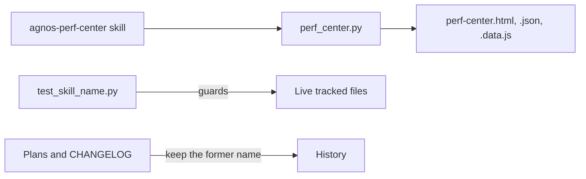

# ADR-TRC-013: One Name, agnos-perf-center, for the Skill and What it Produces
<!-- Amended on 2026-11-22: the performance center's outputs are lowercase, perf-center.* (RQ-TRC-143, DEC-TRC-087). -->

## Status
Accepted — approved by the owner on 2026-10-31, for FTR-TRC-008 (RQ-TRC-104 to RQ-TRC-106). Amends DEC-TRC-001 and DEC-TRC-008 on the names they give.

## Context
`agnos-trace` has grown from a traceability matrix into the place where the execution of the process on a project is monitored.
The name understates its role. It appears in 93 files, some of them plans and changelog entries that record the past.

## Decision

### DEC-TRC-053: The skill is renamed by `git mv`, its IDs stay
Both skill folders move to `agnos-perf-center`, so `git log --follow` reaches their history. The trigram `TRC` and every existing ID stay: IDs identify artifacts, not a name. The description states that performance means the process, not code speed. Fulfils RQ-TRC-104.

### DEC-TRC-054: Outputs, script and page title follow; the template keeps `matrix.*`
The script becomes `perf_center.py`, its test `test_perf_center.py`, the outputs `perf-center.*`, the page's title "Performance center". Environment variables, the data global and the `localStorage` keys follow, which resets a reader's saved page preferences once. `assets/matrix.*` and the Matrix tab stay: they do hold the matrix. Fulfils RQ-TRC-105. Output names made lowercase by DEC-TRC-087 (2026-11-22).

### DEC-TRC-055: History keeps the former name, a test guards the rest
Plans and `CHANGELOG.md` entries keep it as history. Features and ADRs are the current specification: they are aligned, with a dated comment. A test checks the tracked files. Fulfils RQ-TRC-106.

## Consequences
- Existing projects must update their ignore rules for the new output names, and older generated pages are not replaced.
- Plan files keep names such as `PLAN-TRC-001-agnos-trace-skill.md`.
- Some aligned specifications now use the new name for a past state; their dated comment says so.

## Alternatives Considered
- **Renaming the skill only**: the outputs would keep naming a part of the role. Rejected by the owner.
- **Rewriting plans and the changelog**: falsifies what was recorded at the time. Rejected.
- **A new trigram**: breaks every reference to the existing IDs for no gain. Rejected.

## Diagram

