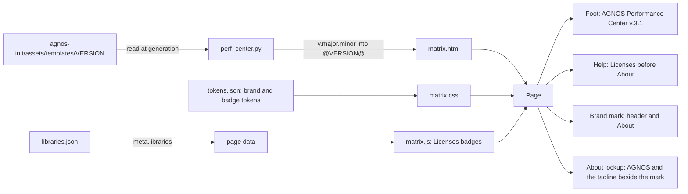

# ADR-TRC-014: Brand in the Design System, Version Read from `VERSION`, Licences as Local Badges
<!-- Amended on 2026-11-06: DEC-TRC-056 no longer leaves out the design's wordmark and tagline; DEC-TRC-059 uses them in About (RQ-TRC-116). -->

## Status
Accepted — approved by the owner on 2026-11-06 with PLAN-TRC-014, from the owner's request of that day, reformulated as FTR-TRC-009 (RQ-TRC-109 to RQ-TRC-116). Extends ADR-TRC-002 (the design system) and ADR-TRC-012 (the Help dialog); aligns RQ-TRC-082 and RQ-TRC-103 on where the licences stand. DEC-TRC-057, DEC-TRC-058 and DEC-TRC-059 amended by ADR-TRC-016, 2026-11-07.

## Context
The page names itself only in its header kicker, shows its libraries and their licences in one line of small text at the foot of the left panel, and draws its brand as three dots in the accent colour. The owner wants the foot to name the application and its version, the licences in their own Help topic drawn as coloured badges, the About links to show their addresses, and a distinctive, coloured mark shown large in About. After three rounds of mock-ups, the owner retained on 2026-11-06 the design "Spans", a reference mock-up made in a design tool: values to be replicated in the page's own styling system, not copied.

Four facts bound the choices. The page loads nothing but its two libraries and its data script (RQ-TRC-080), so a badge cannot be an image from a badge service. The data contract of `<page>.json` is read by other tools (RQ-TRC-100) and one test pins its hash (RQ-TRC-026): a new field would break both. AGNOS keeps its version in one file, `VERSION` (RQ-PLG-032), so that the perf center can show it without copying it. Every visual value goes through the design system (RQ-TRC-018).

## Decision

### DEC-TRC-056: The brand belongs to the design system; one symbol, used twice
The five colours of the retained design become global tokens, `color.brand-tile` (`#3C4043`), `color.brand-light` (`#E8EAED`), `color.brand-blue` (`#4285F4`), `color.brand-green` (`#34A853`) and `color.brand-yellow` (`#FBBC05`), and the semantic tokens `brand-*` refer to them with one value for both themes, since a mark keeps its colours. The mark is one `<symbol id="brand-mark">` of the template's icon sprite, on a 24-unit grid: a tile of corner radius 5.5, and four bars of height 3 and corner radius 1, the light one at x 4, y 3, width 16, the blue at x 4, y 8, width 6, the green at x 10, y 13, width 5, the yellow at x 15, y 18, width 5. The header and the About topic reference it with `<use>`, at the sizes of two component tokens (the header's is the control height; the About's is three times it). Its colours are set by classes of its parts in the stylesheet, from component tokens, so the template holds no colour. The design's wordmark and tagline are not part of the mark: the About topic uses them beside it (DEC-TRC-059). Fulfils RQ-TRC-114, RQ-TRC-115.

### DEC-TRC-057: The version is read from `VERSION` at generation and written into the template, never into the data
The generator reads `agnos-init/assets/templates/VERSION`, a sibling of the skill's folder in the repository and in the delivered plugin, and replaces a marker `@VERSION@` of the template by `v.<major>.<minor>`, or by nothing when the file is absent or is not one SemVer 2.0.0 line. The foot of the left panel is static text in the template: "AGNOS Performance Center @VERSION@". Nothing enters `<page>.json`, so the data contract and the hash of RQ-TRC-026 stay as they are, and the patch is not shown. Fulfils RQ-TRC-109, RQ-TRC-110.

### DEC-TRC-058: A Licenses topic of local badges; the tone depends on the licence
The Licenses topic is a section of the Help template, listed after "Search and details" and before "About". The application's licence and the link to its text are written in the template; the libraries are listed by the page script from `meta.libraries`, already in the data, by the code that wrote the footer's line, which is removed. A badge is two spans styled with component tokens: a slate label and a value filled with one of the four brand tones, its text in the existing `color.slate-950`, which keeps at least 4.5:1 over each of them. The tone comes from a table of the script keyed by licence (`AGPL-3.0` green, `MIT` blue, `Apache-2.0` yellow, any other the light tone), and a test fails when a licence of the library record has no entry, so a library added with a new licence is classified on purpose. About loses the licence link, says "This app" in place of "This page", its two links show their addresses, and the large mark stands above its text. Fulfils RQ-TRC-111, RQ-TRC-112, RQ-TRC-113.

### DEC-TRC-059: The About topic holds the design's lockup; its type values become tokens
Above its sentence, the About topic shows the lockup of the retained design: the large mark (96 px), then 16 px to its right a column centred on it, holding the name "AGNOS" (30 px, weight 700, line height 1.1, letter-spacing 0.12 em) and, 2 px below, the tagline "Agentic efficiency by traceability" (13 px, weight 500, line height 1.3, letter-spacing 0.02 em). The values the design states and the scale lacks become global tokens, `size.30`, `tracking.wordmark`, `tracking.tagline`, `line.display` and `line.snug`, with semantic names; what the scale has (13 px, weights 700 and 500, the gaps of 16 px and 2 px) is reused. The design's text greys are replaced by the existing semantic `text` and `text-muted`, so that the lockup follows the theme: a deviation from the reference, recorded here, of a few points of lightness. The tagline is the owner's, not the design's "Agentic software engineering". The mark in the lockup is decorative, the name beside it naming it. Amends DEC-TRC-056 on the wordmark and the tagline, so its task is Tier L (RQ-FIX-004). Fulfils RQ-TRC-116.

## Consequences
- Easier: raising the version is one edit of `VERSION`; a new library appears in the Licenses topic with no code change.
- Easier: the brand's colours are one place, reusable by other generated pages (`agnos-meta-release`'s report already takes its styles from these tokens).
- Harder: the perf center now depends on a file of another skill, `agnos-init`; without it the page shows no version, and a layout that moves the file is noticed only by a test.
- Constrained: a licence outside the table is drawn in the light tone until classified; a test guards the record, not a user's edited copy.
- The tests of the Help topics' order and of the About links change by design; they describe the new behaviour.
- The brand mark, the foot and the badges are drawn by the page only: no request is added.

## Alternatives Considered
- **Badges from shields.io**: the exact look of the sample, but the page would request a third-party site for each badge, against RQ-TRC-080, and fail offline. Rejected.
- **The version as a field of `<page>.json`**: the script could read it, but the data contract and the pinned hash would change for text that only the page shows. Rejected.
- **A version kept in the skill's own files**: a second source that could disagree with AGNOS's, against RQ-PLG-032. Rejected.
- **The tone as a field of `libraries.json`**: it would have to reach the page through `meta.libraries`, changing the data. Rejected.
- **A monochrome mark in the accent colour, only enlarged**: not distinctive, and not what the owner asked. Rejected.
- **The mock-ups of 2026-11-06 other than "Spans"** (the letter A drawn as a graph, a gauge, a rising curve, in an anthracite and pastel palette; then the original three dots in Google-like colours, in three greys): rejected by the owner in favour of "Spans".
- **A red tone for a licence nobody classified**: the retained design holds no red, and a fifth colour would leave the design system. The light tone stands for it. Rejected.

## Diagram

