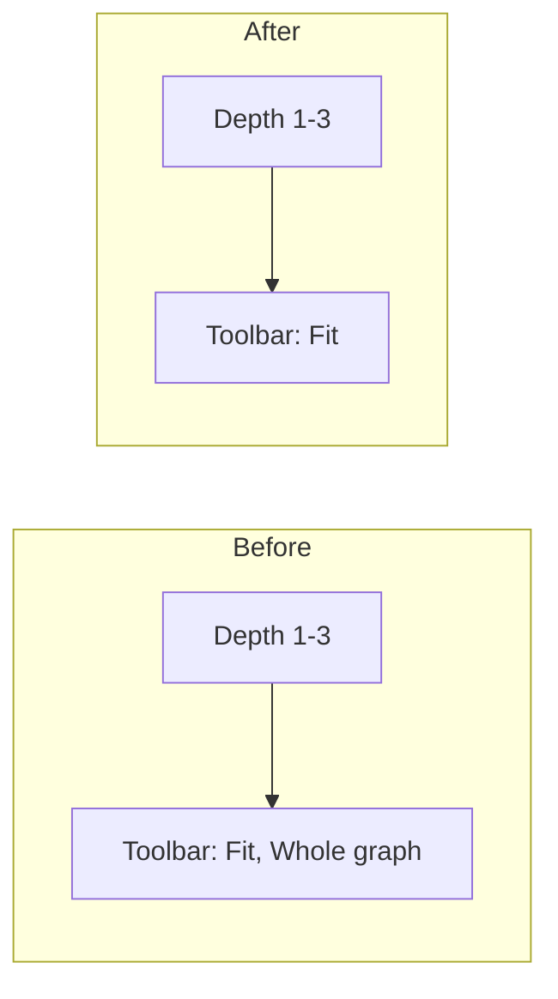

# ADR-TRC-015: No Whole Graph, a Simpler Graph Toolbar

## Status
Accepted — approved by the owner on 2026-11-07, for the amendment of RQ-TRC-012 and RQ-TRC-045. Amends DEC-TRC-006
(ADR-TRC-003).

## Context
"Whole graph" drew every element the filters show as a dot, laid out by `cose` after a size warning above 1,500 nodes.
On a process of any real size the result is an unreadable cloud with no structure — confirmed not exploitable by the
owner on review — sitting beside "Fit", the toolbar's other view-sizing control. Its warning dialog and force-layout
code path were the only use of `WHOLE_GRAPH_WARN` and `COSE_ITERATIONS`.

## Decision

### DEC-TRC-060: Whole graph removed, Fit alone sizes the view
The `#whole` toolbar button, its `wholeElements()` builder, the `whole` state (and its effect on fading, the empty-frame
message, the status line, the zoom floor and the `cose` layout), `WHOLE_GRAPH_WARN` and `COSE_ITERATIONS` are removed
from `matrix.js`; the button is dropped from `matrix.html` and its mention from the Help dialog's Graph topic. The
toolbar's spacer, already placed before the two buttons, now seats "Fit" alone at the toolbar's right edge — no layout
change beyond deleting the button. Fulfils the amendment of RQ-TRC-012 and RQ-TRC-045.

## Consequences
**Easier.** One less control to explain and keep titled (RQ-TRC-045); no force-layout code path to keep fast or test.
**Harder.** Nothing: the view it offered had no reading left in it.
**Constrained.** A reader who wants every element at once uses the Matrix tab instead of the graph.

## Alternatives Considered
- **Keep it behind a higher node-count floor.** Rejected: still an unreadable cloud past that floor, for no asked-for
  benefit.
- **Replace the dots with the flow layout at every depth.** Rejected: that is what Depth 3 already offers, bounded and
  readable (RQ-TRC-037, MAX_DRAWN).

## Diagram

