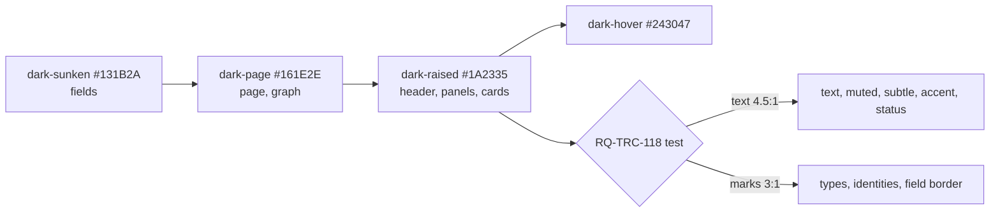

# ADR-TRC-017: Dark Theme in Layers, with Dark Variants of the Fragile Colours

## Status
Accepted (owner, 2026-11-07, candidate "P2" of the mock-up, fragile colours adjusted) — for RQ-TRC-117, RQ-TRC-118. Extends
ADR-TRC-002 (DEC-TRC-009 to DEC-TRC-011); DEC-TRC-064 amends DEC-HST-005 on the identity tokens having one value for both themes.

## Context
The dark theme puts the page, the cards and the panels on `slate-900` and the fields on `slate-950`: no plane stands out, the
fields sink below their container, the borders are at 1.22:1 and `text-subtle` at 3.75:1 (RQ-TRC-118). Lightening the page
lowers the contrast of every colour drawn on it: at slate-800 the feature blue, identity 1 and identity 8 fall under 3:1. A
mock-up of three candidates (owner review, 2026-11-07) placed the ceiling at `#1A2335` for the raised surface.

## Decision

### DEC-TRC-063: Four dark surfaces of increasing lightness
New global tokens hold the dark surfaces: `color.dark-sunken` `#131B2A` (fields, `surface`), `color.dark-page` `#161E2E`
(`surface-subtle`, `graph-background`, `graph-node-border`), `color.dark-raised` `#1A2335` (`surface-raised`),
`color.dark-hover` `#243047` (`surface-hover`), `color.dark-selected` `#1C2D60` (`surface-selected`, `accent-subtle`),
`color.dark-border` `#2A354B` (`border`); `border-strong` becomes `color.slate-550` `#6B7A90` (3:1 on every dark surface). `color.blue-900` takes Tailwind's own value
`#1E3A8A` in place of a green copied by mistake. The light theme is unchanged. Fulfils RQ-TRC-117.

### DEC-TRC-064: Dark variants for the colours that lose contrast
In the dark theme only: `text-subtle` takes `color.slate-450` `#8E9BB0`; `type-ftr` `color.oi-blue-dark` `#3A9AD9` and
`type-task` `color.oi-vermillion-dark` `#E8711F`, lightened Okabe-Ito hues; identities 1, 4, 5, 7, 8, 9 and 12 take blue-500,
`color.red-500`, `color.purple-500`, `color.pink-500`, `color.amber-600`, indigo-400 and `color.fuchsia-500`, so those
identity tokens become per theme, and the RQ-HST-014 test reads each theme's value. The other identities and the oklch
identities keep one value (worst 3.10:1 on `dark-raised`). Amends DEC-HST-005. Fulfils RQ-TRC-118.

## Consequences
- Easier: planes are read at a glance; every text and mark of the dark theme meets WCAG, checked by a test.
- Harder: four identity tokens and two type tokens have two values to keep in step.
- Constrained: a darker or lighter dark surface must pass the RQ-TRC-118 test; `dark-raised` is near the ceiling.

## Alternatives Considered
- **P1, page `#121A2B`, raised slate-850**: separates the planes, barely lighter. Not retained (owner, 2026-11-07).
- **P3, page `#1A2335`, raised slate-800**: three colours under 3:1 without a palette redesign. Rejected.
- **Lighten the surfaces without adjusting colours**: leaves `text-subtle` under 4.5:1. Rejected.

## Diagram

