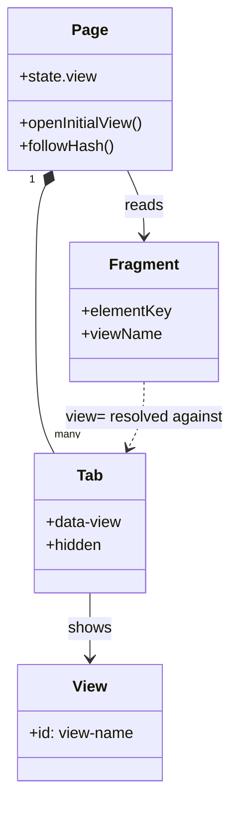
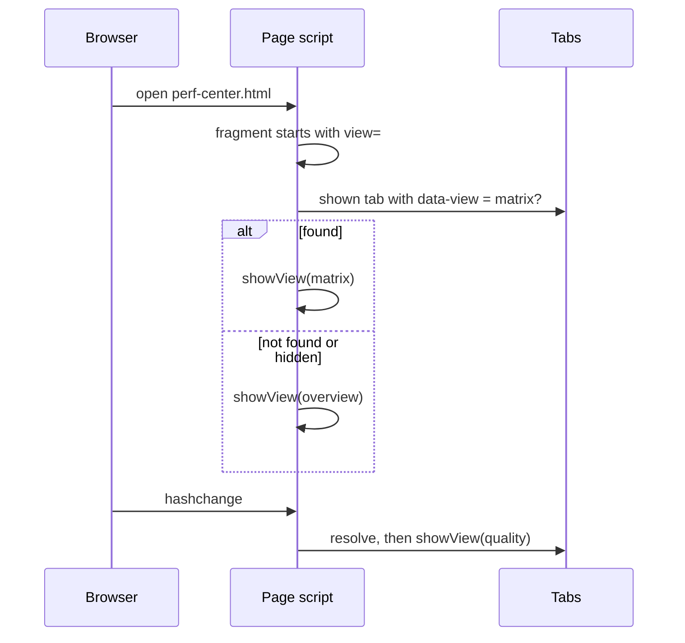

# ADR-TRC-019: Deep links to a view of the page
<!-- Amended on 2026-11-22: the performance center's outputs are lowercase, perf-center.* (RQ-TRC-143, DEC-TRC-087). -->

## Status
Accepted — approved by the owner on 2026-11-12 (owner request of the same day, for RQ-TRC-121). Extends DEC-TRC-007 (RQ-TRC-016,
the fragment that selects an element).

## Context
The URL fragment of the Performance Center names an element, a box or a commit (RQ-TRC-016) and opens the Graph on it; with no
fragment, the page opens on the Overview. The presentation website (FTR-WEB-001) links its Matrix screenshot to the demo page,
which then opens on the Overview, not on the Matrix the reader clicked. The owner asks for a link to a view, open to the views
added later (RQ-TRC-121).

## Decision

### DEC-TRC-066: A `view=` fragment resolved against the page's tabs
- **Statement**: The page SHALL resolve a `#view=<name>` fragment against the `data-view` of the tabs it shows, at opening and on
  each change of the fragment, for linking to one view.
- **Rationale**: the tabs are the list of views already, so a new tab is linkable with no change of this code; the `view=` prefix
  cannot be taken for an element ID (`<TYPE>-<TRI>-<NNN>`), a file path or a commit hash, so RQ-TRC-016 keeps its meaning; a
  hidden tab (History without `--history`, Delivery without data) is not shown, so its name falls back to the default view.

## Consequences
- `perf-center.html#view=matrix` opens the Matrix; the website can link each screenshot to its own view.
- Choosing a tab does not change the URL: the link is written by whoever sends it, and the history of the browser keeps the
  selections only (RQ-TRC-016).
- A view's name becomes part of a public address: renaming a tab breaks the links that name it.

## Alternatives Considered
- **A fixed list of view names in the script**: each new view would need a code change. Rejected (owner: other views will come).
- **A query parameter (`?view=matrix`)**: reloads the page and is lost on `file://` pages opened by some tools. Rejected.
- **The bare name as fragment (`#matrix`)**: could collide with a file path or a future element key. Rejected.
- **Writing the fragment on each tab change**: fills the browser history with tab changes, mixed with RQ-TRC-016's selections;
  not asked. Rejected for now.

## Diagram

