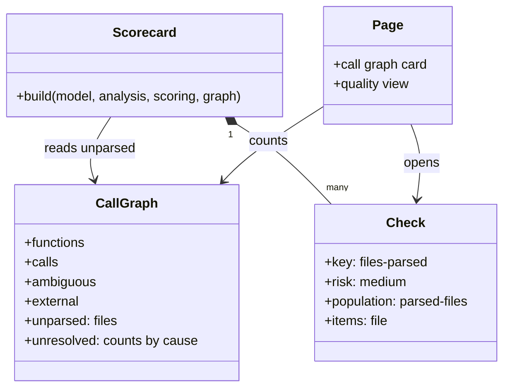
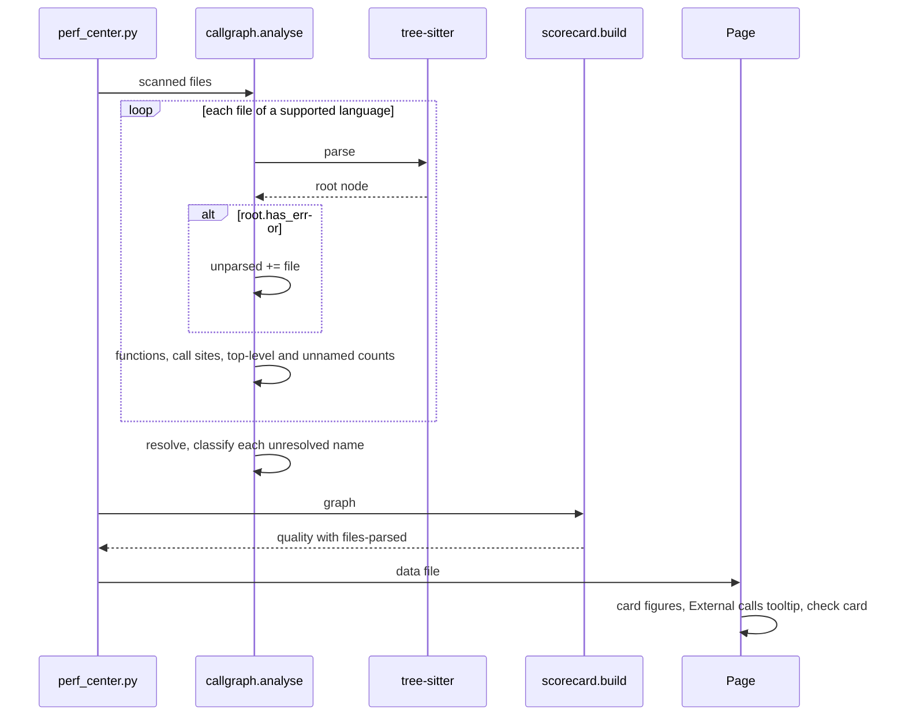

# ADR-TRC-020: Call graph measurement

## Status
Accepted — approved by the owner on 2026-11-21 (session TRC, scope R1 + R2 of the callgraph operational analysis, a file that
does not parse being a finding), for RQ-TRC-122 and RQ-TRC-123. Extends DEC-TRC-015 (what an unresolved call is) and
DEC-TRC-032 (checks are data) without amending them.

## Context
The call graph enters the score through "Functions traced" only (RQ-PLG-024). Tree-sitter is error tolerant: a broken file still
gives a tree, with `ERROR` and `MISSING` nodes, and fewer definitions; nothing in `callgraph.py` reads `has_error`, so a broken
file lowers the number of untraced functions and raises the score (`insights/callgraph-operational-analysis.md`, R1). The
`external` count of RQ-TRC-030 adds up library calls and missed internal calls (Python's `Greeter()`), while the calls dropped by
`NAME_RE` or found outside any function are counted nowhere (R2, R7): no later improvement of the resolution can be ranked.

## Decision

### DEC-TRC-067: A "files-parsed" check read from the tree's error flag
- **Statement**: The call-graph analysis SHALL record each read file whose root node `has_error`, and the scorecard SHALL score
  them as the findings of a medium-risk `files-parsed` check of `scoring.json`, whose population is the files the call graph read.
- **Rationale**: `has_error` is a property of the tree-sitter core, so one line serves every language with no query file;
  a check, not a mention, because a file the tool cannot read cannot be called traced (owner, 2026-11-21); a check of
  `items: "file"` is drawn by the page's existing check code.

### DEC-TRC-068: An `unresolved` block of counts by cause
- **Statement**: The call-graph analysis SHALL expose in `callGraph.counts` an `unresolved` object `{library, constructor,
  cross-language, unnamed, top-level}`, classified from the definitions and declared scopes it already holds, `external`
  staying the sum of the first three.
- **Rationale**: the causes are told apart syntactically, without guessing types: a scope name is a class, a name of another
  language's table is cross-language; keeping `external` keeps RQ-TRC-030 and its readers unchanged.

## Consequences
- A project with broken or unsupported-dialect files gets a lower overall score with `--call-graph`, and the list of those files.
- The functions of a broken file are still read: the check flags the file, it does not drop what was found.
- `callGraph.counts` gains two fields (`unparsed`, `unresolved`): the pinned page hashes of the tests are pinned again.
- The counts of `unresolved` are `(caller, name)` pairs, like `external` and `ambiguous`; `top-level` and `unnamed` count call
  sites, since they have no caller or no name.

## Alternatives Considered
- **A mention in the summary only**: leaves the inflated score in place. Rejected by the owner.
- **Dropping the functions of a broken file**: makes the score worse in another way and loses usable functions. Rejected.
- **Replacing `external` by the breakdown**: changes RQ-TRC-030 and the page's figure for no gain. Rejected.
- **Classifying `library` against a list of standard library names per language**: data to maintain per language, and a guess.
  Rejected.

## Diagram

