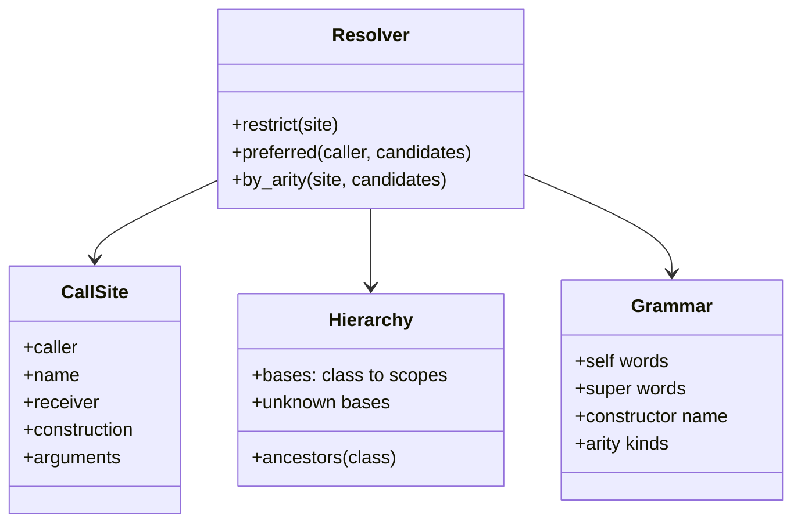
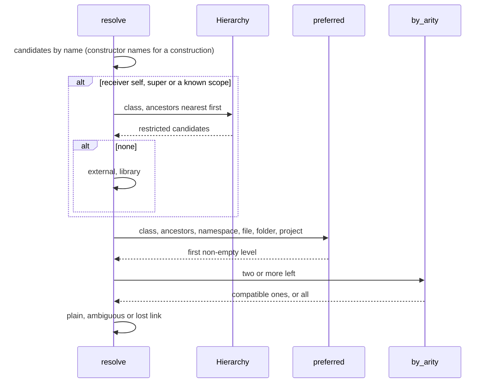

# ADR-TRC-021: Call resolution accuracy

## Status
Accepted — approved by the owner on 2026-11-21 (session TRC, scope R3 to R6 of the callgraph operational analysis; a call
with a certain receiver and no candidate counted as `library`, no new cause; the base classes no scanned file defines
listed by name), for RQ-TRC-124 to RQ-TRC-128. Amends DEC-TRC-015 (the order of preference, the counting unit); extends
DEC-TRC-014 (languages as data) and DEC-TRC-018 (what the call graph does not change).

## Context
Resolution is by name only (DEC-TRC-015): `last_part` drops the receiver, so `self.f()` and `other.f()` are the same call,
and Java's query captures the called identifier alone. Constructions (`new T()`, Python's `T()`) are never linked, inherited
methods fall to the whole project, overloads are never told apart, and beyond five candidates the link is lost
(`insights/callgraph-operational-analysis.md`, R3 to R6). The node names this needs were checked on the pinned grammars.

## Decision

### DEC-TRC-069: Optional captures in the query files, merged per node
- **Statement**: The query files SHALL use optional captures `@call.receiver`, `@new` with `@new.name`, `@scope.base`,
  `@definition.parameters` and `@call.arguments`, and the analysis SHALL merge every match of one captured node.
- **Rationale**: the receiver, the constructed type, the base classes and the parameters are nodes every grammar already
  has; one capture per base cannot hold `implements A, B`, so several matches of one scope are merged; a language without a
  capture keeps today's behaviour.

### DEC-TRC-070: Receiver words, constructor name and parameter kinds in the language table
- **Statement**: The language table SHALL give, per language, its `self` and `super` receiver words, its `constructor` name
  and its `arity` node types (optional, variadic, ignored, spread argument, receiver parameter), so that no script names a
  language.
- **Rationale**: these are facts of each language, not of the algorithm (DEC-TRC-014, `rules.md`, "languages are data").

### DEC-TRC-071: Restriction by the receiver before the preferences
- **Statement**: The resolution SHALL restrict the candidates to the class, ancestors or scope a certain receiver names,
  then apply the preferences of DEC-TRC-015 to what is left, an empty restriction counting as `library` external.
- **Rationale**: restricting and preferring differ: a preference falls back, a certain receiver does not; the owner chose
  `library` since a callee out of the scanned code has nothing to trace, the missing folder being shown by DEC-TRC-072.

### DEC-TRC-072: Ancestors by declared base name, nearest first
- **Statement**: The analysis SHALL map each class to the scopes named by its declared bases, preferring one in the
  class's own namespace, walk them breadth first with a set of visited classes, and list the base names matching no scope.
- **Rationale**: syntactic, no type needed; breadth first follows the override order; the visited set ends cycles; an
  unknown base is a library class or a folder left out, which its name tells.

### DEC-TRC-073: A non-blocking compatible-arity filter
- **Statement**: The resolution SHALL keep, among two or more candidates, those whose minimum and maximum parameter counts
  bound the call's argument count, and all of them when none does or the count is unknown.
- **Rationale**: defaults, variadics and the receiver parameter make equality wrong; the filter only chooses, never
  drops a call.

## Consequences
- Fewer ambiguous and lost links; constructors gain callers; the page's pinned hashes are pinned again on purpose.
- The ambiguous and external counts are per caller and call signature (name, receiver, construction, argument count).
- `self.g()` with no `g` in the class or its ancestors makes no link where a guess was drawn before.
- Out of reach, written in the documentation: a C++ object on the stack, a C# `new()` without type, Java's `super(…)`.
- "Functions traced" is unchanged (RQ-TRC-128, DEC-TRC-018): calls and scopes never trace a function.

## Alternatives Considered
- **A new `receiver` cause**: tells a missing method from a library call, but an untraceable callee has nothing to trace
  and the base-name list says which folder is missing. Rejected by the owner.
- **Inheriting the class's IDs, or tracing a function by its callers**: turns a finding into a false conformance. Rejected
  (analysis §3, RQ-TRC-128).
- **Per-language resolution code**: breaks "languages are data". Rejected.
- **Strict arity equality, or a filter that may empty the list**: wrong with defaults and variadics, hides real calls.
  Rejected.

## Diagram

