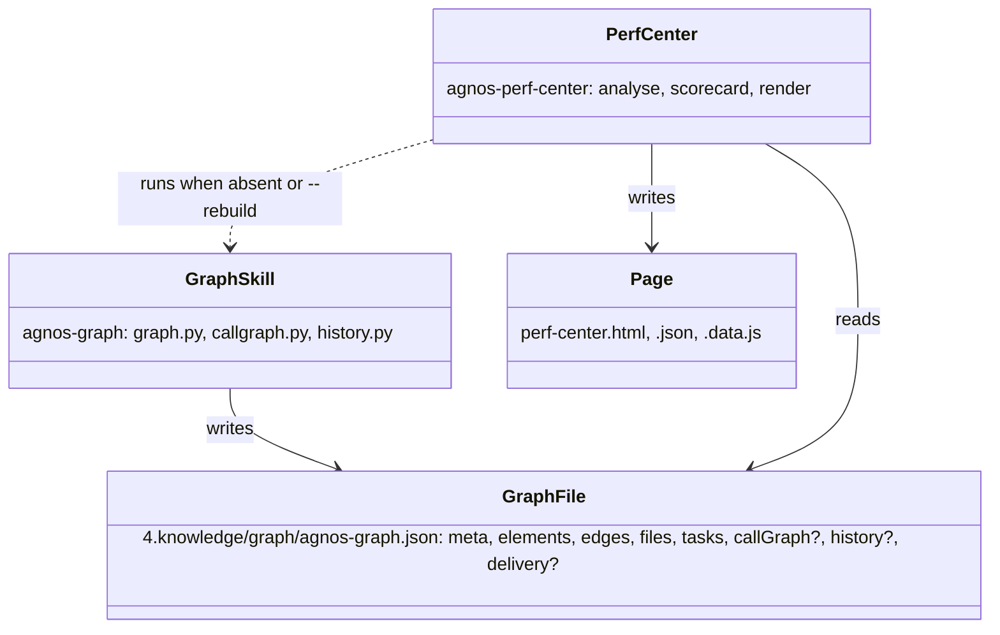
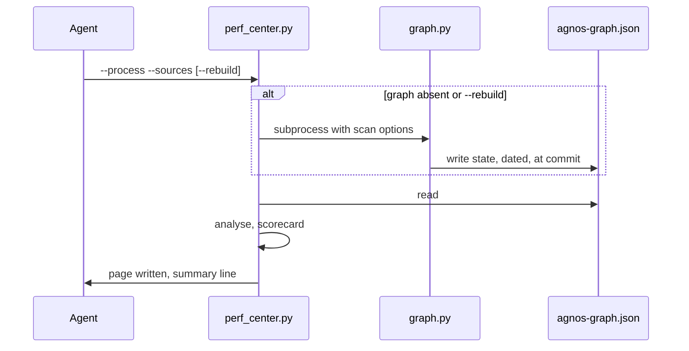

# ADR-TRC-022: Graph construction boundary
<!-- Amended on 2026-11-22: the performance center's outputs are lowercase, perf-center.* (RQ-TRC-143, DEC-TRC-087). -->
<!-- Amended on 2026-11-22: the graph file is in the graph folder, 4.knowledge/graph/ (RQ-TRC-142, DEC-TRC-086). -->

## Status
Accepted (owner, 2026-11-22) — for FTR-TRC-011 (RQ-TRC-129 to RQ-TRC-133). Amends DEC-TRC-002 (one generator holding the model and the page) and
DEC-TRC-013 (the call graph loaded by the perf center); extends ADR-PLG-010 (the knowledge folder).

## Context
FTR-TRC-011: `perf_center.py` builds the model of the process and its sources (`build_process_model`, `scan_sources`), loads
`callgraph.py` and `history.py`, then judges that model (`analyse`, `scorecard`) and renders the page. The state of the project
can only be had as the page's data, mixed with the judgement of it. Each delivered skill runs from its own folder and stays
self-contained (DEC-PLG-027); the perf center already reads one sibling skill's file, the version of `agnos-init` (DEC-TRC-057).

## Decision

### DEC-TRC-074: Graph skill owning model, scan, call graph and history
- **Statement**: The `agnos-graph` skill SHALL own the code that reads the process index, scans the sources, parses the call graph and reads the history (`graph.py`, `callgraph.py`, `history.py`, the tree-sitter queries and their requirements), and SHALL write the state as `agnos-graph.json`, sorted so that two runs on the same inputs write the same bytes.
- **Rationale**: the four parts produce facts of the project at a commit and share one model; moving them together keeps one walk of the sources (DEC-TRC-013) and leaves the perf center no parser to install.

### DEC-TRC-075: Graph file as the perf center's only input
- **Statement**: `agnos-perf-center` SHALL rebuild its model from the graph file's `elements`, `edges`, `files` and task tiers, and SHALL apply `analyse`, `scorecard` and the rendering to it unchanged.
- **Rationale**: the coverage and quality rules keep their code and tests; a graph file written by any version or tool that follows the format feeds the page.

### DEC-TRC-076: Sibling invocation of the graph script
- **Statement**: `agnos-perf-center` SHALL run `../agnos-graph/scripts/graph.py` beside its own skill folder as a subprocess, passing its scan options, when the graph file is absent or `--rebuild` is given.
- **Rationale**: a subprocess keeps both skills self-contained, with no import across skill folders, and the plugin delivers both side by side; the version file read from `agnos-init` already relies on that placement.

### DEC-TRC-077: Graph path declared in the layout
- **Statement**: `layout.json` SHALL declare `graphFile` as `4.knowledge/graph/agnos-graph.json`, and both skills SHALL read it from their generated layout copy.
- **Rationale**: the default path is one name of the process folder, written once (RQ-PLG-036). Path amended by DEC-TRC-086 (2026-11-22).

## Consequences
- Easier: an agent or tool reads the project's state without rendering a page; the page can be regenerated from a kept state.
- Harder: two skills to keep in step on one file format; a graph from an older format must be rebuilt.
- Constrained: the page shows the state of the graph's commit, which may be older than the working tree until `--rebuild`.

## Alternatives Considered
- **Graph and analysis together, the page alone apart**: the state would hold judgements a reader would mistake for facts of
  the project. Rejected (owner, 2026-11-22).
- **Shared Python package imported by both skills**: one copy of the code, but a skill folder would depend on another at
  import. Rejected.
- **Rebuild when the index or a source is newer than the graph**: safer, but needs a freshness rule over every scanned file.
  Rejected (owner, 2026-11-22); `--rebuild` covers it.

## Diagram

