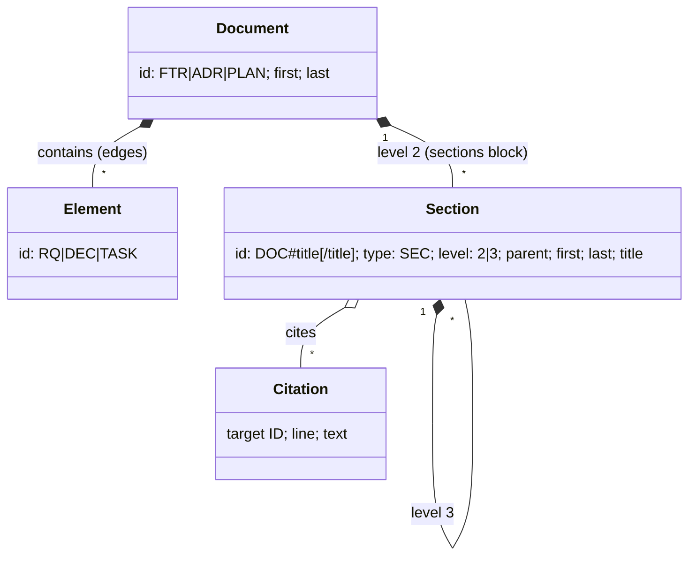
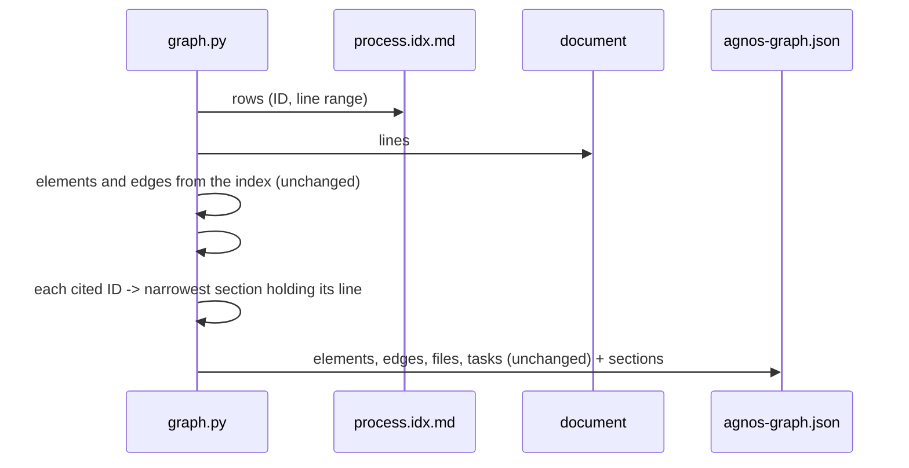

# ADR-TRC-023: Document section representation

## Status
Accepted (owner, 2026-11-22) — for FTR-TRC-012 (RQ-TRC-134 to RQ-TRC-137). Extends ADR-TRC-022 (the graph file format, DEC-TRC-074, DEC-TRC-075).

## Context
FTR-TRC-012: `graph.py` reads the index rows (ID, line range) and attributes each cited ID to the narrowest element holding its
line; a line of a document outside its RQ, DEC or TASK is attributed to the document. The perf center rebuilds its model from
`elements` and `edges` (DEC-TRC-075): a section added to them would move the source of a `refs` edge from an ADR to a `SEC`
node, which its indirect coverage rule does not count, and would change its element counts, its score and its page. The perf
center is out of scope (owner, 2026-11-22).

## Decision

### DEC-TRC-078: Separate sections block in the graph file
- **Statement**: The graph skill SHALL write the section nodes and their citations in a `sections` block of `agnos-graph.json`, and SHALL leave `elements` and `edges` as built from the index alone.
- **Rationale**: the perf center reads `elements`, `edges`, `files` and `tasks` only (DEC-TRC-075), so a new block changes none of its results by construction; a filter in the perf center would put the risk in out-of-scope code.
- **Requirement refs**: RQ-TRC-137, RQ-TRC-134
- **Dependencies**: DEC-TRC-074, DEC-TRC-075

### DEC-TRC-079: Section retention by content
- **Statement**: The graph skill SHALL retain a `##` heading of a feature, ADR or plan as a section when its line range holds no ID the index defines, and a `###` heading inside a retained section as a subsection, reading the headings from the document's lines.
- **Rationale**: the rule follows what a document holds, so a heading an author adds is retained, and the headings holding RQ, DEC or TASK, already children of the document, are excluded without a list of titles to keep in step with the templates.
- **Requirement refs**: RQ-TRC-134, RQ-TRC-135
- **Dependencies**: DEC-TRC-078

### DEC-TRC-080: Document-derived section identifier
- **Statement**: The graph skill SHALL identify a section as `<document ID>#<title>` and a subsection as `<document ID>#<title>/<title>`, with a `.<n>` suffix from the second repeated title under one parent, and SHALL attribute a cited ID to the narrowest section holding its line.
- **Rationale**: no new ID in the process documents nor in `process.idx.md`, which the owner excluded; `#` and `/` cannot appear in an AGNOS ID, so the identifier never collides with one.
- **Requirement refs**: RQ-TRC-136
- **Dependencies**: DEC-TRC-079

## Consequences
- Easier: a reader of the graph tells a citation of a Context, an alternative or a plan's References from one of the document.
- Harder: a section title changed by its author changes its identifier; a reader keeping identifiers across commits sees a new node.
- Constrained: the perf center ignores sections until it reads the `sections` block; `elements` and `edges` keep their document-level links.

## Alternatives Considered
- **Sections in `elements` and `edges`, filtered by the perf center**: one graph, but out-of-scope code to change, and every
  rule of the perf center to check against the new type. Rejected (owner, 2026-11-22).
- **Fixed list of section titles from the templates**: simpler, but misses a heading an author adds. Rejected (owner, 2026-11-22).
- **New AGNOS ID per section in the index**: stable identifiers, but a new artifact type in the instructions and the index. Rejected (owner, 2026-11-22).

## Diagram

