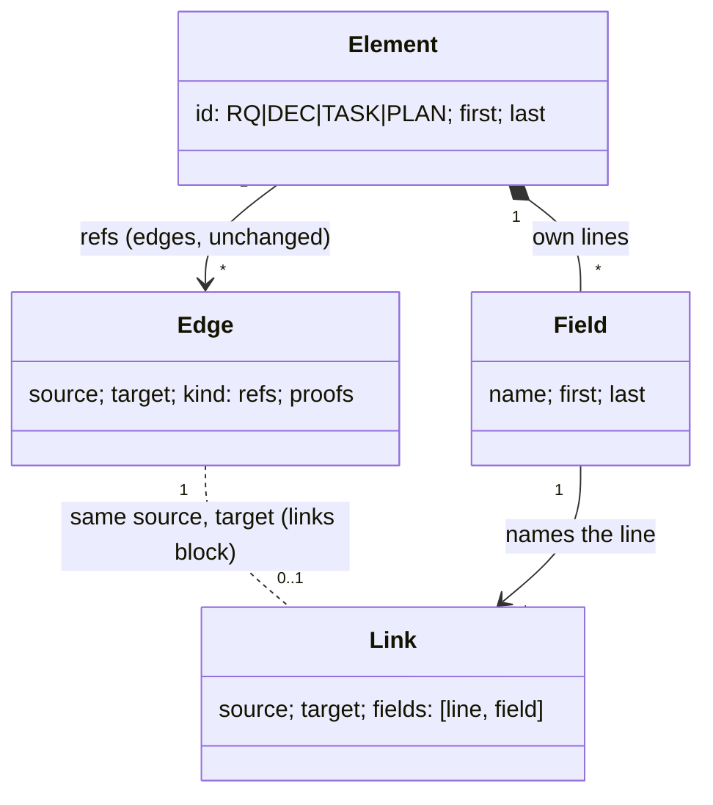
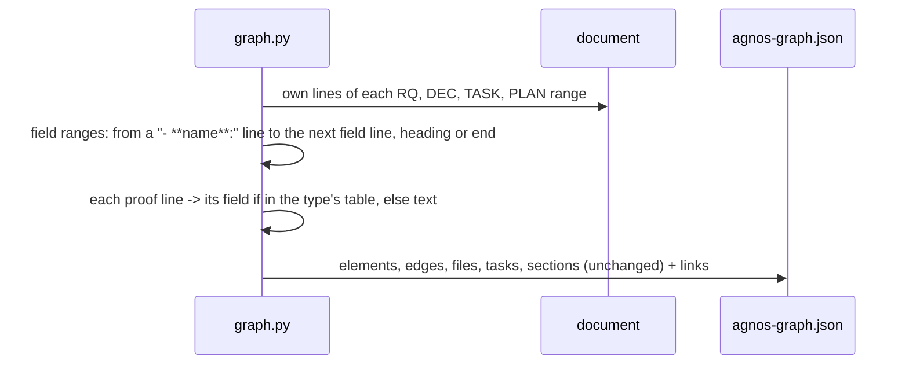

# ADR-TRC-024: Element link field representation

## Status
Accepted (owner, 2026-11-22) — for FTR-TRC-013 (RQ-TRC-138 to RQ-TRC-141). Extends ADR-TRC-022 (the graph file format, DEC-TRC-074, DEC-TRC-075) as ADR-TRC-023 did (DEC-TRC-078).

## Context
FTR-TRC-013: `graph.py` attributes each cited ID to the narrowest element holding its line and adds one proof `[line, text]`
to the `refs` edge, whatever the field of the line. The perf center rebuilds its model from `elements` and `edges`
(DEC-TRC-075) and shows the proofs: a third item in a proof, or a new edge kind, would change its data and its page. The
templates name the link fields of each type: `Dependencies` (RQ), `Requirement refs` and `Dependencies` (DEC),
`Requirement refs`, `ADR refs` and `Dependencies` (TASK), `Requirement refs` and `ADR refs` under `## References` (PLAN), named as the task's by DEC-INI-016; a field is a `- **<name>**:` line, which its author may wrap.

## Decision

### DEC-TRC-081: Separate links block in the graph file
- **Statement**: The graph skill SHALL write, in a `links` block of `agnos-graph.json`, one `[source, target, [[line, field]]]` row per `refs` edge whose source is a requirement, a decision, a task or a plan, and SHALL leave `edges` as built today.
- **Rationale**: the perf center reads `elements`, `edges`, `files` and `tasks` only (DEC-TRC-075), so a new block changes none of its results by construction, as the `sections` block did (DEC-TRC-078); the line joins each field to its proof in `edges`.
- **Requirement refs**: RQ-TRC-138, RQ-TRC-141
- **Dependencies**: DEC-TRC-074, DEC-TRC-075, DEC-TRC-078

### DEC-TRC-082: Closed link field table per element type
- **Statement**: The graph skill SHALL apply a table `{RQ: [Dependencies], DEC: [Requirement refs, Dependencies], TASK: [Requirement refs, ADR refs, Dependencies], PLAN: [Requirement refs, ADR refs]}` to name the field of a proof line, and SHALL write `text` for a line held by no field of its source's type.
- **Rationale**: the table follows the templates of the process file; a field outside it, such as `Statement` or `Verification`, explains rather than declares, and a field misplaced on another type is not a link of that type.
- **Requirement refs**: RQ-TRC-139
- **Dependencies**: DEC-TRC-081, DEC-INI-016

### DEC-TRC-083: Field extent up to the next field line
- **Statement**: The graph skill SHALL apply to a field the range from its `- **<name>**:` line to the line before the next field line, the next heading or the element's last line, reading the lines of the element's own range.
- **Rationale**: a wrapped list stays in its field, and a field line or a heading is where the templates start the next item, so no blank-line nor indentation rule is needed.
- **Requirement refs**: RQ-TRC-140
- **Dependencies**: DEC-TRC-082

## Consequences
- Easier: a reader of the graph tells a declared requirement, decision or dependency of an element from a mention in its text.
- Harder: a field renamed in a template needs the table changed with it; a reader joins `links` to `edges` by source, target and line.
- Constrained: the decisions written before their template gained link fields keep `text` citations until they are migrated;
  the perf center ignores the fields until it reads the `links` block; features and ADRs get no field.

## Alternatives Considered
- **Field as a third item of each proof in `edges`**: one place, but the perf center's data and page change, out of scope. Rejected.
- **One edge kind per field (`refs:Dependencies`…)**: readable, but every rule of the perf center reading `refs` would change. Rejected.
- **Any bold field holding an ID is a link field**: no table, but `Statement`, `Rationale` and `Verification` would declare links. Rejected (owner, 2026-11-22).
- **Fields for features and ADRs too**: their templates hold no link field, and the owner restricted typing to RQ, DEC, TASK and PLAN. Rejected (owner, 2026-11-22).

## Diagram

